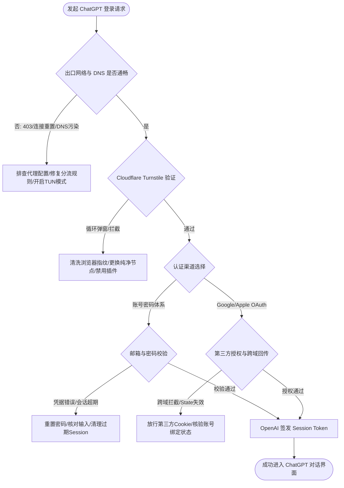
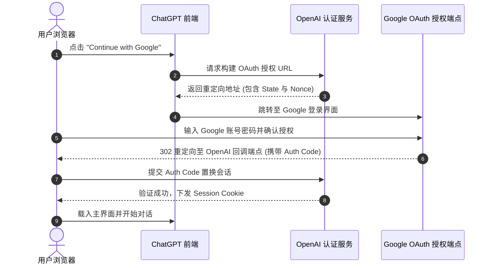
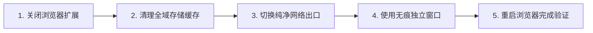

使用 ChatGPT 开展日常工作与科研学习时，登录环节出现异常往往让人措手不及。

很多用户在遇到登录障碍时，第一反应往往是重复点击登录按钮、不断刷新网页或者频繁更换密码。这些盲目的尝试无法解决问题，反而容易因为短时间内的高频请求触发 OpenAI 后端更高级别的风控防御，导致原本轻微的网络波动演变成长达数小时的账号锁定或 IP 封禁。

解决 ChatGPT 登录问题的关键，在于根据具体的报错表现，准确识别故障发生在网络链路、身份认证、浏览器环境还是账号权限层级。



## 第一章 ChatGPT 现代鉴权与会话生命周期机制

要快速排查登录异常，首先要理解 ChatGPT 现行的多层鉴权体系与会话管理流程。

OpenAI 目前采用基于 OAuth 2.0 与 OpenID Connect 协议的现代化身份验证架构。当用户在浏览器或客户端中点击登录按钮时，前端直接将请求交由专用的身份认证服务处理，通过一系列重定向与令牌置换完成鉴权。

整个流程始于边界防护。所有进入 `chatgpt.com` 与 `auth.openai.com` 的流量，首先经过 Cloudflare 全球分布的安全防护网络。在这里，Cloudflare 的边缘节点会对客户端进行第一道环境审计，包括 TLS 指纹检查、HTTP/2 协议特征识别以及基于 Turnstile 的无感人机挑战。

一旦通过边缘安全网关，客户端将被重定向至 OpenAI 的专用认证端点。如果用户选择电子邮箱与密码登录，认证服务器在校验密码哈希无误后，会通过 PKCE 机制生成一个临时的 Authorization Code。如果是通过 Google、Apple 或 Microsoft 快捷登录，系统则通过各生态系统的 OAuth 授权服务完成身份互认。

前端应用拿到 Authorization Code 之后，在后台向令牌服务器发起置换请求，最终获取到包含用户身份信息的 JSON Web Token 集合。

在这一系列令牌中，核心包含三个部分。

第一是 Session Token。它通常以 `__Secure-next-auth.session-token` 为名称持久化保存在浏览器的安全 Cookie 中。这个 Cookie 带有 `Secure`、`HttpOnly` 和 `SameSite=Lax` 属性，负责维持用户在 Web 前端界面的长期登录状态。

第二是 Access Token。这是一个短期有效的 JWT 字符串，前端在向 `chatgpt.com/backend-api/` 发送每一条对话请求、会话列表拉取以及模型配置获取指令时，都必须在 HTTP 请求头的 `Authorization: Bearer <token>` 中携带它。它的有效期通常只有数小时，过期后由客户端静默更新。

第三是 Refresh Token。它用于在 Access Token 过期时，无需用户重新输入密码即可无缝换取新的 Access Token。

当这些令牌在传输、存储或校验的任何一个节点发生异常，比如本地时钟偏差导致 JWT 验签失败、网络代理丢包导致令牌置换中断，或者第三方 Cookie 策略阻断了 Session 写入，前端就会表现为登录停滞或各类错误提示。

## 第二章 核心登录报错代码深度剖析与归因矩阵

在排查故障时，页面上的具体英文提示是最直接的诊断线索。不同的报错文本对应着完全不同的故障层级与处置方向。

### 常见报错解析与应对方向

#### 1. Something went wrong. If this issue persists please contact us

这是 ChatGPT Web 端最普遍但也最模糊的通用报错。它通常出现在点击登录或完成人机验证之后的跳转阶段。

这一报错的技术成因，主要是前端 JavaScript 脚本在尝试与后端 `/api/auth/session` 通信时，返回了非预期的 HTTP 状态码（如 500、502 或解析超时）。这代表本地网络无法完整解析 OpenAI 的鉴权服务响应，或者本地浏览器缓存中残留了已经失效的旧版会话碎片，导致新旧令牌产生冲突。

遇到此错误时，首要动作是强制清除当前域名下的所有缓存与 Cookie，并在代理客户端中确认针对 `auth0.openai.com` 与 `identity.openai.com` 的分流规则处于代理状态。

#### 2. We ran into an issue signing you in / Unable to load site

这一报错通常直接由 OpenAI 的风控安全网关直接拦截产生。

当系统检测到发起登录请求的客户端环境存在异常特征时，就会返回该提示。常见诱因包括同一出口 IP 在短时间内有过多并发登录行为、客户端在几分钟内跨越了地理距离悬殊的两个国家节点，或者浏览器的 WebGL、Canvas 指纹与底层操作系统报文存在矛盾。

此时切忌连续刷新页面。正确的做法是彻底关闭浏览器，切换至一个线路质量更高、延迟稳定的独立节点，静置 15 分钟后再行尝试。

#### 3. HTTP 403 Forbidden 与 Cloudflare Error 1020

403 属于标准的 HTTP 协议状态码，意味着服务器理解了请求但拒绝执行。在 OpenAI 的业务场景下，403 通常发生在两个位置。

一是 Cloudflare WAF 层面。如果客户端的 IP 属于已知的高风险机房网段，WAF 规则会直接阻断连接并可能展示 `Error 1020: Access Denied` 页面。

二是 OpenAI 业务网关层面。即使通过了 Cloudflare，如果请求头中的地理位置标记（`cf-ipcountry`）属于未开放服务区域（如部分被判定为香港或中国大陆的 IP），网关同样会直接切断握手并返回 403。

#### 4. HTTP 429 Too Many Requests 与 Rate Limit Exceeded

429 报错代表请求频次超过了系统设定的速率上限。

很多用户即便自己只点了一次登录也会遇到 429，这是因为其所使用的网络节点属于成百上千人共享的公共数据中心 IP。当其他用户在该 IP 上进行了大量请求或自动化调用时，整个 IP 的配额池被耗尽，后续所有通过该 IP 发起的鉴权请求都会被直接降级拦截。解决此问题的唯一有效手段是更换低共享率的优质专线出口。

#### 5. Your account has been deactivated / Suspicious activity detected

这类提示明确属于账号维度的状态异常。

`Account deactivated` 表明账号已被管理系统冻结或注销；`Suspicious activity` 则代表系统检测到异地异常登录或 API 违规调用，触发了被动保护机制。此时任何网络层面的调整都无法恢复访问，必须通过官方申诉渠道提交工单核实。

### 核心报错排查对比矩阵

| 报错代码与提示信息 | 故障所属层级 | 典型触发原因 | 快速判断方法 | 标准修复方案 |
| :--- | :--- | :--- | :--- | :--- |
| **Something went wrong** | 会话与传输层 | 本地 Token 冲突或后端鉴权接口超时 | 浏览器 F12 网络面板显示 session 接口 500/504 | 清理 Cookie 与本地缓存，重置代理路由 |
| **We ran into an issue signing you in** | 风控网关层 | 节点跳跃过频、IP 信誉偏低、指纹异常 | 换号同样报错，换设备与纯净网络后恢复 | 固定稳定单节点，静置 20 分钟后重试 |
| **HTTP 403 Forbidden / Error 1020** | 边界安全层 | 出口 IP 处于不支持地区或黑名单机房段 | 访问其他境外站点正常，唯独 OpenAI 阻断 | 更换新加坡/美日原生节点，检查 IP 归属地 |
| **HTTP 429 Too Many Requests** | 速率限制层 | 共享节点存在大量并发请求，配额耗尽 | 页面秒报 429，无密码验证环节 | 更换独立专线出口，避开高拥堵公共节点 |
| **Your account has been deactivated** | 账号权限层 | 账号违反政策被封禁或关联充值异常 | 任何网络与设备登录均显示相同封禁提示 | 前往 help.openai.com 提交官方申诉工单 |
| **Auth0 / State mismatch error** | 协议交互层 | 跨站重定向被拦截，第三方 Cookie 缺失 | 点击第三方一键登录后跳转失败卡死 | 浏览器放行跨站 Cookie，关闭隐私强阻断插件 |

## 第三章 网络层与出口 IP 风控判定完整机制

在排查 ChatGPT 登录问题的各类因素中，网络出口的质量与配置准确性占据了极高比重。

OpenAI 为了保护其计算资源并遵守各地区合规要求，对访问来源建立了多维度的 IP 信誉评估体系。很多用户常常感到困惑：为什么自己的网络可以流畅观看 4K 海外视频，却无法打开或登录 ChatGPT。

原因在于不同服务商对 IP 的审核标准存在本质差异。流媒体服务通常只校验 IP 的物理地理位置定位，而 OpenAI 的安全风控系统则会实时调用 IP 威胁情报数据库，对自主系统号（ASN）、网络类型、托管服务商属性进行全量审查。

### 数据中心 IP 与原生住宅 IP 的判定机制

互联网上的 IP 地址主要分为数据中心 IP（Hosting/Datacenter）与住宅宽带 IP（Residential/ISP）。

全球绝大部分普通中转代理节点部署在 AWS、Google Cloud、DigitalOcean、Linode 或各类商业机房中。机房 IP 的 ASN 属性直接被标记为商业托管机构。对于 OpenAI 而言，机房 IP 天然具备更高的自动化脚本与爬虫嫌疑，因此其风控系统会对此类 IP 赋予极高的初始威胁分值，强制要求频繁通过 Turnstile 人机验证，甚至直接实施段落封锁。

优质的网络节点通常拥有纯净的商业宽带分配，或者维护了专门针对 AI 服务的路由通道，其出口被主流 GeoIP 数据库标记为未受污染的广播或原生网段。

### IPv6 泄漏与双栈网络冲突

现代操作系统与家庭宽带普遍支持 IPv4 与 IPv6 双栈协议。然而许多代理软件在默认配置下仅处理 IPv4 流量，对 IPv6 流量则采用直连或旁路放行。

当用户尝试登录 ChatGPT 时，浏览器向 `chatgpt.com` 发起 DNS 查询，同时获得了 A 记录（IPv4）与 AAAA 记录（IPv6）。如果系统优先通过本地物理网卡发送 IPv6 连接请求，这些请求就会绕过代理直接流向目标服务器。由于本地直连网络无法访问 OpenAI 的服务端点，连接会立即发生重置或超时，导致网页出现白屏或加载中断。

在代理工具中彻底禁用 IPv6 路由解析，或者在操作系统网卡属性中取消勾选“Internet 协议版本 6 (TCP/IPv6)”，是确保所有请求均走指定代理通道的必要手段。

### 自动化网络诊断与连通性检测脚本

当遇到登录异常且怀疑网络链路存在问题时，可以通过以下自动化脚本快速检测关键端点的 DNS 解析、TLS 握手状态及出口 IP 属性。

#### 跨平台检测脚本（PowerShell 环境）

```powershell
# ChatGPT 登录环境网络诊断工具 2026 (PowerShell 5.1 / 7+)
Write-Host "=================================================" -ForegroundColor Cyan
Write-Host "  ChatGPT 登录环境网络诊断工具 2026" -ForegroundColor Cyan
Write-Host "=================================================" -ForegroundColor Cyan

$Endpoints = @(
    "https://chatgpt.com",
    "https://auth.openai.com",
    "https://oaistatic.com",
    "https://oaiusercontent.com",
    "https://api.openai.com"
)

# 1. 检查各核心端点 HTTP 连通性与状态码
Write-Host "`n[步骤 1/3] 正在测试 OpenAI 核心域名连通性..." -ForegroundColor Yellow
foreach ($Url in $Endpoints) {
    try {
        $Stopwatch = [System.Diagnostics.Stopwatch]::StartNew()
        $Response = Invoke-WebRequest -Uri $Url -Method Head -TimeoutSec 8 -UseBasicParsing -ErrorAction Stop
        $Stopwatch.Stop()
        $StatusCode = $Response.StatusCode
        Write-Host "  [OK] $Url - 状态码: $StatusCode (耗时: $($Stopwatch.ElapsedMilliseconds)ms)" -ForegroundColor Green
    }
    catch {
        $Err = $_.Exception.Message
        Write-Host "  [FAIL] $Url - 访问失败: $Err" -ForegroundColor Red
    }
}

# 2. 检查当前出口 IP 归属与 ASN 风险
Write-Host "`n[步骤 2/3] 正在查询当前代理出口 IP 属性..." -ForegroundColor Yellow
try {
    $IpInfo = Invoke-RestMethod -Uri "https://ipinfo.io/json" -TimeoutSec 8 -ErrorAction Stop
    Write-Host "  出口 IP: $($IpInfo.ip)" -ForegroundColor White
    Write-Host "  物理国家: $($IpInfo.country)" -ForegroundColor White
    Write-Host "  城市区域: $($IpInfo.city), $($IpInfo.region)" -ForegroundColor White
    Write-Host "  组织/ASN: $($IpInfo.org)" -ForegroundColor White
    
    if ($IpInfo.country -in @("CN", "HK", "MO", "IR", "RU", "KP")) {
        Write-Host "  [警告] 当前出口位于不受支持或受限地区 ($($IpInfo.country))，会导致 403 登录失败！" -ForegroundColor Red
    } else {
        Write-Host "  [正常] 当前出口位于支持服务的主流地区。" -ForegroundColor Green
    }
}
catch {
    Write-Host "  [FAIL] 无法获取出口 IP 信息，代理可能未正确接管基础流量。" -ForegroundColor Red
}

# 3. 检查系统时间与网络标准时间偏差
Write-Host "`n[步骤 3/3] 正在校验本地系统时钟偏差..." -ForegroundColor Yellow
try {
    $NistTime = Invoke-RestMethod -Uri "http://worldtimeapi.org/api/timezone/Etc/UTC" -TimeoutSec 5 -ErrorAction Stop
    $NetworkUtc = [DateTime]::Parse($NistTime.datetime).ToUniversalTime()
    $LocalUtc = [DateTime]::UtcNow
    $DiffSeconds = [Math]::Abs(($NetworkUtc - $LocalUtc).TotalSeconds)
    
    if ($DiffSeconds -gt 15) {
        Write-Host "  [危险] 本地系统时钟与网络标准时间相差 $($DiffSeconds.ToString('F1')) 秒！" -ForegroundColor Red
        Write-Host "  严重时钟偏差会导致 JWT 签名校验失败与 SSL 握手阻断，请在系统设置中同步时间。" -ForegroundColor Yellow
    } else {
        Write-Host "  [正常] 系统时钟偏差在安全范围内 ($($DiffSeconds.ToString('F2')) 秒)。" -ForegroundColor Green
    }
}
catch {
    Write-Host "  [跳过] 时间校验服务器连接超时，未能完成比对。" -ForegroundColor DarkGray
}

Write-Host "`n=================================================" -ForegroundColor Cyan
Write-Host "  诊断完成。若端点存在 FAIL 项，请针对性调整分流规则。" -ForegroundColor Cyan
Write-Host "=================================================" -ForegroundColor Cyan
```

#### Bash 终端诊断命令（macOS / Linux 环境）

```bash
#!/usr/bin/env bash
# macOS / Linux 终端快速检测命令
echo "=== ChatGPT 出口与握手测试 ==="
echo "1. 检查出口 IP 及地理位置:"
curl -sS --max-time 5 https://api.ip.sb/geoip | grep -E '"ip"|"country_code"|"asn_organization"'

echo -e "\n2. 测试 OpenAI 认证端点 TLS 握手状态:"
curl -Iv https://auth.openai.com 2>&1 | grep -E "Connected to|SSL connection|HTTP/"

echo -e "\n3. 检查 IPv6 解析情况 (如返回直连地址需排查分流):"
dig +short chatgpt.com AAAA
```

## 第四章 多认证渠道登录异常专项排查与修复

用户注册与登录 ChatGPT 主要依托三种渠道：独立邮箱密码、Google 账号授权以及 Apple ID 快捷登录。不同的认证通道，在交互流程与易错点上有着显著差异。

### 电子邮箱与独立密码登录异常

直接使用邮箱登录是掌控度最高的方式，但在实际操作中常常遭遇验证邮件阻断与密码校验异常。

#### 1. 验证邮件与一次性登录链接（Magic Link）未送达

当系统判定当前网络环境存在轻微风险时，会向注册邮箱下发一封包含 6 位数字验证码或 Magic Link 确认链接的邮件。国内部分邮箱服务商（如 QQ、163）在邮件网关层面会对来自海外自动化系统的邮件进行严格过滤，经常将其归入垃圾箱，甚至在邮件交换（MX）服务器层面进行静默拒收。

如果长时间未收到邮件，应当首先检查垃圾邮件夹与拦截日志。对于长期使用的账户，建议将注册邮箱绑定为国际通用的 Gmail、Outlook 或 ProtonMail。

#### 2. 密码输入无误却提示 Invalid username or password

这通常发生在用户使用密码管理器自动填充密码时。部分密码管理器在填充过程中可能额外追加了不可见的尾随空格或特殊字符编码，导致哈希计算结果不符。建议在记事本中明文核对密码后，手动复制粘贴至输入框。

此外，如果在密码修改成功后立即登录，分布式数据库的同步延迟可能导致部分鉴权节点在数分钟内仍保留旧密码哈希，稍等 3 到 5 分钟再次提交即可恢复。

### Google 账号授权登录失败

Google OAuth 凭借便捷的一键登录特性被大量用户选用，但其对浏览器的安全策略极其敏感。



#### 1. 点击 Google 登录后直接报错 403: disallowed_useragent

如果用户在部分内嵌浏览器环境（例如微信内置浏览器、部分移动端安全软件的沙盒浏览器）中尝试调起 Google 登录，Google 会检测到当前浏览器的 User-Agent 属于受限的内嵌 Webview，出于防止中间人攻击（MITM）的考虑，会直接返回 403 阻断授权。

解决办法是在系统默认的独立 Chrome、Safari 或 Edge 浏览器中打开完整网页进行登录。

#### 2. 授权跳转过程中卡在 auth.openai.com/u/login 页面

此现象的主要根源在于浏览器的跨站跟踪保护拦截了 Cookie 的双向交换。当 Google 授权完成后，会将带有授权凭证的 Code 回传至 OpenAI。如果浏览器配置了“阻止所有第三方 Cookie”，OpenAI 无法在回调过程中比对最初下发的 State 验证参数，就会判定本次请求无效并停留在死循环中。

需要在浏览器隐私设置中将 `google.com` 与 `openai.com` 列入允许跨站交互的白名单。

### Apple ID 登录异常排查

Apple 登录提供了一套独特的隐私保护机制，尤其是“隐藏我的邮件”（Hide My Email）功能，这也是最容易引发登录故障的技术隐患。

#### 1. 隐藏邮件生成的随机中继地址失效

如果在初次注册时选择了“隐藏我的邮件”，Apple 会为用户生成一个类似 `privaterelay.appleid.com` 结尾的虚拟中继邮箱。所有发往该中继邮箱的验证码与通知信件，都会由 Apple 后端自动转发至用户的真实 Apple ID 邮箱。

如果用户在 iCloud 设置中关闭了该中继地址的转发，或者 Apple 的中继邮件队列发生拥堵，用户就无法收到来自 OpenAI 的安全重置邮件，导致账号陷入无法找回的境地。

#### 2. iOS 系统双重认证弹窗被打断

在苹果设备上点击 Apple 登录时，系统会调起原生的 Passkey 或双重认证弹窗。如果当前设备处于网络代理的 TUN 模式下，且代理规则未对 Apple 的推送与认证服务器（如 `gateway.icloud.com`、`identity.apple.com`）进行正确分流，可能导致苹果原生认证连接超时，进而引发登录挂起。

## 第五章 验证码无限死循环与 Cloudflare Turnstile 破局

验证码无限循环是 ChatGPT 用户在登录过程中遭遇的最令人沮丧的障碍之一。表现为用户点击“确认您是真人”复选框后，绿色打勾图标闪烁一下便立即消失，随后重新变为未勾选状态，周而复始。

### Turnstile 人机验证的技术机制

OpenAI 广泛采用 Cloudflare Turnstile 作为其主站防御方案。与传统需要辨认扭曲字符或点击红绿灯图片的验证码不同，Turnstile 是一种注重非感官交互的智能评估系统。

当页面加载 Turnstile 脚本时，它在浏览器后台执行一系列严格的检测流程。

首先是硬件与浏览器环境探针。脚本会检测浏览器的 User-Agent、屏幕色彩深度、CPU 核心数量、内存容量，并通过 WebGL 与 Canvas 渲染一段不可见的图形，以此计算当前设备的硬件特征哈希值。

其次是自动化行为检测。系统会监测页面加载前后鼠标移动轨迹的物理平滑度、键盘输入间隙的微秒级抖动，以及是否存在 `window.navigator.webdriver` 等自动化测试软件特征标记。

最后也是最关键的一环是网络信誉加权。Turnstile 会将上述所有客户端数据连同出口 IP 地址一并发送至 Cloudflare 分析引擎。如果出口 IP 属于存在恶劣滥用记录的数据中心段，引擎会判定当前客户端环境具有高度风险，从而拒绝下发通过令牌（Token），并强制前端刷新验证组件，形成用户看到的“无限循环”。

### 解决验证码死循环的标准操作流程



#### 第一步：全面排查并禁用浏览器扩展插件

某些常用的浏览器插件在后台静默修改了浏览器的底层 JavaScript 原型链，从而被 Turnstile 识别为篡改环境。

必须临时禁用的插件包括：各类去广告插件（如 uBlock Origin、AdGuard）、网页自动翻译扩展、各类用户脚本管理器（如 Tampermonkey、Violentmonkey）以及修改 WebRTC 或 User-Agent 的隐私伪装插件。这些插件如果向页面注入了自定义脚本，会直接破坏 Turnstile 的完整性校验。

#### 第二步：彻底清除浏览器本地持久化存储

单纯的按 `Ctrl + F5` 刷新页面无法清除深层存储。必须按照以下步骤彻底清理：

1. 打开浏览器开发者工具（按 `F12` 或右键点击“检查”）。
2. 切换至 **Application**（应用程序）选项卡。
3. 在左侧菜单中展开 **Storage**（存储），点击 **Clear site data**（清除网站数据），勾选包括 Cookies、Local storage、Session storage、IndexedDB 以及 Web SQL 在内的所有项目，点击执行。
4. 切换至 **Service Workers** 选项卡，如果存在注册的 Worker，全部点击 **Unregister** 注销。

#### 第三步：切换至纯净的网络出口并开启私密浏览模式

完成上述清理后，彻底退出浏览器进程。在代理客户端中切换到一个非热门机房的优质出口节点，然后打开浏览器的**无痕模式（Incognito Window）**。无痕模式能够提供一个不受既有缓存和扩展干扰的纯净沙盒环境，极大地提升 Turnstile 的通过概率。

## 第六章 多端客户端登录故障专项（iOS / Android / macOS / Windows）

除了网页端，OpenAI 官方推出的移动应用与桌面端软件拥有庞大的使用群体。由于客户端运行在独立的原生或混合架构（如 Electron）中，其网络与凭据交互机制与普通网页存在显著差异。

### iOS 客户端登录失败排查

在 iPhone 或 iPad 上使用 ChatGPT 官方 App 时，常见的问题是点击登录后没有任何反应，或者弹出“An error occurred. Please check your credentials”错误提示。

#### 1. 系统时间与时区漂移引发的 TLS 握手阻断

iOS 系统的安全机制极其严格。如果用户为了玩游戏或调试软件手动修改过系统时钟，或者时区设置存在偏差，当 App 尝试与 OpenAI 服务器建立 TLS 加密连接时，系统层面的安全框架会检测到服务器 SSL 证书的生效时间与本地时钟产生冲突，从而直接切断网络通信。

解决步骤：进入 iOS **设置 -> 通用 -> 日期与时间**，确保**自动设置**开关处于开启状态。

#### 2. Apple 凭据存储损坏与 Keychain 冲突

当 App 跨版本升级或从 iCloud 备份恢复后，保存在系统钥匙串（Keychain）中的旧身份令牌可能出现解析损坏。

解决步骤：在桌面长按 ChatGPT 图标选择“删除 App”，随后进入 iOS **设置 -> 密码**，搜索与 `openai` 或 `chatgpt` 相关的保存项并全部删除。重启手机后，在 App Store 重新下载安装最新版本。

### Android 客户端登录异常与运行环境修复

Android 版本的官方应用在启动与登录过程中，深度集成了 Google 的底层安全验证体系。

#### 1. Google Play 服务框架缺失与完整性检测

官方 Android App 依赖 Google Play Services（GMS）提供的安全通信与设备完整性验证（Play Integrity API）。如果在没有完整 GMS 框架的国产定制 ROM 或模拟器上运行，App 在登录时无法完成设备安全证明，会直接报错闪退或提示无法连接。

必须确保设备已正确安装 Google Play 商店与 Google 服务框架，并在 Play 商店的“Play 保护机制”设置中确认设备状态已通过认证。

#### 2. 移动端代理客户端的分流与应用绕过配置

很多 Android 用户在手机上开启了代理，但未开启全局代理或未将 ChatGPT 加入分流名单。在 Android 系统的 VPN 架构下，代理工具需要获得网络流量的完全接管权限。

进入代理客户端（如 Clash Meta for Android / Sing-box），在设置中找到**分应用代理（Access Control / Per-App Proxy）**功能，必须确保 **ChatGPT** 以及 **Google Play 服务** 均处于“允许代理”列表中，或者直接使用全局路由模式。

### 桌面端（macOS / Windows）白屏与系统代理冲突

macOS 与 Windows 平台的 ChatGPT 客户端基于 Web 技术打包构建。

#### 1. Electron 内部缓存与 GPU 硬件加速冲突

桌面客户端在长周期运行后，其内部的 Chromium 渲染引擎缓存可能发生损坏，导致启动后整个窗口呈现灰白或纯黑状态，无法渲染登录输入框。

修复方法：
- **Windows 环境**：按下 `Win + R`，输入 `%APPDATA%\ChatGPT` 并回车，删除该目录下的 `Cache`、`GPUCache`、`Local Storage` 与 `Session Storage` 文件夹。
- **macOS 环境**：在访达中按下 `Cmd + Shift + G`，前往 `~/Library/Application Support/ChatGPT`，清理对应的缓存目录。

#### 2. 系统代理环境变量配置

桌面客户端在发起网络请求时，优先读取操作系统的网络代理设置（系统代理）或环境变量（如 `HTTP_PROXY` 与 `HTTPS_PROXY`）。如果代理软件仅开启了本地 Socks5 监听，而未正确设置系统 HTTP 代理注册表，桌面客户端将无法感知代理的存在，进而直接通过直连网络发起握手并导致超时。

最稳妥的解决方案是在代理客户端中开启 **TUN 模式（虚拟网卡接管）**，从操作系统网络驱动层强制接管所有来自桌面应用的 TCP/UDP 报文。

## 第七章 分流代理与网络配置最佳实战配置

为了保障 ChatGPT 全平台登录与日常对话的长期稳定性，最根本的措施是构建一套精确无误的代理分流规则与防污染 DNS 体系。

### OpenAI 核心资产域名与服务划分

OpenAI 并不是单一域名的单体系统。一个完整的登录与对话交互链路，涵盖了数十个不同功能的域名。如果分流规则缺失了其中的关键子域，就会导致部分请求走代理、关键鉴权走直连的“流量撕裂”现象。

核心域名资产必须全量纳入代理路由：

- **主站与用户前端**：`chatgpt.com`、`chat.openai.com`
- **身份认证与授权平台**：`auth.openai.com`、`auth0.openai.com`、`identity.openai.com`
- **静态前端资源加速网段**：`oaistatic.com`、`oaiusercontent.com`
- **核心推理与会话 API**：`api.openai.com`、`chatgpt.com/backend-api/`
- **实时事件推送与遥测分析**：`events.statsig.api.openai.com`、`browser-intake-datadoghq.com`
- **Cloudflare 边缘防护端点**：`challenges.cloudflare.com`、`turnstile.com`

### 生产级分流配置示例（Mihomo / Clash 核心格式）

以下是一份标准、规范的 YAML 配置文件片段，包含了针对 OpenAI 完整域名集的精确分流规则、专用策略组设定以及防 DNS 污染的 Fake-IP 方案。

```yaml
# ChatGPT 专用高可用分流规则配置示例
# 适配 Mihomo (Clash.Meta) / Clash Verge Rev / Clash Nyanpasu

# 1. 混合入站与 DNS 核心配置
mixed-port: 7890
allow-lan: false
mode: rule
log-level: info
ipv6: false # 明确禁用 IPv6，彻底规避双栈泄漏

dns:
  enable: true
  listen: 127.0.0.1:1053
  enhanced-mode: fake-ip # 采用 Fake-IP 模式消除本地 DNS 污染
  fake-ip-range: 198.18.0.1/16
  fake-ip-filter:
    - "*.lan"
    - "localhost.ptlogin2.qq.com"
  nameserver:
    - 223.5.5.5
    - 119.29.29.29
  fallback:
    - 1.1.1.1
    - 8.8.8.8
    - 9.9.9.9
  fallback-filter:
    geoip: true
    geoip-code: CN
    geosite:
      - gfw

# 2. TUN 虚拟网卡模式 (全局网络驱动接管，保障客户端免配置)
tun:
  enable: true
  stack: mixed # mixed 或 gvisor 模式
  dns-hijack:
    - "tcp://any:53"
    - "udp://any:53"
  auto-route: true
  auto-detect-interface: true

# 3. 策略组设计 (为 AI 服务设立独立路由通道)
proxy-groups:
  - name: "🤖 OpenAI/ChatGPT"
    type: select
    proxies:
      - "🇸🇬 新加坡专线-01"
      - "🇺🇸 美国专线-01"
      - "🇯🇵 日本专线-01"
      - "DIRECT"

  - name: "🛡️ 广告与隐私拦截"
    type: select
    proxies:
      - "REJECT"
      - "DIRECT"

# 4. 精确分流规则列表 (严格遵循自上而下的命中逻辑)
rules:
  # 拦截干扰 Turnstile 验证的已知垃圾遥测
  - DOMAIN-SUFFIX,browser-intake-datadoghq.com,🛡️ 广告与隐私拦截

  # OpenAI 核心主站与应用网段
  - DOMAIN-SUFFIX,chatgpt.com,🤖 OpenAI/ChatGPT
  - DOMAIN-SUFFIX,openai.com,🤖 OpenAI/ChatGPT
  - DOMAIN-SUFFIX,oaistatic.com,🤖 OpenAI/ChatGPT
  - DOMAIN-SUFFIX,oaiusercontent.com,🤖 OpenAI/ChatGPT
  - DOMAIN-KEYWORD,openai,🤖 OpenAI/ChatGPT

  # 第三方鉴权与身份提供商
  - DOMAIN-SUFFIX,auth0.com,🤖 OpenAI/ChatGPT
  - DOMAIN-SUFFIX,identrust.com,🤖 OpenAI/ChatGPT

  # Cloudflare 人机验证与安全网关服务
  - DOMAIN-SUFFIX,challenges.cloudflare.com,🤖 OpenAI/ChatGPT
  - DOMAIN-SUFFIX,turnstile.cloudflare.com,🤖 OpenAI/ChatGPT

  # 基础公共规则集
  - GEOIP,CN,DIRECT
  - MATCH,DIRECT
```

## 第八章 真实世界故障排查实战案例复盘

为了给日常维护提供直观的实战参考，本章复盘三起在不同网络拓扑与硬件终端中发生的真实登录故障，展示完整的排查路径、判断依据与解决步骤。

### 案例一：企业内网环境下“页面空白与 403 循环”排查复盘

#### 1. 问题现象
某软件开发工程师在公司办公电脑（Windows 11）上使用 Chrome 访问 `https://chatgpt.com`。输入账号密码并提交后，页面反复刷新并在白色空白与 `403 Forbidden` 之间跳转，始终无法载入主会话界面。而在其个人手机热点网络下登录完全正常。

#### 2. 环境信息
- 操作系统：Windows 11 专业版 64 位
- 网络环境：企业局域网（配备上级透明网关代理与双网卡环境）
- 客户端工具：Chrome 最新稳定版，本地运行代理分流客户端（端口 7890）

#### 3. 排查路径与关键判断
工程师首先打开 Chrome 开发者工具（F12）的 Network 面板，勾选“Preserve log”（保留日志）后重试登录。

抓包分析显示：
- 对 `chatgpt.com/api/auth/csrf` 的请求返回了 `200 OK`，状态正常；
- 紧随其后由页面发起的对 `https://cdn.oaistatic.com/_next/static/chunks/...js` 静态资源包的请求全部处于 `(failed) net::ERR_CONNECTION_RESET` 状态；
- 对 `auth.openai.com` 的会话置换请求返回了 `403 Forbidden`，响应头中的 `cf-ray` 标识显示请求落在了国内直连网关。

关键判断：本地代理工具仅对 `openai.com` 主域名进行了路由代理，而企业的上级内网 DNS 将 `oaistatic.com` 解析到了无效 IP，且静态资源加载失败导致前端鉴权脚本崩塌。

#### 4. 执行步骤与结果验证
1. 工程师在本地代理工具的配置文件中追加了 `DOMAIN-SUFFIX,oaistatic.com` 与 `DOMAIN-SUFFIX,oaiusercontent.com` 规则，并将其绑定至专线策略组。
2. 开启代理工具的 TUN 虚拟网卡驱动，强制覆盖企业内网网卡的默认 DNS，将系统 DNS 解析完全重定向至代理内核的 Fake-IP 模块。
3. 清除 Chrome 浏览器的本地缓存并重启浏览器。

重新访问 `https://chatgpt.com`，前端静态资源毫秒级加载完毕，登录流程一气呵成，正常进入对话界面。

#### 5. 复盘总结
在复杂的企业网络或双网卡环境中，必须注意“局部直连泄漏”问题。单一主域名的代理无法满足复杂前端工程的运行需求，必须保证鉴权、静态 CDN 与主站 API 全部运行在一致的代理链路上。

### 案例二：移动端 Apple ID 快捷登录无响应排查复盘

#### 1. 问题现象
用户在 iPhone 15 Pro 上打开官方 ChatGPT iOS App，点击“Continue with Apple”。系统弹出了 Face ID 认证界面，人脸识别成功后，登录窗口关闭，但 App 依然停留在初始欢迎页面，未登录任何账号，且无任何错误弹窗提示。

#### 2. 环境信息
- 设备型号：iPhone 15 Pro (iOS 18.2)
- 账号体系：美区 Apple ID 注册，初次登录启用了“隐藏我的邮件”
- 网络环境：Wi-Fi 连接，路由器端配置全局透明代理

#### 3. 排查路径与关键判断
排查人员首先检查路由器的实时流量日志。在用户点击 Face ID 确认的瞬间，路由器记录到来自 iPhone 的两条关键请求：
- 一条指向 `identity.apple.com`，状态正常；
- 另一条由 ChatGPT App 发起，指向 `https://chatgpt.com/backend-api/accounts/apple`，该请求被路由器直接丢弃（Drop），原因是该连接使用了非标准端口的 UDP 传输，触发了路由器针对未知 UDP 流量的 QoS 拦截规则。

进一步检查发现，iOS 端的 Apple 授权回调在底层使用了 HTTP/3 (QUIC) 协议通信，而路由器的代理规则对 UDP 443 端口的支持存在缺陷，导致授权握手包在回传给 OpenAI 时丢失。

#### 4. 执行步骤与结果验证
1. 在路由器的代理核心配置中，针对 `chatgpt.com` 所在策略组开启了“QUIC 流量转 TCP 回退”开关，或者在规则层强制将所有目标端口为 UDP 443 的 OpenAI 流量丢弃，迫使客户端降级使用稳定的 HTTP/2 (TCP) 协议。
2. 在 iPhone 上进入“设置 -> 通用 -> 传输或还原 iPhone -> 还原 -> 还原网络设置”，清除本地可能残留的网络配置缓存。
3. 打开 ChatGPT App 重新点击“Continue with Apple”。

Face ID 扫描完成后，App 瞬间完成身份确认，成功载入历史会话。

#### 5. 复盘总结
移动端现代操作系统（尤其是 iOS）在授权登录时，广泛优先使用基于 UDP 的 HTTP/3 协议。当本地代理环境对 UDP 转发支持不佳时，会导致看似诡异的“静默无响应”故障。强制将流量规整至可靠的 TCP 协议，是排查移动端授权卡顿的有效技巧。

### 案例三：高频切换节点触发的 429 与 Session 强制失效复盘

#### 1. 问题现象
某学术研究员在使用网页端 ChatGPT 撰写论文时，发现突然被强制踢出登录状态。重新输入密码尝试登录，页面直接显示 `HTTP 429: Too Many Requests`，即使更换多个不同国家的节点，依然持续报错 429 无法进入。

#### 2. 环境信息
- 操作系统：macOS Sonoma
- 浏览器：Safari 浏览器
- 代理配置：启用了代理客户端的“自动测速并切换最优节点（URL-Test / Load-Balance）”功能

#### 3. 排查路径与关键判断
排查人员查看了该研究员代理客户端的运行日志，发现由于其配置了每 30 秒进行一次延迟探测并自动切换最低延迟节点，客户端在过去的 20 分钟内，先后在香港、日本、美国、新加坡的 6 个不同出口节点之间发生了十余次无缝跳跃。

对于 OpenAI 的后端会话监视器而言，同一个包含特定 `Session Token` 的客户端在极短时间内跨越了全球多个完全不连续的物理 IP。这种异常模式触发了系统的自动化反脚本与反黑产防御规则，系统主动吊销了该 Session 的合法性，并对该账号的鉴权接口实施了限流惩罚。

#### 4. 执行步骤与结果验证
1. 立即在代理客户端中关闭了“URL-Test / 自动负载均衡”策略，将策略组改为手动固定指向单一的高稳定性新加坡专线节点。
2. 在 Safari 浏览器的“偏好设置 -> 隐私 -> 管理网站数据”中，搜索 `openai` 与 `chatgpt`，将相关的所有本地持久化数据完全移除。
3. 保持网络连接断开状态，静置该账号 30 分钟，不进行任何刷新与尝试。
4. 30 分钟惩罚期结束后，重新打开 Safari 并在固定的新加坡节点下输入凭据登录。

系统成功下发了新的有效会话，429 报错彻底消失，账号恢复正常使用。

#### 5. 复盘总结
稳定性高于测速延迟。将 AI 工具绑定至频繁切换的负载均衡节点，是诱发风控与 429 限流的高危操作。日常使用务必坚持“固定出口、长效连接”的原则。

## 第九章 长期高可用登录策略与账号安全防护

为了彻底告别登录频繁报错的困扰，建立一套长期、健壮的账号维护与安全管理习惯至关重要。

### 开启基于 Authenticator 的双重认证（2FA）

启用双重认证（Two-Factor Authentication）是提升账号安全等级并大幅降低风控拦截率的有效手段。

当账号开启了基于 TOTP 算法的双重认证后，OpenAI 的风控引擎在评估登录风险时，会赋予该账户更高的信任权重。即便出口网络偶尔发生轻微的 IP 变动，系统也倾向于直接要求输入 6 位动态验证码，而不是简单粗暴地下发 403 或锁定账号。

配置步骤：
1. 成功登录后，点击页面左下角的用户头像，进入 **Settings -> Security**。
2. 找到 **Two-factor authentication** 选项并点击开启。
3. 使用可靠的身份验证器应用（如 1Password、Bitwarden、Google Authenticator 或 Microsoft Authenticator）扫描屏幕上的二维码。
4. **至关重要的一步**：系统在激活 2FA 时会生成一组应急备份码（Recovery Codes）。务必将这组备份码离线复制并保存在安全的地方。如果手机丢失或验证器数据损坏，这组代码是重新登录账号的唯一凭据。

### 规范多设备会话管理

在多台电脑、手机或平板上混合使用 ChatGPT 时，应当定期在控制面板中清理过期设备。

进入 **Settings -> Security -> Log out of all devices**（从所有设备登出）。当遇到无法解释的登录冲突或怀疑账号在其他地点被异常挂载时，执行此操作可以一键使全球所有已签发的 Session Token 立即作废，强制所有端点回归初始状态，然后再在当前纯净环境下重新登录。

### 账号防封禁的三条安全红线

1. **绝对避免在短期内高频共享账号**：多人共用一个账号并同时在不同地理位置高频发起并发对话，是触发系统风控封号的最主要原因。
2. **严禁使用未经验证的第三方爬虫脚本直接注入 Cookie**：市面上部分所谓免登录镜像站工具，通过抓取真实用户的 Session Token 进行逆向转发，这类操作极易导致原账号被关联封杀。
3. **规避劣质低价公共代理池**：长期在已被万人污染的脏 IP 段上运行，会持续拉低账号自身的信任分级，增加登录时的验证阻力。

### 官方客服申诉工单处理

如果确认账号被系统误封（出现 `Your account has been deactivated`），可以准备以下证明材料前往官方帮助中心进行申诉：

- 注册时使用的原始邮箱地址；
- 账号绑定的支付凭证末四位（如适用）；
- 客观简要的英文情况说明，阐述自身为正常个人开发者/研究人员，遵守相关服务准则，请求人工审核团队重新核查。

通过官方 Help Center（`help.openai.com`）右下角的对讲机交互入口提交申诉后，保持邮箱通畅，官方团队通常会在数个工作日内完成复核。
