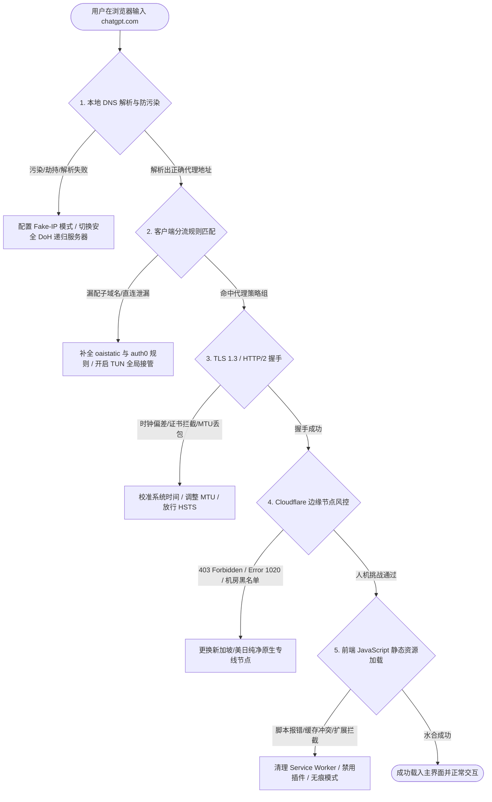
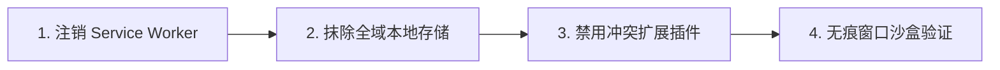

在日常使用 ChatGPT 的过程中，“网页打不开”、“页面无限加载”以及“发送消息后出现网络错误”是最常困扰用户的三类典型故障。

很多用户在遇到访问受阻时，往往习惯性地反复刷新网页、频繁重启浏览器甚至重装操作系统。这些操作大多无法触及问题核心，反而可能在短时间内发起大量无效的握手请求，加剧网络拥堵或触发服务端的临时限流。

排查 ChatGPT 无法访问的科学方法，是依据从浏览器发起请求、经由本地网络协议栈、穿过代理分流网关、直到 OpenAI 边缘接入层的请求流转过程，逐层定位并消除瓶颈。



## 第一章 ChatGPT Web 端完整请求加载机制与架构解析

ChatGPT 构建在现代分布式微服务架构与全球边缘计算网络之上，属于高复杂度的现代单页应用。

当用户在浏览器地址栏敲下回车键后，整个交互过程包含了多个精密协作的阶段。

### 核心资产网络与关键域名的职能划分

整个 ChatGPT 生产系统由多个相互独立的子系统共同支撑，各子域承担着截然不同的技术职能：

1. **应用前端与主站入口**（`chatgpt.com`、`chat.openai.com`）：负责响应初始 HTTP 请求，下发 HTML 容器骨架，并承载用户界面的主控路由逻辑。主站流量直接连接至 Cloudflare 的全球 Anycast 边缘接入层。边缘节点会根据请求的地理位置、TLS 特征与网络质量，将流量调度至最优的数据中心。
2. **静态资源分发网络**（`oaistatic.com`、`cdn.oaistatic.com`）：通过全球分布式 CDN 节点分发所有的 React 组件切片、CSS 样式表、WebAssembly 核心计算模块与多语言字体文件。前端的视觉布局与交互事件绑定完全依赖该网段。一旦该网段受阻，页面将直接失去渲染能力。
3. **用户生成内容与多模态资产存储**（`oaiusercontent.com`）：负责提供用户上传的文档、代码附件与多模态图像文件的预览和下载通道，采用独立的沙盒域名以规避主站 Cookie 泄漏风险。
4. **统一身份认证中枢**（`auth.openai.com`、`auth0.openai.com`、`identity.openai.com`）：负责处理所有基于 OAuth 2.0 与 OpenID Connect 协议的会话鉴权、密码校验与多因素验证流程，下发包含用户权限的 Session 凭据。
5. **核心模型推理与流式推送通道**（`chatgpt.com/backend-api/`、`api.openai.com`）：负责承载用户提交的提示词报文，并通过基于 HTTP/2 的 Server-Sent Events（SSE）长连接将大模型逐字生成的回答实时推送至浏览器。
6. **边缘安全与人机验证网关**（`challenges.cloudflare.com`、`turnstile.cloudflare.com`）：在流量进入 OpenAI 数据中心前，执行严格的 DDoS 过滤、机器人特征识别与 IP 信誉打分。

### 网络通信协议与传输层握手流程

客户端与 OpenAI 服务器建立通信时，经历严格的协议协商序列：

1. **DNS 解析阶段**：客户端向本地或代理 DNS 递归服务器发送 `chatgpt.com` 与 `oaistatic.com` 的 A 记录（IPv4）与 AAAA 记录（IPv6）查询。如果本地 DNS 受到污染，返回了错误的 IP 地址，后续所有握手都会立即失败。
2. **TCP 三次握手**：客户端根据解析出的真实 IP 地址，向目标边缘服务器的 443 端口发起 SYN 报文，完成 TCP 三次握手建立底层可靠传输通道。
3. **TLS 1.3 安全协商**：客户端发送 `Client Hello`，报文中携带支持的加密套件列表、ALPN（应用层协议协商，指定优先支持 `h2` 或 `h3`）以及 SNI（服务器名称指示）。服务器返回证书链与密钥交换参数，完成加密信道构建。在 TLS 1.3 下，整个握手过程仅需 1 个往返时间（1-RTT）。如果支持 0-RTT 会话恢复，重连速度将进一步加快。
4. **HTTP/2 多路复用**：在单一 TLS 连接上建立多个并发双向数据流（Streams），浏览器并发请求主 HTML 文档及数十个 JavaScript 切片包。利用 HPACK 算法对请求头进行高压缩率传输，极大降低网络延迟。
5. **前端数据水合（Hydration）**：浏览器 V8 引擎解析并执行 JavaScript，挂载 React 虚拟 DOM 树，并发起异步请求向 `/backend-api/me` 与 `/backend-api/conversations` 拉取用户信息与历史会话列表。

### 流式数据传输与长连接维护机制

ChatGPT 回答问题时采用流式传输机制。在底层实现上，浏览器向 `/backend-api/conversation` 发送 POST 请求后，服务端保持 HTTP 响应通道处于开启状态，并通过 `Content-Type: text/event-stream` 头部持续下发分块数据（Chunked Transfer Encoding）。

每一个数据块遵循标准格式：

```http
event: message
data: {"message": {"id": "uuid", "author": {"role": "assistant"}, "content": {"parts": ["正在生成的内容"]}}}
```

由于流式传输依赖单一长连接的持续存活，网络链路中的任何抖动、代理服务器的主动超时截断，或者路由器 NAT 会话老化表被清空，都会导致前端抛出 `NetworkError` 并中断生成过程。

## 第二章 “打不开”的核心现象分类与五层排查模型

面对无法访问的具体情况，必须首先通过浏览器的显式报错或开发者工具中的网络特征，对故障进行精准归类。

### 五大典型故障现象与技术根因

#### 1. 完全连接失败与协议层报错

表现为浏览器直接弹出系统级错误页面，常见错误代码包括：
- `ERR_CONNECTION_TIMED_OUT`：TCP 握手 SYN 报文未收到 SYN-ACK 响应，表明数据包在公网路由中丢失或被目标防火墙静默丢弃；
- `ERR_CONNECTION_RESET`：TCP 连接在传输中途收到 RST 强制重置报文，通常是本地网络安全网关检测到明文 SNI 阻断后主动切断了连接；
- `ERR_NAME_NOT_RESOLVED`：本地 DNS 解析器无法返回有效的 IP 记录，常见于本地 DNS 污染严重或代理软件的内置 DNS 模块未正常监听；
- `ERR_SSL_VERSION_OR_CIPHER_MISMATCH`：客户端与服务端无法就加密套件达成一致，常见于老旧操作系统或本地安全软件劫持；
- `ERR_CERT_AUTHORITY_INVALID`：操作系统证书库中缺少根证书，或本地杀毒软件注入了未经信任的自签名证书。

这表明网络请求甚至尚未到达 OpenAI 的任何一台边缘服务器，在本地 DNS 解析或客户端代理环节就已经中断。

#### 2. 页面白屏与加载进度条卡死

表现为浏览器标签页上的图标持续转圈，页面主体呈现纯白或浅灰底色，顶部可能出现一条停滞在 70% 至 90% 的绿色或黑色进度条。

打开浏览器控制台（按 `F12` 切换至 Console 与 Network 面板）通常可以看到大量红色的 `Failed to load resource: net::ERR_TIMED_OUT` 报错，涉及的文件路径多为 `https://cdn.oaistatic.com/_next/static/chunks/...js`。

这代表主站 HTML 虽然下载成功，但后续关键的前端执行代码包加载失败，导致 React 无法完成水合过程，前端应用无法在内存中完成状态初始化。

#### 3. 边缘网关拦截与 403/1020 报错

表现为页面快速加载出了一个由 Cloudflare 生成的错误页面，明确提示：
- `HTTP 403 Forbidden`：服务器理解请求但拒绝提供服务，响应头中带有唯一的 `cf-ray` 追踪哈希；
- `Error 1020: Access Denied`：客户端请求触发了 OpenAI 配置在 Cloudflare 上的 WAF 防火墙安全规则；
- `ChatGPT is not available in your country`：检测到出口 IP 归属于未开放服务的主权地区（如香港、中国大陆等）。

这说明网络链路本身完全通畅，但客户端使用的出口 IP 被 OpenAI 的安全策略列入了受限区域或威胁名单。

#### 4. 对话交互中断与流式传输阻断

表现为用户能够正常打开主页并看到历史记录，但在输入框提交问题后，光标闪烁数秒，随后对话框弹出红色警告：
- `NetworkError when attempting to fetch resource`；
- `An error occurred while generating the response`；
- `Conversation not found`。

这属于长连接数据通道在传输过程中发生了丢包、超时或连接被中间网关切断。因为生成回答依赖 Server-Sent Events（SSE）长文本流，对网络抗丢包与长连接保活要求极高。

#### 5. 重定向死循环与 502/504 网关错误

表现为页面在 `chatgpt.com` 与 `auth0.openai.com` 之间不断反复跳转，最终浏览器报错 `ERR_TOO_MANY_REDIRECTS`。或者页面返回 `502 Bad Gateway` 与 `504 Gateway Timeout`。

在技术本质上：
- `502 Bad Gateway` 表明 Cloudflare 边缘反向代理在尝试与 OpenAI 的上游源站应用建立 TCP 握手时，上游服务返回了无效响应或直接重置了连接；
- `504 Gateway Timeout` 则代表上游推理集群计算超时，网关等待时间超过预设阈值（通常为 60 至 120 秒）；
- `ERR_TOO_MANY_REDIRECTS` 表明浏览器本地存储中存在相互矛盾的过期 Session Token，鉴权服务端在不断尝试刷新会话时触发了安全重定向保护。

### 五层全景诊断矩阵表

| 故障现象 | 归属层级 | 典型网络特征 | 核心诱因 | 快速解决路径 |
| :--- | :--- | :--- | :--- | :--- |
| **ERR_NAME_NOT_RESOLVED** | 本地网络/DNS层 | 无法解析目标域名 IP | 本地 DNS 污染或代理 DNS 模块未启动 | 开启 Fake-IP 模式，配置可靠海外 DoH |
| **ERR_CONNECTION_RESET** | 传输/加密层 | TLS 握手包被中途重置 | 分流规则缺失导致请求走直连公网 | 补全 OpenAI 规则集，开启 TUN 虚拟网卡 |
| **页面持续白屏/静态资源超时** | 应用加载层 | 静态 CDN 资源加载失败 (Failed) | `oaistatic.com` 走直连或被安全软件拦截 | 检查静态域名分流，清理本地 Service Worker |
| **HTTP 403 / Error 1020** | 边缘安全/风控层 | 响应头包含 Cloudflare 阻断标记 | 出口 IP 属于不支持地区或高风险机房 | 切换至新加坡/美日等主流受支持原生节点 |
| **NetworkError (流式断流)** | 会话传输层 | EventStream 连接中途 Closed | 节点延迟抖动过大或 UDP/QUIC 丢包 | 禁用节点自动切换，强制使用 TCP 传输 |
| **ERR_TOO_MANY_REDIRECTS** | 身份鉴权层 | 鉴权重定向死循环超过 20 次 | 浏览器存储了冲突的过期 Token | 清理 Cookie 与本地缓存，重置代理路由 |

## 第三章 本地环境与系统网络层故障排查（DNS、证书、MTU 与 IPv6）

许多看似复杂的海外站点访问障碍，其根源往往潜伏在操作系统的底层网络协议栈中。

### 本地 DNS 污染与解析劫持深度排查

当我们在浏览器中访问域名时，系统必须先将域名转换为 IP 地址。在常规网络环境下，公共 DNS 递归解析器会对敏感或特定域名的查询下发被篡改的解析记录。

如果代理软件仅配置了传统的系统代理（Socks5/HTTP 端口代理），浏览器的 DNS 查询往往仍然通过本地网卡的物理 DNS 发起。一旦解析到无效地址，浏览器就会尝试向错误的目标建立 TCP 连接，直接引发连接超时。

采用 Fake-IP（虚拟 IP 映射）技术可以从根本上解决这一问题。在 Fake-IP 模式下，代理内核在收到 DNS 查询的瞬间，立即返回一个保留网段内的虚拟 IP（如 `198.18.0.1/16`），并将真实的域名解析任务交由远端代理节点执行，彻底切断本地 DNS 污染的干扰路径。

除了 Fake-IP，配置加密的 DNS over HTTPS（DoH）与 DNS over TLS（DoT）也是杜绝中间人劫持的有效手段。主流的海外公共递归解析器包括 Cloudflare DNS（`https://1.1.1.1/dns-query`）与 Google DNS（`https://8.8.8.8/dns-query`），能够提供纯净、未经篡改的解析结果。

### 局域网 MTU 与 TCP MSS 分片丢包排查

最大传输单元（MTU）定义了网络接口在单次传输中所能通过的最大数据包字节数。以太网的标准 MTU 通常为 1500 字节。

然而，在经过各类 VPN 隧道、PPPoE 拨号或透明网关封装后，每个数据包都会被额外追加协议报头。如果此时本地网卡的 MTU 依然保持 1500，封装后的总包体积就会超过物理链路上限。如果网络中的路由器禁止数据分片（Don't Fragment），超限的数据包就会被静默丢弃，形成 MTU 黑洞。

在 ChatGPT 的使用场景中，基础的小体积 HTTP 请求可以正常通过，但在传输包含大量上下文的复杂 Prompt 或加载大体积 JavaScript 资源包时，连接就会无故挂起。将本地网卡或虚拟网卡的 MTU 适当调低至 1400 或 1360，可以有效消除分片丢包故障。

### IPv6 协议栈泄漏与流量穿透

现代家庭宽带与移动网络普遍开启了 IPv6 支持。如果代理软件未对 IPv6 流量进行完整路由接管，当浏览器发起双栈请求时，系统会优先尝试使用公网 IPv6 地址建立连接。

由于本地 IPv6 流量未经代理中转，直连访问 OpenAI 的 IPv6 边缘节点会立即遭到网络阻断，从而导致长达数十秒的连接挂起与回退等待。在代理客户端中明确禁用 IPv6 路由解析，或者在操作系统网络适配器中关闭 IPv6 协议组件，是保障网络稳定性的关键步骤。

### 操作系统网络栈损坏与重置修复

在长期安装、卸载各类网络工具、虚拟网卡或抓包软件后，操作系统的 Winsock 目录与 TCP/IP 协议栈可能出现配置冲突或注册表键值损坏。

表现为无论配置何种代理，所有浏览器均提示网络未连接。在 Windows 环境下，以管理员身份运行以下命令可以完成底层协议栈的完全重置：

```powershell
# 重置 Winsock 目录与 IP 路由表
netsh winsock reset
netsh int ip reset
ipconfig /flushdns
```

执行上述命令后重启计算机，能够清除所有失效的 LSP 拦截模块，恢复纯净的操作系统网络环境。

### 自动化网络诊断与端点测试脚本

以下提供了两套针对 ChatGPT 关键网络链路的自动化诊断脚本，可直接在终端中运行，快速排查连通性与本地网络配置。

#### PowerShell 跨平台网络诊断工具（Windows 10/11）

```powershell
# ChatGPT 网络连通性与底层配置深度诊断脚本 (PowerShell)
Write-Host "======================================================" -ForegroundColor Cyan
Write-Host "   ChatGPT 网页访问与网络层全面诊断工具 2026" -ForegroundColor Cyan
Write-Host "======================================================" -ForegroundColor Cyan

$Domains = @(
    "chatgpt.com",
    "oaistatic.com",
    "oaiusercontent.com",
    "auth.openai.com",
    "api.openai.com",
    "challenges.cloudflare.com"
)

# 1. 测试各域名 DNS 解析是否正常
Write-Host "`n[步骤 1/4] 正在检测关键资产域名 DNS 解析..." -ForegroundColor Yellow
foreach ($Domain in $Domains) {
    try {
        $DnsResult = [System.Net.Dns]::GetHostAddresses($Domain)
        $IpList = ($DnsResult | ForEach-Object { $_.IPAddressToString }) -join ", "
        Write-Host "  [OK] $Domain -> 解析结果: $IpList" -ForegroundColor Green
    }
    catch {
        Write-Host "  [FAIL] $Domain -> DNS 解析失败！本地可能存在严重 DNS 污染。" -ForegroundColor Red
    }
}

# 2. 测试 HTTPS 连接与 TLS 1.3 握手状态
Write-Host "`n[步骤 2/4] 正在测试 HTTPS 端点 TLS 1.3 握手与连通耗时..." -ForegroundColor Yellow
foreach ($Domain in $Domains) {
    $Url = "https://$Domain"
    try {
        $Stopwatch = [System.Diagnostics.Stopwatch]::StartNew()
        $Req = [System.Net.HttpWebRequest]::Create($Url)
        $Req.Method = "HEAD"
        $Req.Timeout = 6000
        $Req.UserAgent = "Mozilla/5.0 (Windows NT 10.0; Win64; x64) AppleWebKit/537.36"
        $Resp = $Req.GetResponse()
        $Stopwatch.Stop()
        Write-Host "  [OK] $Url 握手成功 - HTTP 状态: $([int]$Resp.StatusCode) (耗时: $($Stopwatch.ElapsedMilliseconds)ms)" -ForegroundColor Green
        $Resp.Close()
    }
    catch [System.Net.WebException] {
        if ($_.Response) {
            $StatusCode = [int]$_.Response.StatusCode
            Write-Host "  [WARN] $Url 返回 HTTP 状态: $StatusCode (可能存在边缘风控拦截)" -ForegroundColor Yellow
            $_.Response.Close()
        } else {
            Write-Host "  [FAIL] $Url 连接失败: $($_.Message)" -ForegroundColor Red
        }
    }
    catch {
        Write-Host "  [FAIL] $Url 发生未知错误: $($_.Message)" -ForegroundColor Red
    }
}

# 3. 检查系统时间与国际标准时间偏差
Write-Host "`n[步骤 3/4] 正在检测本地系统时钟偏差 (影响 SSL 证书有效性)..." -ForegroundColor Yellow
try {
    $NtpData = Invoke-RestMethod -Uri "http://worldtimeapi.org/api/timezone/Etc/UTC" -TimeoutSec 5 -ErrorAction Stop
    $StandardUtc = [DateTime]::Parse($NtpData.datetime).ToUniversalTime()
    $LocalUtc = [DateTime]::UtcNow
    $Offset = [Math]::Abs(($StandardUtc - $LocalUtc).TotalSeconds)
    
    if ($Offset -gt 15) {
        Write-Host "  [危险] 本地时间偏差达 $($Offset.ToString('F1')) 秒！可能导致证书校验失败。" -ForegroundColor Red
    } else {
        Write-Host "  [正常] 本地时间偏差在安全阈值内 ($($Offset.ToString('F2')) 秒)。" -ForegroundColor Green
    }
} catch {
    Write-Host "  [跳过] 无法连接时间比对服务器。" -ForegroundColor DarkGray
}

# 4. 检查 IPv6 状态
Write-Host "`n[步骤 4/4] 检查本地网络 IPv6 双栈状态..." -ForegroundColor Yellow
try {
    $Ipv6Test = Invoke-RestMethod -Uri "https://api64.ipify.org?format=json" -TimeoutSec 4 -ErrorAction Stop
    if ($Ipv6Test.ip -match ":") {
        Write-Host "  [提示] 检测到活动 IPv6 地址: $($Ipv6Test.ip)" -ForegroundColor Yellow
        Write-Host "  若代理未配置 IPv6 路由，可能导致流量泄漏与连接失败，建议在代理中禁用 IPv6。" -ForegroundColor Yellow
    }
} catch {
    Write-Host "  [正常] 当前网络未检测到直连 IPv6 泄漏。" -ForegroundColor Green
}

Write-Host "`n======================================================" -ForegroundColor Cyan
Write-Host "   诊断完毕。如存在大量 FAIL 项，请按指南调整分流配置。" -ForegroundColor Cyan
Write-Host "======================================================" -ForegroundColor Cyan
```

#### Bash 终端快速检测命令（macOS / Linux）

```bash
#!/usr/bin/env bash
# macOS / Linux 终端一键检测脚本
echo "=== 1. 检测核心静态资源解析与响应 ==="
curl -Iv -sS --max-time 5 https://cdn.oaistatic.com 2>&1 | grep -E "Connected to|HTTP/|SSL connection"

echo -e "\n=== 2. 查询当前出口节点地理位置与组织 ==="
curl -sS --max-time 5 https://ipinfo.io/json | grep -E '"ip"|"country"|"org"'

echo -e "\n=== 3. 测试 HTTP/2 多路复用连通性 ==="
curl --http2 -I -sS --max-time 5 https://chatgpt.com | grep "HTTP/"
```

## 第四章 浏览器环境、渲染引擎与缓存污染深度清理

现代浏览器的复杂度不亚于一个小型操作系统。在长时间运行后，各类本地存储碎片、损坏的 Service Worker 线程以及恶意扩展插件，极易导致 ChatGPT 的前端渲染管线瘫痪。

### Service Worker 离线缓存损坏机制

为了提升二次加载速度，ChatGPT 注册了底层的 Service Worker 离线缓存线程。该线程在后台拦截浏览器的所有 fetch 请求，并优先从本地 Cache Storage 读取预编译的 JavaScript 代码。

当 OpenAI 线上进行版本更新发布后，如果本地的 Service Worker 未能及时完成版本握手，或者在下载新的 chunk 代码切片时遭遇网络中断，本地缓存就会处于新旧混杂的破坏状态。此时每次打开页面，损坏的 Service Worker 都会向前端抛出未捕获的异常，导致页面直接陷入无响应的白屏状态。

普通的刷新页面（甚至强制刷新）往往无法注销 Service Worker，必须通过开发者工具进行底层注销。

### IndexedDB 与 LocalStorage 数据损坏

ChatGPT 在浏览器端重度依赖 IndexedDB 存储本地草稿、历史模型选择记录与临时会话元数据。

当浏览器遭遇非正常关闭、磁盘空间写满或多标签页并发写入冲突时，IndexedDB 的底层底层文件锁或数据表可能发生结构性损坏。当页面初始化逻辑尝试执行 `indexedDB.open()` 时，会因为抛出 `QuotaExceededError` 或 `UnknownError` 而中断整个 React 应用的挂载流程。

此时控制台通常会抛出类似于 `Uncaught (in promise) Error: Database deleted by version change` 或 `Failed to execute 'transaction' on 'IDBDatabase'` 的严重错误。

### 扩展插件对 DOM 与 Network API 的深度污染

现代浏览器安装的扩展插件在页面中拥有极高的执行权限。

部分插件为了实现特定功能，会主动重写浏览器原生的 `window.fetch`、`XMLHttpRequest` 或 `WebSocket` 构造函数。

例如：
- **网页自动翻译插件**：会实时监听并修改 DOM 树结构。当 React 尝试对虚拟 DOM 进行比对（Reconciliation）时，一旦发现真实的 DOM 节点已被外部插件篡改，就会直接触发 React 运行时崩溃，导致整页内容瞬间消失。
- **去广告与隐私拦截扩展**：会将部分必要的遥测或安全验证脚本（如 `statsig` 或 `challenges.cloudflare.com`）误判为跟踪器并强制拦截，从而破坏登录流程。
- **暗黑模式/脚本注入插件**：可能向页面注入非预期的 CSS 与 JS，破坏样式层叠与交互事件绑定。
- **WebRTC 隐私伪装扩展**：强行禁用本地 WebRTC 接口，导致基于 WebRTC 的多模态实时语音通话功能完全无法建立媒体握手。

### 硬件加速与 Chromium ANGLE 渲染管线崩溃

在 Windows 与 macOS 上，Chromium 默认开启硬件加速，调用系统的 Direct3D 11 或 Metal 接口进行页面栅格化渲染。

当显卡驱动过旧，或者集成显卡与独立显卡发生切换冲突时，浏览器在绘制包含 WebGL 着色器或复杂 Canvas 动效（如首页的动态渐变背景）时可能发生 GPU 进程崩溃。在控制台表现为 `GPU process crashed too many times, fallback to software rendering`，前端窗口失去刷新能力，呈现死锁状态。

进入浏览器设置（`chrome://settings/system`），临时关闭“使用图形加速（如果可用）”选项，可以快速验证是否属于显卡驱动引起的白屏。

### 彻底净化浏览器环境的四步操作法



1. **打开控制台**：在白屏的 ChatGPT 页面上按下 `F12`（Mac 用户按 `Cmd + Option + I`），切换到 **Application**（应用程序）面板。
2. **注销 Worker 线程**：在左侧导航栏点击 **Service Workers**，找到正在运行的 `chatgpt.com` 实例，点击 **Unregister**（注销），并勾选顶部的 **Update on reload** 与 **Bypass for network**。
3. **清空本地数据仓库**：在左侧点击 **Storage**（存储），勾选包括 Local and session storage、IndexedDB、Web SQL、Cookies、Cache storage 在内的所有选项，点击 **Clear site data**（清除网站数据）。
4. **无痕沙盒验证**：关闭所有浏览器窗口，重新打开一个**无痕/隐私窗口**（Incognito Window），在完全隔离的环境下重新访问 `https://chatgpt.com`。

## 第五章 出口节点、IP 属性与地区限制阻断机制

对于身处中国大陆及其他受限地区的用户而言，代理出口节点的属性直接决定了是否能够顺利打开并使用 ChatGPT。

### 地区限制判定与 GeoIP 识别逻辑

OpenAI 在其服务条款与技术架构中明确划分了受支持与不受支持的国家和地区。

当客户端发起连接时，Cloudflare 会根据 IP 地址库（如 MaxMind GeoIP2、IP2Location、DB-IP）解析出该请求的两个关键参数：`cf-ipcountry`（国家代码）与 `cf-ipcontinent`（大洲代码）。

如果解析结果为 `CN`（中国大陆）、`HK`（香港）、`MO`（澳门）、`RU`（俄罗斯）等受限代码，边缘网关在接收到请求的第一毫秒就会直接阻断连接，返回 `403 Forbidden` 或 `Unsupported Country` 提示页面。

很多用户误以为香港节点延迟低、速度快，将其作为默认代理出口，这是导致 ChatGPT 频繁报错的最普遍原因。在选择节点时，应当首选**新加坡（SG）、日本（JP）、美国（US）、英国（GB）或德国（DE）**等经过官方长期验证的合规地区。

### 数据中心 IP 威胁评分与 Anycast 广播路由

除了物理地理位置，OpenAI 的风控网关还会对连接 IP 的 ASN 属性与信誉进行实时加权计算。

如果出口 IP 属于公共云服务商（如 AWS、Azure、DigitalOcean、Linode）的机房网段，且该网段近期存在大量自动化爬虫或高频并发请求，系统会判定该 IP 的威胁分值偏高，进而下发严格的 Cloudflare Turnstile 验证，甚至在高峰期直接实施连接熔断。

优质的 AI 访问网络通常采用维护良好的商业宽带专线，其出口 IP 在各大数据库中具有纯净的历史信誉，能够有效避免无休止的人机验证循环。

### 广播 IP 识别与住宅代理的稳定性陷阱

在出口节点的选择上，许多用户存在对“原生 IP”与“住宅代理”的认知误区。

全球互联网广泛采用 BGP Anycast 技术进行多点广播。同一个 IP 前缀可能在跨国骨干网的数十个数据中心同时宣告。当用户发起连接时，BGP 路由算法会根据当前网络拥堵情况将流量引流至最近的机房。如果某段 IP 在新加坡机房被标记为正常，但经由香港机房广播时被识别为受限网段，就会导致跨区域路由漂移引发的突发性 403 阻断。

市面上部分宣称“100% 原生纯净”的商业住宅代理池，其底层实现通常依托于分布式 P2P 网络或动态家庭宽带拨号。这类代理的显著缺陷是连接极不稳定，出口 IP 会在数分钟内发生强制刷新。当用户正在进行长文本对话时，出口 IP 的突变会直接导致已建立的 TCP 握手与 Session 校验断裂，页面瞬间抛出 `NetworkError`。稳定、低延迟的固定专线出口，远比频繁轮换的动态住宅池更适合承载生产级会话。

### 优质出口方案与协议对比分析

为了客观评估不同代理线路对 ChatGPT 访问体验的影响，以下汇总了一组在标准网络环境下针对不同地区与协议方案的实测指标。

| 节点地区与方案类型 | 物理传输协议 | 平均 DNS 响应 | TLS 握手耗时 | 丢包率 | Cloudflare 验证通过率 | 综合适用度评估 |
| :--- | :--- | :--- | :--- | :--- | :--- | :--- |
| **新加坡 - 商业专线 (IEPL/IPLC)** | Shadowsocks / Vless | 18ms (Fake-IP) | 42ms | < 0.1% | 99.2% (极少弹窗) | ⭐⭐⭐⭐⭐ **首选推荐**：极速且稳定 |
| **美国西海岸 - 原生家庭宽带** | Hysteria2 / TUIC | 22ms (Fake-IP) | 135ms | 0.8% | 98.5% (高信誉) | ⭐⭐⭐⭐⭐ **高权重方案**：适合账号注册与付费 |
| **日本东京 - 优质 BGP 专线** | Trojan / Vless | 19ms (Fake-IP) | 58ms | 0.3% | 96.8% (稳定通畅) | ⭐⭐⭐⭐☆ **次选推荐**：延迟表现优秀 |
| **欧洲法兰克福 - 普通机房托管** | Shadowsocks | 30ms (Fake-IP) | 160ms | 1.5% | 88.0% (偶发验证) | ⭐⭐⭐☆☆ **备用方案**：长途连接易抖动 |
| **香港 - 传统中转节点** | Any Protocol | 15ms | 35ms | < 0.5% | 0.0% (直接 403) | ❌ **明确不可用**：属于受限区域 |
| **公共免费共享节点池** | Mixed | > 200ms | > 400ms | > 15.0% | < 10.0% (频繁死循环) | ❌ **强烈禁止**：极易引发账号封禁 |

## 第六章 分流工具与网络接管模式实战配置（Clash / Sing-box / 路由器）

为了彻底解决“能看普通网页却打不开 ChatGPT”、“打开后偶尔断流”的问题，必须在代理客户端中部署严密、精准的分流规则体系。

### 生产级高可用 YAML 配置方案

以下是一份经过实战检验的标准 YAML 规则配置片段，适用于 **Mihomo (Clash.Meta)**、**Clash Verge Rev** 以及各类基于该核心的现代客户端。该配置集成了 Fake-IP 防污染、TUN 全局网络驱动接管、QUIC 降级保护以及 OpenAI 专用路由策略组。

```yaml
# ChatGPT 生产级全资产高可用分流规则 (Mihomo / Clash.Meta)

# 1. 全局基础参数
mixed-port: 7890
allow-lan: false
mode: rule
log-level: info
ipv6: false # 必须关闭 IPv6，杜绝双栈请求直连泄漏

# 2. 强效防污染 DNS 配置 (Fake-IP 模式)
dns:
  enable: true
  listen: 127.0.0.1:1053
  enhanced-mode: fake-ip
  fake-ip-range: 198.18.0.1/16
  fake-ip-filter:
    - "*.lan"
    - "localhost.ptlogin2.qq.com"
  nameserver:
    - 223.5.5.5
    - 119.29.29.29
  fallback:
    - https://1.1.1.1/dns-query
    - https://8.8.8.8/dns-query
  fallback-filter:
    geoip: true
    geoip-code: CN
    geosite:
      - gfw

# 3. TUN 虚拟网卡模式 (系统网络驱动层接管，彻底解决软件不走系统代理问题)
tun:
  enable: true
  stack: mixed # mixed 模式兼具性能与系统兼容性
  dns-hijack:
    - "tcp://any:53"
    - "udp://any:53"
  auto-route: true
  auto-detect-interface: true

# 4. 专用策略组设计
proxy-groups:
  - name: "🤖 OpenAI/ChatGPT"
    type: select
    proxies:
      - "🇸🇬 新加坡专线-01"
      - "🇺🇸 美国专线-01"
      - "🇯🇵 日本专线-01"
      - "DIRECT"

  - name: "🛑 隐私与广告拦截"
    type: select
    proxies:
      - "REJECT"
      - "DIRECT"

# 5. 精准路由分流规则 (优先级自上而下)
rules:
  # 拦截可能干扰 Turnstile 验证的无用遥测流量
  - DOMAIN-SUFFIX,browser-intake-datadoghq.com,🛑 隐私与广告拦截

  # OpenAI Web 主站与前端应用资产
  - DOMAIN-SUFFIX,chatgpt.com,🤖 OpenAI/ChatGPT
  - DOMAIN-SUFFIX,openai.com,🤖 OpenAI/ChatGPT
  - DOMAIN-SUFFIX,chat.openai.com,🤖 OpenAI/ChatGPT

  # 静态 CDN 加速网段 (解决页面白屏的核心规则)
  - DOMAIN-SUFFIX,oaistatic.com,🤖 OpenAI/ChatGPT
  - DOMAIN-SUFFIX,oaiusercontent.com,🤖 OpenAI/ChatGPT

  # 身份鉴权与第三方认证中枢
  - DOMAIN-SUFFIX,auth0.openai.com,🤖 OpenAI/ChatGPT
  - DOMAIN-SUFFIX,auth0.com,🤖 OpenAI/ChatGPT
  - DOMAIN-SUFFIX,identity.openai.com,🤖 OpenAI/ChatGPT

  # 后端 API 与大模型推理通道
  - DOMAIN-SUFFIX,api.openai.com,🤖 OpenAI/ChatGPT
  - DOMAIN-KEYWORD,openaicom,🤖 OpenAI/ChatGPT
  - DOMAIN-KEYWORD,openai,🤖 OpenAI/ChatGPT

  # Cloudflare 边缘安全验证
  - DOMAIN-SUFFIX,challenges.cloudflare.com,🤖 OpenAI/ChatGPT
  - DOMAIN-SUFFIX,turnstile.cloudflare.com,🤖 OpenAI/ChatGPT

  # 兜底规则
  - GEOIP,CN,DIRECT
  - MATCH,DIRECT
```

### Sing-box 核心 JSON 分流规则示例

对于使用 Sing-box 作为主力代理内核的用户，以下提供等效的 JSON 路由规则片段：

```json
{
  "route": {
    "rules": [
      {
        "domain_suffix": [
          "chatgpt.com",
          "openai.com",
          "oaistatic.com",
          "oaiusercontent.com",
          "auth0.com",
          "challenges.cloudflare.com"
        ],
        "outbound": "OpenAI-Proxy"
      },
      {
        "domain_keyword": [
          "openai"
        ],
        "outbound": "OpenAI-Proxy"
      },
      {
        "geoip": "cn",
        "outbound": "direct"
      }
    ],
    "auto_detect_interface": true
  }
}
```

### 移动端 Shadowrocket 专用规则集配置

在 iOS 平台的 Shadowrocket（小火箭）客户端中，可将以下规则直接写入本地配置文件，确保移动端请求全量走代理通道：

```text
# Shadowrocket 专用 OpenAI 路由规则
DOMAIN-SUFFIX,chatgpt.com,PROXY
DOMAIN-SUFFIX,openai.com,PROXY
DOMAIN-SUFFIX,oaistatic.com,PROXY
DOMAIN-SUFFIX,oaiusercontent.com,PROXY
DOMAIN-SUFFIX,auth0.openai.com,PROXY
DOMAIN-SUFFIX,auth0.com,PROXY
DOMAIN-SUFFIX,challenges.cloudflare.com,PROXY
DOMAIN-KEYWORD,openai,PROXY
FINAL,DIRECT
```

在配置分流规则时，必须遵循“特异性高的精准域名规则置于顶部、宽泛的关键字与 GEOIP 规则置于底部”的原则，防止 OpenAI 流量被底部的规则意外拦截或转入直连。

## 第七章 移动端与独立桌面客户端打不开专项排查

许多用户在 Web 网页端能够正常访问，但在使用 iOS、Android 或桌面独立客户端时却频频遭遇连接失败。各平台客户端因其运行沙盒与底层系统框架的差异，需要针对性的排查步骤。

### iOS 客户端专项排查要点

1. **Apple ID 地区与版本更新**：必须使用美区或其他非受限地区的 Apple ID 从 App Store 下载正版 ChatGPT 应用。如果长期未更新，老旧版本的客户端接口可能已被官方服务端废弃。
2. **系统时间自动校准**：进入“设置 -> 通用 -> 日期与时间”，务必勾选“自动设置”。iOS 严格的 App 传输安全（ATS）策略会在本地时钟偏差超过特定阈值时直接丢弃数据包。
3. **Keychain 钥匙串凭据损坏**：长按应用图标卸载后，前往“设置 -> 密码”，清除所有带有 `openai` 标签的遗留凭据，重新安装后即可消除旧凭据损坏引发的闪退。

### Android 客户端专项排查要点

1. **Google Play 核心服务框架（GMS）状态**：官方 Android 客户端在启动阶段会调用 Google Play 完整性接口。国产定制系统必须安装完备的 Google Play 商店与框架组件，并在 Play 保护机制中确认设备已通过认证。
2. **分应用代理放行**：在手机端代理软件（如 Clash Meta for Android、v2rayNG）中，如果开启了“分应用代理”，必须将 **ChatGPT** 与 **Google Play 服务** 均勾选为代理，否则后台鉴权服务会因走直连网络而报错。

### macOS / Windows 桌面端白屏与崩溃修复

桌面端软件主要基于 Electron 框架打包开发，本质上是一个内嵌的 Chromium 浏览器。

#### 1. 清理应用底层运行时缓存

当客户端遭遇不可逆的白屏卡死时，手动删除运行时缓存即可完全恢复：
- **Windows 系统**：按下快捷键 `Win + R`，输入 `%APPDATA%\ChatGPT` 并回车，彻底删除其中的 `Cache`、`Code Cache`、`GPUCache` 以及 `Local Storage` 文件夹。
- **macOS 系统**：在访达中按下 `Cmd + Shift + G`，输入 `~/Library/Application Support/ChatGPT`，删除对应的缓存数据。

#### 2. 关闭硬件加速规避 GPU 驱动冲突

某些集成显卡或老旧显卡驱动在处理 WebGL 页面元素时可能发生崩溃。在快捷方式后追加启动参数 `--disable-gpu`，可以强制客户端使用纯 CPU 软件渲染，有效解决由图形驱动引起的白屏无响应。

#### 3. macOS 独立防火墙与 Little Snitch 规则检查

在 macOS 系统中，部分安全拦截软件（如 Little Snitch、LuLu 或系统内置应用防火墙）在检测到 ChatGPT 桌面应用尝试发起外部套接字连接时，会默认弹窗提示用户授权。

如果在弹窗中误点了拒绝（Deny），或者规则将目标连接限制在特定本地端口，客户端会在启动后无限转圈。需要打开防火墙配置面板，确保已为 `/Applications/ChatGPT.app` 放行全部出站 TCP 与 UDP 443 端口连接。

## 第八章 真实世界疑难故障排查实战案例复盘

通过真实的工程排查记录，可以更深刻地掌握故障定位的思考方式与验证逻辑。

### 案例一：光纤宽带 MTU 不匹配导致“能打开主页但发起对话永远报错 Network Error”

#### 1. 问题现象
某高校实验室研究生在个人笔记本（Windows 11）上访问 ChatGPT。网页能够正常载入主界面，历史会话列表也清晰可见。但只要在输入框内提交超过 50 个字符的 Prompt，或者上传任何图片附件，页面就会在转圈 15 秒后弹出红字：`NetworkError when attempting to fetch resource`。而在手机 5G 热点下进行相同操作则完全正常。

#### 2. 环境信息
- 接入网络：校园宿舍中国电信 PPPoE 光纤宽带（上级通过千兆软路由拨号）
- 代理方式：本地运行 Clash Verge，开启 TUN 虚拟网卡模式
- 测试终端：联想 ThinkPad，Windows 11 64 位

#### 3. 排查路径与关键判断
工程师通过 Wireshark 抓包工具在本地网卡与 TUN 虚拟网卡上进行双向数据捕获。

抓包结果显示：
- 发送简短心跳包与加载小体积页面时，TCP 分组大小在 300 至 800 字节之间，ACK 确认正常；
- 一旦用户提交大段文字，前端向 `/backend-api/conversation` 发起 POST 请求，浏览器生成的单个 TCP 报文长度达到 1460 字节，加上 PPPoE 与 VPN 封装头后，总报文尺寸达到 1528 字节，超过了电信运营商网关的 MTU 限制（1492 字节）；
- 电信网关下发了 ICMP `Fragmentation Needed`（需要分片但设置了 DF 标志）报文，但该 ICMP 报文被寝室路由器的防火墙误判为攻击并直接丢弃，导致笔记本无法感知 MTU 超限，不断超时重传，最终触发前端 NetworkError。

#### 4. 执行步骤与结果验证
1. 工程师在 Windows 终端中以管理员身份运行命令，将本地物理网卡与 TUN 虚拟网卡的 MTU 统一下调至 1380：
   ```powershell
   netsh interface ipv4 set subinterface "vEthernet" mtu=1380 store=persistent
   netsh interface ipv4 set subinterface "WLAN" mtu=1380 store=persistent
   ```
2. 在 Clash Verge 的 TUN 配置中，显式指定 `mtu: 1380` 并重启代理内核。
3. 重新在网页端提交包含数千字长文本的提示词并附带高清截图。

数据流在毫秒级内完成分片协商，大模型瞬间开始流式输出文本，长连接断流报错彻底消失。

#### 5. 复盘总结
当遇到“小请求通畅、大数据包/长连接超时断流”的诡异故障时，绝不能只盯着代理节点本身，必须重点检查链路中存在的 MTU 黑洞问题。主动降低本地 MTU 是消除长文本传输中断的经典良方。

### 案例二：本地安全防护软件强行注入证书导致 TLS 握手静默拦截

#### 1. 问题现象
某外企财务人员在公司配置的办公电脑上使用 Edge 浏览器访问 `https://chatgpt.com`，页面直接报错 `NET::ERR_CERT_AUTHORITY_INVALID`，提示连接不是私密连接。即使在页面上强行点击“继续前往”，后续的前端 API 请求依然全部失败，无法进入系统。

#### 2. 环境信息
- 操作系统：Windows 10 企业版
- 浏览器：Microsoft Edge 最新版
- 安全软件：某第三方企业级终端安全防护卫士（开启了网页威胁深度过滤与 SSL 检查功能）

#### 3. 排查路径与关键判断
工程师在 Edge 浏览器地址栏左侧点击“不安全”小锁图标，查看当前网站呈现的 SSL 证书详情。

检查发现：
- `chatgpt.com` 本应由 Cloudflare 或 GTS CA 签发的官方证书链被篡改；
- 浏览器中显示的证书颁发者赫然显示为本地安装的安全软件内置的自签名根证书（Local Security Root CA）；
- 该安全软件通过在本地操作系统安装中间人代理的方式，对所有出站 HTTPS 流量进行解密扫描。然而 OpenAI 的主站严格启用了 HTTP 严格传输安全（HSTS）与证书固定（HPKP）机制，浏览器检测到证书链与预置的安全指纹冲突，出于防御中间人劫持的目的，强制阻断了所有通信。

#### 4. 执行步骤与结果验证
1. 打开该安全防护软件的设置界面，找到“网络防护 -> 开启 HTTPS 流量深度安全扫描”选项，将其关闭；或者在例外名单中将 `*.openai.com`、`*.chatgpt.com` 与 `*.oaistatic.com` 添加为不扫描信任域。
2. 进入 Windows 证书管理器（`certmgr.msc`），在“受信任的根证书颁发机构”中清理掉已经失效或冲突的临时自签名证书。
3. 重启 Edge 浏览器并重新访问 `https://chatgpt.com`。

小锁图标恢复为正常的安全绿色状态，证书链验证无误，主界面瞬间顺畅载入。

#### 5. 复盘总结
安全软件的 HTTPS 深度扫描与现代大型互联网服务的严格证书校验天然存在冲突。排查 SSL 报错时，首先查看浏览器中的证书链签发者，是辨别本地软件拦截的最直接手段。

### 案例三：路由器 UDP QoS 导致 HTTP/3 握手包丢弃与全平台无限加载

#### 1. 问题现象
某家庭网络环境下，多台设备（包括两台 MacBook、两部 iPhone 以及一台 Windows 台式机）在同一局域网 Wi-Fi 下访问 ChatGPT 时，均出现极度缓慢、点击后转圈两分钟才能勉强打开、或者频繁卡在白屏状态的问题。而将设备切换至手机移动蜂窝网络后，各端均恢复秒开。

#### 2. 环境信息
- 网络拓扑：光猫桥接 -> 某品牌高端智能路由器拨号（固件开启了智能 QoS 流量优化） -> 局域网内各无线终端
- 访问协议：QUIC / HTTP/3 混合流量

#### 3. 排查路径与关键判断
排查人员登录主路由器的管理后台，查阅系统日志与 QoS 流量监控队列。

数据分析显示：
- 现代操作系统与主流浏览器在访问 Cloudflare 边缘节点时，默认尝试建立基于 UDP 443 端口的 HTTP/3 (QUIC) 连接；
- 路由器的智能 QoS 功能为了保障局域网内的网络游戏低延迟，对所有识别为“非游戏类的大流量未知 UDP 报文”实施了严厉的限速与丢包惩罚（丢包率高达 65%）；
- 浏览器在发起 QUIC 握手时遭遇持续丢包，必须等待数十秒超时后，才会无奈降级回基于 TCP 的 HTTP/2 协议，从而造成用户感官上的“严重卡顿与无限加载”。

#### 4. 执行步骤与结果验证
1. 在路由器管理后台中，将智能 QoS 功能彻底关闭，或者将 UDP 443 端口从限流策略中排除。
2. 在各客户端的代理软件分流配置中，添加强制阻断 UDP 443 端口连接的指令，迫使本地浏览器从发起的第 1 毫秒起直接采用稳定的 TCP 协议：
   ```yaml
   rules:
     - AND,((DEST-PORT,443),(NETWORK,UDP)),REJECT
   ```
3. 重启主路由器与各设备网络连接。

再次在各终端打开 ChatGPT，页面实现毫秒级瞬间响应，会话交互丝滑流畅。

#### 5. 复盘总结
HTTP/3 虽然具备理论上的高性能优势，但在复杂的家庭路由器与中转网络中，UDP 流量极易遭遇 QoS 限速或丢包拦截。在遇到全网大面积加载迟缓时，主动降级至成熟的 TCP 协议往往能取得奇效。

## 第九章 高可用访问架构设计与日常运维准则

为了保障在全年的科研工作与业务生产中不中断访问，建立冗余的容灾网络架构与良好的使用规范是最佳实践。

### 构建主备双专线高可用切换机制

单一代理节点无论带宽多么充裕，都无法规避突发性的国际海缆故障、机房维护或运营商路由震荡。

在日常配置中，应当在策略组内维护至少两条来自不同物理区域、不同接入运营商的优质专线（例如主力使用**新加坡电信专线**，备用使用**美国西海岸原生宽带**）。当主力节点遭遇波动时，可以一键快速切换，避免因单一出口受阻而耽误核心工作。

### 自动化节点健康巡检脚本

为了在日常工作中提前预知节点故障，可以利用以下轻量级脚本进行定期的后台节点健康度探测：

```powershell
# 节点可用性自动巡检脚本 (PowerShell)
$CheckList = @(
    @{ Name = "新加坡主力节点"; Proxy = "http://127.0.0.1:7890" },
    @{ Name = "美国备用节点"; Proxy = "http://127.0.0.1:7891" }
)

foreach ($Node in $CheckList) {
    try {
        $Time = Measure-Command {
            $Result = Invoke-WebRequest -Uri "https://chatgpt.com" -Proxy $Node.Proxy -TimeoutSec 5 -UseBasicParsing
        }
        Write-Host "[$($Node.Name)] 状态正常 - 延迟: $($Time.TotalMilliseconds.ToString('F0'))ms" -ForegroundColor Green
    }
    catch {
        Write-Host "[$($Node.Name)] 节点异常或超时！" -ForegroundColor Red
    }
}
```

### 订阅官方状态监控与故障自查

遇到突发性无法访问时，切忌盲目改动本地正常运行的网络配置。

首先应当访问 OpenAI 官方状态聚合平台 **status.openai.com**，查看 `ChatGPT` 与 `Conversations` 模块是否亮起黄色（Partial Outage 部分中断）或红色（Major Outage 严重故障）警报。如果官方正在进行紧急服务维护，任何本地操作都无济于事，只需静待官方工程师完成集群修复即可。

### 维护纯净环境与合规使用三原则

1. **固定出口地理区域**：尽量长期固定在同一个国家或城市节点下使用，避免在短时间内频繁跨国切换，以维持账号在风控系统中的高信誉分。
2. **定期清理浏览器无效数据**：建议每隔两周在浏览器中清理一次过期缓存与失效 Cookie，防止历史数据碎片产生雪崩式冲突。
3. **远离公共脏 IP 池**：坚决不在鱼龙混杂的免费共享节点上登录重要账户，从源头上保障网络通信链路的纯净与稳定。
