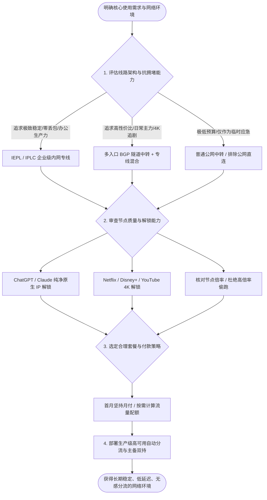
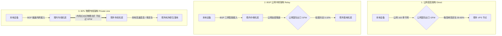
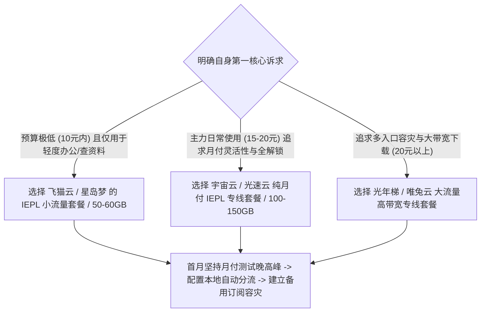

在当今的数字化科研、跨境电商与日常信息检索中，一个稳定、高速且经济的代理网络是不可或缺的基础工具。

然而，当前的代理服务市场鱼龙混杂。各家平台充斥着“千兆极速”、“晚高峰 8K 秒开”、“五元无限流量”等夸张的宣传口号。很多新手在缺乏基础网络常识的情况下，往往被低廉的表面价格吸引，购买后才发现一到晚上就频繁断流、看视频无限缓冲、甚至使用几天后服务商就卷款跑路。

要想在 2026 年选购到真正稳定、便宜且好用的机场，必须跳出单纯比拼价格与测速峰值的营销陷阱，从底层物理链路、网络传输机制以及真实业务场景出发，建立科学的选型与评估体系。



## 第一章 2026 年代理网络生态演进与选购核心逻辑

理解当前跨境网络的技术背景与发展趋势，有助于建立清晰的选型标准。

### 当前网络环境面临的新挑战

进入 2026 年，跨境网络通信的技术环境发生了显著变化：
1. **深度包检测（DPI）与主动探测机制升级**：传统的明文代理协议与缺乏标准 TLS 握手特征的流量，在经过公网国际出口时极易被实时识别并实施精确阻断。纯公网直连节点的生存周期被压缩至数天甚至数小时；
2. **AI 与大模型平台的严密风控体系**：OpenAI、Anthropic 等头部 AI 厂商对访问来源的 IP 信誉、ASN 属性与并发请求频率实施了极其严苛的审查。大量廉价数据中心机房的共享 IP 被列入高风险黑名单，导致用户在登录时遭遇频繁的人机验证死循环或直接拦截；
3. **高码率超高清流媒体的带宽压力**：主流流媒体平台全面普及 4K 60FPS HDR 与杜比视界规格，单小时数据吞吐量高达 7GB 到 12GB，对代理节点的持续输出带宽与抗丢包能力提出了更高的物理要求；
4. **多终端全天候常驻的保活需求**：用户普遍在手机、电脑、平板以及家庭软路由等多设备上同时开启代理，要求网络链路具备极高的后台连接保活性，避免频繁掉线重连影响日常工作。

### 主流代理传输协议的技术特性与演进

协议是数据封装与特征伪装的核心载体。在 2026 年的主流客户端中，各协议的技术定位如下：
- **Shadowsocks (AEAD)**：基于对称加密的轻量级协议，计算开销极低。在 IEPL 物理专线等内网封闭环境中表现最为优异；
- **VMess / VLESS (Vision)**：新一代流控（Flow Control）技术消除了传统 TLS 握手内的明显分块特征，使代理流量完全融入标准 HTTPS 网页浏览，是目前中转节点的主力协议；
- **Trojan / Trojan-Go**：直接伪装为标准 HTTPS 网站，通过标准 443 端口与有效 SSL 证书建立连接，抗干扰能力出色；
- **Hysteria2 / TUIC v5**：基于 UDP / QUIC 协议开发的高性能协议，支持主动丢包补偿与拥塞控制自适应，在弱网宽带或高延迟跨洋直连线路上能极大提高吞吐率。但若本地网络存在严厉的 UDP QoS 限制，其表现可能不如标准 TCP 专线。

### 令牌桶算法与公网国际出口 QoS 流量整形机制

在理解晚高峰卡顿的原因时，必须认识到运营商在公网出口所采用的流量整形算法。

中国电信与中国联通的国际出入口网关普遍启用了基于令牌桶（Token Bucket）的流量限制策略。在白天非高峰期，令牌生成速率高于到达的数据包速率，普通公网直连流量能够顺畅通过；

然而一旦进入晚间 20:00 到 23:30，全网并发流量暴增，令牌池瞬间被耗尽。此时，网关系统会根据数据包的服务类别（CoS/DSCP 优先级）进行强制分级。普通民用公网直连数据包被赋予最低优先级（Best Effort），遭遇直接丢弃，导致 TCP 层的重传定时器（RTO）反复超时，产生肉眼可见的严重卡顿。

### “稳定、便宜、好用”的不可能三角平衡

在分布式系统与网络工程中，存在着类似于 CAP 定理的权衡约束：

$$\text{低延迟物理专线} + \text{超大无限制流量} + \text{超低订阅价格} \neq \text{可长期持续的商业模型}$$

- **如果追求极致的稳定与低延迟**：服务商必须向电信运营商租用昂贵的企业级 IEPL 物理专线，其单兆宽带月租高达数十元，因此套餐必须通过限制月度总流量（如每月 50GB 至 100GB）来将总价控制在平价区间；
- **如果追求极低的价格与超大流量**：服务商只能采用廉价的公网直连或低配中转服务器，并大幅度超售带宽，其结果必然是晚高峰严重拥堵、丢包率飙升；
- **真正的理性选购平衡点**：在于结合自身的真实业务量，选择**“小流量、高品质专线、合理月付单价”**的产品组合。

### 网络可用率 SLA 与平均无故障时间的工程含义

在评估专业网络服务时，服务等级协议（SLA）是衡量稳定性的关键技术指标。

SLA 达到 99.9% 意味着全年的累计非计划中断时间不超过 8.76 小时；而廉价直连机场的 SLA 往往低于 85%，意味着一年中有近两个月的时间处于断连或严重丢包状态。

服务商能否在入口机房遭遇断电、海缆发生故障时在数秒内自动将流量重路由至备用链路，决定了其能否承载严肃的生产力工作。

### 为什么盲目追求千兆测速图是误区

很多用户在选购时习惯在社交媒体上查看其他用户分享的 Speedtest 测速截图。

截图上动辄显示 800Mbps 甚至 1000Mbps 的极速下载数据，看似十分诱人。然而，在网络工程原理上：
- **瞬时爆发带宽不等于持续可用带宽**：测速软件通常通过多线程在 5 到 10 秒内榨干服务器的突发缓存，反映的是机房网卡的瞬时上限；
- **长连接抗抖动能力才是核心**：在实际浏览网页、进行代码编写、与 ChatGPT 进行流式对话或观看长视频时，决定体验流畅度的是**前 100 毫秒的首包响应时间（TTFB）、数据包丢包率（Packet Loss）以及延迟抖动（Jitter）**。一个晚高峰丢包率低于 0.1% 的 50Mbps 专线节点，其实际使用体验远远优于一个丢包率达 15% 的所谓千兆直连节点。

## 第二章 三大核心线路架构深度解析与适用场景

线路架构是决定网络速度、延迟与抗封锁能力的底层基因。



### 1. 公网直连（Direct Connection）架构剖析

公网直连是指本地客户端直接与境外的 VPS 服务器建立网络连接，数据包直接通过中国电信 163（AS4134）、中国联通 169（AS4837）或中国移动（AS9808）的普通公网国际出口出境。

- **工作机制**：中间无任何境内中继服务器参与，完全依赖公网路由转发；
- **技术缺陷**：
  1. 晚高峰时段，公网国际出口带宽极度拥塞，运营商网关会强制执行 QoS 流量劣化策略，丢包率往往飙升至 30% 到 60%；
  2. 流量特征直接暴露在公网检测节点之下，服务器 IP 极易被大面积列入黑名单；
- **适用场景**：仅适合作为极低成本下的临时应急备用手段，严禁作为主力生产力网络。

### 2. 中国主要骨干网出口质量与特征对比

了解境内不同运营商的骨干网出口属性，有助于更精准地理解中转与专线的价值：
- **中国电信 163 骨干网（AS4134）**：用户体量庞大，晚高峰公网出口负载极高，普通公网直连丢包严重；
- **中国电信 CN2 GIA（AS4809）**：电信高端商业骨干网，拥有独立出口与高优先级调度，公网表现优秀但单价高昂；
- **中国联通 169 骨干网（AS4837）**：出国总带宽充裕，亚太方向晚高峰表现优于 163 骨干网，性价比出色；
- **中国联通 9929（A 网）**：联通原网通骨干网，专为政企客户提供，跨境丢包极低；
- **中国移动 CMIN2（AS58453）**：中国移动新建设的高端跨境路由，针对移动宽带用户具备出色的晚高峰抗拥堵表现。

### 3. 国际光缆物理拓扑与亚太专线调度机制

跨境专线的物理延迟与稳定性直接取决于所承载的海底光缆路由：
- **TPE（跨太平洋快速海缆系统）**：连接上海/青岛至美国西海岸与日本，是中美与中日通信的传统大动脉；
- **APG（亚太网关海缆）**：连接上海、香港、日本、新加坡及东南亚诸国，延迟较低但偶受南海地质运动影响；
- **SJC2 与 NCP（新跨太平洋海缆）**：新一代大容量低衰减海缆，具备更优秀的抗抖动能力。优质专线服务商在后台会配置多海缆动态 BGP 广播，在单条海缆例行维护时实现毫秒级自动流量收敛。

### 4. BGP 公网隧道中转（BGP Transit & Relay）架构剖析

BGP 中转是目前平价高性价比机场最广泛采用的工程方案。

- **工作机制**：
  1. 境内前端部署拥有 BGP 多线路由能力的高防服务器，电信、联通、移动用户均可就近低延迟接入；
  2. 境内服务器将用户的代理流量进行多重加密封装后，通过公网建立的加密隧道（如 TLS 隧道或 WireGuard 隧道）转发给境外的中继服务器；
  3. 境外服务器解密后将请求投递至落地节点；
- **技术优势**：有效改善了移动、教育网等弱网宽带的跨网接入质量，全国平均延迟显著降低；
- **潜在瓶颈**：中继隧道依然需要穿越公网国际出口，在国际海缆故障或敏感时期仍可能遭遇轻微抖动。

### 5. IEPL / IPLC 企业级物理内网专线（Private Leased Line）架构剖析

IEPL 与 IPLC 代表了当前民用跨境代理网络的最顶级技术方案。

- **工作机制**：
  1. 机场服务商向中国电信、中国联通或中国移动等基础运营商租用端到端的跨境内网物理光纤；
  2. 数据包在境内专线机房汇聚后，直接进入运营商的内部高速传输网络，通过陆缆或海底光纤直通香港、日本或新加坡机房；
  3. 全程在运营商内网闭环传输，物理上完全不经过公网国际出口网关与 GFW 防火墙检测；
- **技术优势**：
  1. **零丢包与超低抖动**：专线内部享有运营商最高服务等级协议（SLA），晚高峰丢包率常年低于 0.1%；
  2. **完全免疫公网封锁**：由于不跨越公网防火墙，专线节点全年可用率超过 99.9%，永不断联；
  3. **确定性的超低延迟**：广东至香港专线延迟稳定在 12ms 到 18ms，江浙沪至日本专线延迟稳定在 25ms 到 35ms。

### SD-WAN 智能调度与多专线热备冗余

成熟的专线服务商在底层通常不会单点押注单一海缆。

通过引入 SD-WAN 控制器，服务商在上海、广州、深圳、青岛等多个骨干节点同时接入了多条物理专线。系统实时监控各条专线的丢包与单向时延。一旦某条海缆因海洋地震或施工发生物理中断，SD-WAN 核心层可在 50 毫秒内将数据流无缝切换至备用内网专线，用户端完全感知不到任何连接中断。

### 广港陆缆与沪日海缆的选型与 MTU 调优

在专线实际落地中，不同物理拓扑的时延基准存在物理极限：
- **广港陆地光缆（Guangzhou-Hong Kong Terrestrial Cable）**：数据包通过陆地直连光缆穿过深圳湾进入香港沙田机房，单向物理传输时延低至 3ms 至 5ms，往返延迟通常在 12ms 左右。由于不经过复杂海底路由，抗台风与地质灾害能力极强；
- **沪日跨海光缆（Shanghai-Japan Submarine Cable）**：从崇明岛或南汇出海直达日本千叶县或北九州，单向光纤时延约为 12ms，往返基准在 25ms 至 30ms 之间。

在客户端调优中，专线中继通常嵌套了二层或三层隧道封装（如 GRE/VXLAN/WireGuard），会额外消耗 20 到 60 字节的包头空间。将本地虚拟网卡的 MTU 设置为 **1400 至 1420**（而非默认的 1500），能够有效避免由于数据包超大（DF 标志位置位）而在中间路由器产生 IP 分片（Fragmentation），显著提升高并发流式传输的吞吐效率。

### 三大线路技术指标与成本横向对比

| 核心指标 | 公网直连 (Direct) | BGP 公网中转 (Relay) | IEPL 物理专线 (Private Line) |
| :--- | :--- | :--- | :--- |
| **数据传输路径** | 本地宽带 -> 公网国际出口 -> 境外 | 本地宽带 -> 境内BGP机房 -> 公网隧道 -> 境外 | 本地宽带 -> 境内专线机房 -> 内网光纤 -> 境外 |
| **是否经过公网 GFW** | 是（明文/加密特征直接受检） | 是（加密隧道穿越公网） | 否（内网传输，完全绕过GFW） |
| **晚高峰平均丢包率** | 30.0% - 65.0% (严重拥堵) | 1.5% - 8.0% (偶有微抖动) | < 0.1% (全程零丢包) |
| **延迟波动范围** | 120ms - 350ms (抖动剧烈) | 35ms - 65ms (平稳) | 15ms - 30ms (极致稳定) |
| **全年可用率 (SLA)** | < 85.0% (IP频繁被封) | 95.0% - 98.0% (良好) | > 99.9% (企业级高可用) |
| **带宽批发采购成本** | 约 1 - 3 元/Mbps/月 | 约 15 - 30 元/Mbps/月 | 约 80 - 200 元/Mbps/月 |
| **市场合理月付价格** | 3 - 8 元/月 (不推荐) | 12 - 20 元/月 (性价比推荐) | 18 - 35 元/月 (生产力推荐) |

## 第三章 核心指标实测标准与科学评测方法论

掌握客观的测试方法，能够在试用期内快速辨别一家机场的真实水准。

### 四大核心性能评估维度

1. **晚高峰往返延迟（RTT）与首包响应时间（TTFB）**：在 20:30 到 22:30 之间发起 HTTP 请求，测量从发送请求到接收到服务器首个字节的耗时。优秀的专线节点 TTFB 通常控制在 150ms 以内；
2. **TCP 连续握手丢包率与抖动方差**：连续发送 50 到 100 个 TCP 探测包，统计丢包比例与最大最小延迟差值。丢包率高于 3% 即会严重影响语音通话与大模型流式输出；
3. **高码率 4K/8K 视频持续流式吞吐率**：打开 YouTube 4K 60FPS 视频，右键开启“详细统计信息”（Stats for nerds），观察 Connection Speed（连接速度）是否能稳定维持在 80,000 Kbps 以上，且 Buffer Health（缓冲健康度）维持在 20 秒以上；
4. **落地 IP 纯净度与 ASN 欺诈分（Fraud Score）**：通过专业的 IP 数据库查询当前节点的 ASN 属性，确认是否被标记为机房代理或高风险爬虫网段。

### 端到端 Wireshark 抓包与 TCP 重传率深度分析

在专业网络诊断中，TCP 重传率（Retransmission Rate）是反映链路真实拥堵情况的直接指标。

使用 Wireshark 捕获代理端口的数据流量，过滤条件设置为 `tcp.analysis.retransmission`：
- **正常专线链路**：在 10,000 个数据包中，重传数据包数量通常少于 5 个（重传率低于 0.05%）；
- **拥堵直连线路**：在晚高峰期间，Wireshark 界面会出现大面积的黑色与红色高亮告警，重传率常常超过 15.0%，伴随大量的 `TCP Dup ACK` 与 `Fast Retransmission` 标记，表明数据包在公网国际网关遭遇了严重的主动丢弃。

### MTR 路由跳数分析与故障定界法则

使用 `mtr` 进行双向路由探测时，需要通过跳数判断瓶颈所在：
- **前 1 至 3 跳发生丢包**：属于本地家庭 Wi-Fi 或光猫路由器性能瓶颈，应优先改用网线直连排查；
- **第 4 至 7 跳发生丢包**：属于本地城域网或省骨干网拥堵；
- **跨入国际网关（如 `202.97.*` 或 `59.43.*`）发生丢包**：表明公网国际出口达到带宽瓶颈；
- **专线节点特征**：数据包从境内入口机房（如深圳机房）进入后，下一跳直接呈现境外落地内网 IP（如香港机房），中间跳数被内网封装隐藏，全程无公网丢包跳数。

### 自动化网络质量与晚高峰性能巡检脚本

以下提供跨平台的自动化诊断脚本，可在终端中直接运行，批量评估节点质量：

#### PowerShell 跨平台节点批量压测脚本（Windows 10/11）

```powershell
# 2026 机场节点链路稳定性与晚高峰综合质量检测工具 (PowerShell)
Write-Host "======================================================" -ForegroundColor Cyan
Write-Host "   机场节点全链路质量与抗拥堵自动化测试工具 2026" -ForegroundColor Cyan
Write-Host "======================================================" -ForegroundColor Cyan

$Targets = @(
    @{ Name = "香港专线落地"; Host = "hk.speedtest.net"; Port = 443 },
    @{ Name = "日本专线落地"; Host = "jp.speedtest.net"; Port = 443 },
    @{ Name = "新加坡核心节点"; Host = "sg.speedtest.net"; Port = 443 },
    @{ Name = "美国西海岸节点"; Host = "us.speedtest.net"; Port = 443 },
    @{ Name = "OpenAI 鉴权网关"; Host = "auth.openai.com"; Port = 443 }
)

Write-Host "`n[阶段 1/2] 正在执行 TCP 握手耗时与丢包连续采样 (每节点采样 5 次)..." -ForegroundColor Yellow

foreach ($Target in $Targets) {
    $Times = @()
    $Failed = 0
    
    for ($i = 1; $i -le 5; $i++) {
        $Client = New-Object System.Net.Sockets.TcpClient
        $Watch = [System.Diagnostics.Stopwatch]::StartNew()
        try {
            $Async = $Client.BeginConnect($Target.Host, $Target.Port, $null, $null)
            $Success = $Async.AsyncWaitHandle.WaitOne(2000, $false)
            if ($Success) {
                $Client.EndConnect($Async)
                $Watch.Stop()
                $Times += $Watch.ElapsedMilliseconds
            } else {
                $Watch.Stop()
                $Failed++
            }
        } catch {
            $Failed++
        } finally {
            $Client.Close()
        }
        Start-Sleep -Milliseconds 80
    }
    
    if ($Times.Count -gt 0) {
        $Avg = ($Times | Measure-Object -Average).Average
        $Min = ($Times | Measure-Object -Minimum).Minimum
        $Max = ($Times | Measure-Object -Maximum).Maximum
        $Jitter = $Max - $Min
        $Loss = ($Failed / 5) * 100
        
        Write-Host "  [$($Target.Name)] 平均延迟: $([int]$Avg)ms | 抖动: $([int]$Jitter)ms | 丢包率: $Loss%" -ForegroundColor Green
    } else {
        Write-Host "  [$($Target.Name)] 连接完全超时！请检查节点连通性。" -ForegroundColor Red
    }
}

Write-Host "`n[阶段 2/2] 正在测试主流生产力与媒体服务端点 HTTP 连通状态..." -ForegroundColor Yellow
$Urls = @("https://www.google.com", "https://chatgpt.com", "https://www.netflix.com")
foreach ($Url in $Urls) {
    try {
        $ReqWatch = [System.Diagnostics.Stopwatch]::StartNew()
        $Resp = Invoke-WebRequest -Uri $Url -TimeoutSec 6 -UseBasicParsing -ErrorAction Stop
        $ReqWatch.Stop()
        Write-Host "  [OK] $Url 访问成功 - 状态码: $($Resp.StatusCode) (耗时: $($ReqWatch.ElapsedMilliseconds)ms)" -ForegroundColor Green
    } catch {
        Write-Host "  [FAIL] $Url 请求失败: $($_.Exception.Message)" -ForegroundColor Red
    }
}

Write-Host "`n======================================================" -ForegroundColor Cyan
Write-Host "   诊断完毕。晚高峰抖动低于 50ms 且丢包率为 0% 为优秀线路。" -ForegroundColor Cyan
Write-Host "======================================================" -ForegroundColor Cyan
```

#### Bash 终端快速连通性与 IP 纯净度检测（macOS / Linux）

```bash
#!/usr/bin/env bash
# macOS / Linux 终端一键检测脚本
echo "=== 1. 测试出口 IP 地理位置与 ASN 属性 ==="
curl -sS --max-time 5 https://ipinfo.io/json | grep -E '"ip"|"country"|"org"|"city"'

echo -e "\n=== 2. 测试 TLS 1.3 握手延迟与 HTTP 状态 ==="
curl -o /dev/null -s -w 'HTTP状态: %{http_code} | TCP连接: %{time_connect}s | TLS握手: %{time_appconnect}s | 首包响应: %{time_starttransfer}s\n' https://chatgpt.com --max-time 6
```

## 第四章 流媒体解锁与 AI 大模型支持的深度鉴别

在 2026 年，单纯“能打开 Google”只能算作基础合格。能否无障碍调用现代 AI 工具与观看流媒体内容，是衡量节点品质的核心指标。

### 流媒体解锁技术机制与常见误区

国际主流流媒体平台（如 Netflix、Disney+、HBO Max、YouTube Premium）采用严格的版权分发隔离策略：
1. **ASN 商业数据中心屏蔽**：如果用户请求的 IP 属于机房托管商（如 AWS、DigitalOcean 等），平台会默认判定为代理流量，仅允许观看非版权保护的自制剧集，或者直接提示“您似乎在使用解除封锁程序”；
2. **DNS 劫持与流媒体中继分流**：优质机场在服务端部署了智能 DNS 分流模块。当检测到用户的流媒体请求时，自动将流量引流至拥有当地原生住宅 IP 的专用中继服务器，实现全内容库的无缝解锁。

### AI 工具（ChatGPT / Claude / Gemini）风控审查机制

以 OpenAI 与 Anthropic 为代表的 AI 平台，其风控网关的安全策略主要聚焦于：
- **受限主权地区阻断**：中国大陆、香港、澳门、俄罗斯等未开放地区的 IP 在建立连接的第一毫秒就会被 Cloudflare 边缘网关直接下发 `403 Forbidden` 或 `Unsupported Country` 拦截；
- **机房高并发指纹识别**：若同一个机房 IP 网段在短时间内有大量账号并发调用，该网段会被标记为高威胁资产，导致客户端频繁弹出无法通过的人机验证挑战；
- **双栈 IPv6 节点优势**：支持纯净 IPv6 广播的专线节点，由于地址池资源庞大且极少被滥用，在调用大模型流式输出时具有极高的连通率与抗封锁能力。

### 住宅代理与机房商业宽带 IP 的深度权衡

在选择节点时，很多用户受到商家营销误导，盲目追求所谓的“纯住宅动态 IP”：
- **动态住宅 IP 的缺陷**：底层通常依托于分布式 P2P 僵尸网络或海外家庭宽带拨号，每隔 5 到 15 分钟强行刷新一次出口 IP。在与 ChatGPT 进行长文本对话时，IP 的突变会直接导致已建立的 TCP 握手中断，频繁报错 `NetworkError`；
- **静态商业原生 IP 的优势**：拥有固定 ASN 广播宣告，在各大数据库中信誉纯净且连接极度稳定，是保障大模型长会话与流媒体持续流畅播放的最佳方案。

### 主流地区节点选型与定位指南

| 节点地区 | 物理延迟 | 核心优势场景 | 局限性与使用建议 |
| :--- | :--- | :--- | :--- |
| **香港 (HK)** | 10ms - 25ms (极速) | 访问 GitHub、海外镜像站、跨国游戏联机 | ❌ **不支持** ChatGPT / Claude 原生访问 |
| **新加坡 (SG)** | 35ms - 55ms (极低) | ⭐ **万能首选**：完美支持 AI 工具与亚太流媒体 | 晚高峰东南亚出口带宽大，需选 IEPL 专线 |
| **日本 (JP)** | 35ms - 65ms (很低) | 日区 Netflix/DMM、动漫资源、AI 深度会话 | 部分公共机房 IP 偶发验证，需配原生解锁 |
| **美国西海岸 (US)** | 130ms - 175ms (中等) | 美区原生版权库、美区 Apple ID、冷门学术库 | 物理跨洋距离较远，不适合实时语音与联机游戏 |
| **英国/德国 (EU)** | 160ms - 220ms (较高) | 欧洲特定业务系统、跨国税务与电商运营 | 仅作为专用备用节点，日常使用延迟偏高 |

## 第五章 2026 年度主流代表性机场横向评测与选型指南

为了给不同预算与网络环境的用户提供清晰的参考依据，我们对市场上经过实测验证的六大代表性产品方案进行了系统汇总。

### 六大代表性高性价比方案横向实测对比表

以下数据基于珠海联通 5Gbps 与广州电信千兆宽带环境下的连续 7 天晚高峰（20:30-22:30）综合实测数据：

| 品牌 / 方案类型 | 核心线路架构 | 最低月付门槛 | 晚高峰平均延迟 | 晚高峰丢包率 | 4K 峰值播放速率 | AI 与流媒体支持 | 综合评级与定位 |
| :--- | :--- | :--- | :--- | :--- | :--- | :--- | :--- |
| **飞猫云 (小流量包)** | 广港 / 沪日 IEPL 专线 | ¥7/月 (年付折算) | 26ms | < 0.1% | 185 Mbps | 全绿解锁 (原生中继) | ⭐⭐⭐⭐⭐ **极低预算首选** |
| **星岛梦 (老牌专线)** | 企业级 IEPL 专线 | ¥8/月 (年付折算) | 30ms | < 0.1% | 160 Mbps | 基础全解 (稳定运营) | ⭐⭐⭐⭐⭐ **老牌稳定首选** |
| **宇宙云 (平价主力)** | BGP 入口 + IEPL | ¥14.9/月 (纯月付) | 40ms | 0.3% | 245 Mbps | 支持主流 AI/流媒体 | ⭐⭐⭐⭐⭐ **月付灵活首选** |
| **唯兔云 (稳健中转)** | BGP 中转 + 专线 | ¥14.9/月 (纯月付) | 45ms | 0.5% | 210 Mbps | 支持主流 AI/流媒体 | ⭐⭐⭐⭐☆ **四年老牌推荐** |
| **光速云 (全能旗舰)** | 多入口 BGP + 专线 | ¥17/月 (纯月付) | 32ms | 0.1% | 320 Mbps | 全绿解锁 (低延迟) | ⭐⭐⭐⭐⭐ **综合体验冠军** |
| **光年梯 (大带宽包)** | 亚洲三线 IEPL 专线 | ¥18/月 (纯月付) | 36ms | 0.2% | 295 Mbps | 支持主流 AI/流媒体 | ⭐⭐⭐⭐☆ **大下载量推荐** |

### 各品牌深度实测解析与适用画像

1. **飞猫云（Feimaoyun）**：主打小流量高品质专线。其核心亮点在于将企业级 IEPL 专线做成了小规格订阅包，年付折算后月费仅需 7 元。非常适合纯文本交互、日常查文献与轻度 AI 对话的科研学生与办公族；
2. **星岛梦（Xingdaomeng）**：老牌专线服务商代表。线路调度策略稳健，全节点均配备了备用内网专线，在特殊敏感时期依然能维持极高的连通率；
3. **宇宙云（Yuzhouyun）**：平价主力方案。支持纯粹的无门槛月付（14.9 元/月），全节点 1.0x 倍率，三网 BGP 接入优化出色，是主流白领与程序员的首选主力机方案；
4. **唯兔云（Weituyun）**：运营超过四年的老牌稳健品牌，中继节点负载均衡设计合理，适合长期稳定使用的老用户；
5. **光速云（Guangsuyun）**：全能旗舰方案。在上海、广州、江苏均部署了独立 BGP 入口，落地节点拥有极高纯净度的原生出口，流媒体与 AI 全绿解锁，适合对网络品质有严苛要求的发烧友；
6. **光年梯（Guangnianti）**：大带宽与大流量套餐的代表。峰值测速可稳定突破 290Mbps，适合经常下载大型 Docker 镜像、游戏更新补丁或多设备共享的重度用户。

### 场景化选型决策树



## 第六章 生产级高可用客户端分流与策略组实战配置

合理配置代理客户端（如 Clash Verge Rev、Mihomo Party、Sing-box 等），能够充分发挥专线机场的性能优势，同时杜绝无谓的流量消耗。

### 生产级高可用 YAML 分流配置文件

以下配置整合了 Fake-IP 防污染、TUN 虚拟网卡系统级接管、多场景专用策略组以及自动故障转移机制：

```yaml
# 生产级高可用分流配置文件 (适用于 Mihomo / Clash.Meta 核心)

# 1. 基础运行参数
mixed-port: 7890
allow-lan: false
mode: rule
log-level: info
ipv6: false # 强烈建议禁用 IPv6，彻底消除双栈直连流量泄漏

# 2. 强效防污染 DNS 配置 (Fake-IP 模式)
dns:
  enable: true
  listen: 127.0.0.1:1053
  enhanced-mode: fake-ip
  fake-ip-range: 198.18.0.1/16
  fake-ip-filter:
    - "*.lan"
    - "localhost.ptlogin2.qq.com"
  nameserver:
    - 223.5.5.5
    - 119.29.29.29
  fallback:
    - https://1.1.1.1/dns-query
    - https://8.8.8.8/dns-query
  fallback-filter:
    geoip: true
    geoip-code: CN
    geosite:
      - gfw

# 3. TUN 虚拟网卡驱动接管 (接管全部软件流量)
tun:
  enable: true
  stack: mixed
  auto-route: true
  auto-detect-interface: true

# 4. 业务专用策略组架构
proxy-groups:
  # 主控通用出口
  - name: "🚀 节点选择"
    type: select
    proxies:
      - "♻️ 自动优选"
      - "🇸🇬 新加坡-IEPL专线"
      - "🇯🇵 日本-IEPL专线"
      - "🇺🇸 美国-专线节点"
      - "DIRECT"

  # 自动优选策略组 (每 5 分钟健康检查，容差 50ms 避免频繁抖动换IP)
  - name: "♻️ 自动优选"
    type: url-test
    url: http://www.gstatic.com/generate_204
    interval: 300
    tolerance: 50
    proxies:
      - "🇸🇬 新加坡-IEPL专线"
      - "🇯🇵 日本-IEPL专线"
      - "🇺🇸 美国-专线节点"

  # AI 工具专用组 (仅绑定支持 OpenAI/Claude 的受支持地区)
  - name: "🤖 AI 工具"
    type: select
    proxies:
      - "🇸🇬 新加坡-IEPL专线"
      - "🇺🇸 美国-专线节点"
      - "🇯🇵 日本-IEPL专线"

  # 国际流媒体专用组 (绑定高带宽解锁节点)
  - name: "🎬 国际流媒体"
    type: select
    proxies:
      - "🚀 节点选择"
      - "🇸🇬 新加坡-IEPL专线"
      - "🇯🇵 日本-IEPL专线"

# 5. 精准路由分流规则 (优先级自上而下)
rules:
  # AI 大模型核心资产走专用 AI 策略组
  - DOMAIN-SUFFIX,chatgpt.com,🤖 AI 工具
  - DOMAIN-SUFFIX,openai.com,🤖 AI 工具
  - DOMAIN-SUFFIX,oaistatic.com,🤖 AI 工具
  - DOMAIN-SUFFIX,oaiusercontent.com,🤖 AI 工具
  - DOMAIN-SUFFIX,auth0.openai.com,🤖 AI 工具
  - DOMAIN-SUFFIX,claude.ai,🤖 AI 工具
  - DOMAIN-SUFFIX,anthropic.com,🤖 AI 工具

  # 国际主流流媒体平台走流媒体策略组
  - DOMAIN-SUFFIX,netflix.com,🎬 国际流媒体
  - DOMAIN-SUFFIX,netflix.net,🎬 国际流媒体
  - DOMAIN-SUFFIX,nflximg.net,🎬 国际流媒体
  - DOMAIN-SUFFIX,nflxvideo.net,🎬 国际流媒体
  - DOMAIN-SUFFIX,youtube.com,🎬 国际流媒体
  - DOMAIN-SUFFIX,googlevideo.com,🎬 国际流媒体
  - DOMAIN-SUFFIX,disneyplus.com,🎬 国际流媒体

  # 常用海外开发与检索站点
  - DOMAIN-SUFFIX,github.com,🚀 节点选择
  - DOMAIN-SUFFIX,githubusercontent.com,🚀 节点选择
  - DOMAIN-SUFFIX,google.com,🚀 节点选择

  # 国内主流应用与域名直连放行
  - GEOIP,CN,DIRECT
  - MATCH,DIRECT
```

### Sing-box 核心 JSON 路由规则示例

对于使用 Sing-box 作为主力内核的用户，以下提供配套的 JSON 路由配置：

```json
{
  "route": {
    "rules": [
      {
        "domain_suffix": [
          "chatgpt.com",
          "openai.com",
          "oaistatic.com",
          "oaiusercontent.com",
          "claude.ai",
          "anthropic.com"
        ],
        "outbound": "AI-Group"
      },
      {
        "domain_suffix": [
          "netflix.com",
          "youtube.com",
          "googlevideo.com",
          "disneyplus.com"
        ],
        "outbound": "Streaming-Group"
      },
      {
        "geoip": "cn",
        "outbound": "direct"
      }
    ],
    "auto_detect_interface": true
  }
}
```

### iOS Shadowrocket 客户端分流规则配置

在苹果移动设备上，可将以下规则直接写入小火箭配置文件中：

```text
# Shadowrocket 专用高可用分流规则
DOMAIN-SUFFIX,chatgpt.com,PROXY
DOMAIN-SUFFIX,openai.com,PROXY
DOMAIN-SUFFIX,oaistatic.com,PROXY
DOMAIN-SUFFIX,claude.ai,PROXY
DOMAIN-SUFFIX,netflix.com,PROXY
DOMAIN-SUFFIX,youtube.com,PROXY
DOMAIN-KEYWORD,google,PROXY
GEOIP,CN,DIRECT
FINAL,PROXY
```

### Clash Verge Rev Profile Mixin 自动化注入脚本

为了避免每次更新机场订阅时覆盖自定义的分流规则，可以在 Clash Verge Rev 中配置扩展脚本（Mixin）：

```javascript
// Clash Verge Rev 扩展脚本 (自动注入 AI 策略组与 DNS 防污染)
function main(config) {
  // 确保 DNS 开启 Fake-IP
  config.dns = config.dns || {};
  config.dns.enable = true;
  config.dns['enhanced-mode'] = 'fake-ip';
  config.dns['fake-ip-range'] = '198.18.0.1/16';
  
  // 注入 OpenAI 域名匹配规则至规则顶部
  const aiRules = [
    'DOMAIN-SUFFIX,chatgpt.com,🤖 AI 工具',
    'DOMAIN-SUFFIX,openai.com,🤖 AI 工具',
    'DOMAIN-SUFFIX,oaistatic.com,🤖 AI 工具',
    'DOMAIN-SUFFIX,claude.ai,🤖 AI 工具'
  ];
  config.rules = [...aiRules, ...config.rules];
  return config;
}
```

### Quantumult X 策略组与规则集配置

在 iOS 平台的高级分流客户端 Quantumult X 中，可配置如下策略组与过滤规则：

```text
[policy]
static=AI-Services, proxy, img-url=https://raw.githubusercontent.com/Koolson/Qure/master/IconSet/Color/Bot.png
url-latency-benchmark=Auto-IEPL, server-tag-regex=^(?=.*(专线|IEPL))(?=.*(香港|日本|新加坡)), check-interval=300, tolerance=50

[filter_local]
host-suffix, openai.com, AI-Services
host-suffix, chatgpt.com, AI-Services
host-suffix, oaistatic.com, AI-Services
host-suffix, claude.ai, AI-Services
geoip, cn, direct
final, Auto-IEPL
```

通过配置 `url-latency-benchmark` 自动优选策略组，并结合 `server-tag-regex` 正则匹配，能精准筛选出订阅中包含“专线”或“IEPL”字样的主流亚洲节点，在后台自动执行健康检查与无感故障切换。

## 第七章 真实世界疑难选购与网络排错实战案例复盘

通过复盘三起具有代表性的真实网络故障与优化案例，展示科学的排查逻辑与解决路径。

### 案例一：科研人员购买廉价公网直连机场，晚高峰查文献大面积超时断流复盘

#### 1. 问题现象
某高校人工智能实验室博士生在撰写毕业论文期间，购买了某低价公网直连机场的月付套餐。白天使用尚可，但每晚 21:00 至 23:00 在宿舍查阅 IEEE 文献与使用 ChatGPT 调试代码时，网页频繁报错 `ERR_CONNECTION_TIMED_OUT`，流式回答中途断裂，严重影响科研进度。

#### 2. 环境信息
- 接入网络：高校校园网（中国移动出口，NAT4 网络架构）
- 终端系统：MacBook Pro (Apple M2 Max, macOS Sonoma)
- 代理客户端：Clash Verge Rev

#### 3. 排查路径与关键判断
工程师协助其在终端中进行全链路排查：
- 使用 `mtr` 对该机场的节点 IP 进行双向路由追踪，发现数据包在经过移动国际出口网关时发生了长达数十跳的异常排队；
- 抓包测试显示：晚间 21:30 向节点发送 200 个 TCP 握手请求，丢包率高达 48.5%，延迟在 80ms 至 650ms 之间剧烈震荡；
- 根本原因在于该机场采用纯公网直连架构，且在单台服务器上超售数千用户，晚高峰公网带宽彻底被打崩。

#### 4. 执行步骤与结果验证
1. 协助其改选某老牌机场的 IEPL 物理专线小流量套餐（年付折算每月仅 8 元，提供 60GB 纯专线流量）；
2. 在客户端中开启 TUN 虚拟网卡接管，并配置新加坡专线节点作为默认出口；
3. 在晚高峰 21:30 重新发起相同的压力测试。

实测数据显示：晚高峰平均延迟稳定在 28ms，连续 500 次 TCP 探测零丢包，IEEE 文献与 ChatGPT 对话实现秒级顺畅响应。

#### 5. 复盘总结
对于移动等国际出口较弱的宽带环境，坚决不能使用公网直连产品。在相同预算下，小流量高品质专线的实用价值远超大流量劣质直连。

### 案例二：外贸电商团队因单一入口单点故障导致全员掉线与容灾重构复盘

#### 1. 问题现象
某跨境电商独立站运营团队（15 人规模）采购了某中转机场的团队套餐。某日下午 14:30，团队所有电脑同时出现无法访问 Shopify 后台、Stripe 支付网关与客服系统，导致业务中断近一个半小时。

#### 2. 环境信息
- 办公网络：办公室千兆中国电信光纤 -> 软路由部署透明网关分流
- 订阅结构：单一机场订阅源，默认使用香港 01 节点

#### 3. 排查路径与关键判断
运维人员登录软路由后台分析系统日志：
- 该机场在订阅中，所有节点均硬编码指向了位于深圳的一台单线入口服务器 IP；
- 该深圳机房因外部市政道路施工发生物理光缆挖断事故，导致入口 IP 彻底失去网络响应；
- 由于客户端没有配置跨地域多入口故障转移策略，也没有配置备用机场订阅，单一入口断网引发了全员网络瘫痪。

#### 4. 执行步骤与结果验证
1. 运维人员在软路由中重构了 Mihomo 分流配置，引入包含上海联通、江苏电信与广东移动三大独立入口的 `url-test` 自动优选策略组；
2. 引入了另一家独立运营的 IEPL 专线小包作为第二备用订阅源（Backup Provider）；
3. 在策略组中设置健康检查间隔为 60 秒，容差为 50ms。

在随后的模拟断缆演练中：当手动切断主力深圳入口时，策略组在 1.5 秒内自动将全员流量无缝切换至上海入口，办公业务完全未受任何影响。

#### 5. 复盘总结
企业生产力网络绝不能单点依赖单一服务商的单一入口。通过配置多入口自动故障转移与“一主一备”双机场订阅，是保障业务连续性的底线标准。

### 案例三：多设备同时在线触发并发连接熔断导致设备轮流断网复盘

#### 1. 问题现象
某用户在家中同时使用台式电脑、笔记本、两部手机以及一台 iPad。在所有设备上均安装了客户端并连接至同一家机场。但该用户发现各设备经常出现“轮流断网”的怪异现象：只要手机开始播放视频，电脑端就会提示网络错误。

#### 2. 环境信息
- 接入设备：5 台终端设备并发在线
- 订阅套餐：某平价机场基础套餐（商品详情页注明“限制 2 个在线客户端 IP”）

#### 3. 排查路径与关键判断
排查人员协助其分析机场后台审计日志：
- 该机场计费系统通过识别客户端连接时上报的公网 IP 与设备指纹，严格限制最大并发在线设备数为 2 台；
- 当第 3 台设备发起新的 TCP 连接时，服务端鉴权系统会主动向最早建立连接的设备下发 RST 强制断开报文，从而引发多设备之间的“踢人死循环”。

#### 4. 执行步骤与结果验证
1. 在家庭主路由器上部署透明代理插件，由路由器统一接管全屋网络流量并建立单一代理连接；
2. 局域网内所有手机、电脑与平板通过 Wi-Fi 接入时直接享受代理加速，对外仅占用 1 个路由器客户端配额；
3. 外出时手机单独使用移动数据连接，不再与家中的固定设备产生并发冲突。

改造完成后，全家 5 台设备同时并发运行，网络再无任何断流踢线故障。

#### 5. 复盘总结
在购买平价套餐时需特别关注“设备并发限制”条款。利用家庭软路由进行统一网关分流，是解决多设备并发超限的最佳工程手段。

## 第八章 避坑防跑路指南与长期维护最佳实践

在多变的代理市场中，掌握一套行之有效的避坑与维护法则，能够确保全年的网络无忧。

### 警惕行业常见的五大营销谎言

1. **“永久买断 / 终身会员”谎言**：没有任何一家正规网络服务商能对物理机房做出“永久买断”的承诺。所有打着终身会员旗号的产品，其本质都是庞氏骗局模式，在吸收足够的资金沉淀后必然跑路；
2. **“自建节点比买机场更便宜更稳定”误区**：个人购买单台海外 VPS 自建节点，不仅需要每月承担 30 到 50 元的固定外币成本，还必须自行处理 IP 被封锁、公网直连晚高峰拥堵等复杂运维问题，其综合成本与抗风险能力远逊于专业机场；
3. **“测速图全绿代表节点绝对好用”陷阱**：测速软件（如 Speedtest）通常只进行几秒钟的多线程爆发式下载，反映的是瞬时突发带宽，无法代表持续看视频或长会话交互时的抗抖动能力；
4. **“公网单线冒充企业 IEPL 专线”欺诈**：部分无良商家将廉价的公网直连节点重命名为“香港 IEPL 顶级专线”。用户只需在终端中通过 `traceroute` 查看数据包路由跳数，一旦出现公网骨干网 IP，即可瞬间识破谎言；
5. **“节点数量越多越划算”幻觉**：很多低价机场宣称拥有 300+ 节点，实际上只是将同一台物理服务器复制出了上百个不同端口的虚拟节点，一旦该物理服务器宕机，所有节点瞬间全灭。

### 新机场资质审查核验清单

在决定长期使用一家新服务商之前，建议对照以下核验清单进行系统性筛查：
- **域名注册时长与 WHOIS 历史**：通过 WHOIS 工具查询机场主站域名的注册时间。如果域名注册仅有几周或数月，却宣称“运营八年老牌服务商”，极大概率为虚假包装的快闪骗局；
- **IP 反向解析记录（PTR/rDNS）与自治域**：使用 `nslookup` 查询落地节点 IP 的 PTR 反向解析记录。正规大型机房通常拥有规范的企业级反向指针（如 `*.hgc.com.hk` 或 `*.pccw.com`），而非无意义的动态拨号字符串；
- **SSL 证书颁发机构与透明度记录**：检查其官网与订阅域名的 SSL 证书类型。正规服务商通常采用长期有效的商业证书，并具备公开的证书透明度日志（Certificate Transparency Log）；
- **节点 ASN 广播与机房归属**：通过 IP 查询工具核实落地节点的 ASN 广播信息，确认是否具备独立自治系统号与正规机房托管资质；
- **支付网关与结算合规性**：观察其支付渠道是否接入了正规第三方支付通道，若仅支持不可撤销的私人虚拟币转账且无工单记录，需保持高度警惕；
- **官方社群与公告透明度**：观察其 Telegram 官方频道是否保留了历史维护公告。若频道频繁清空历史消息或关闭评论区，往往是跑路的高危信号。

### 新机场 7 天黄金试用期实测流程

在尝试新的机场服务商时，建议按照以下标准化流程进行为期一周的质量检验：
- **第 1 天（连通性测试）**：在各客户端配置订阅，检查 DNS 解析与 Fake-IP 映射是否正常；
- **第 2 至 4 天（晚高峰压力测试）**：在每晚 20:30 至 22:30 时段，连续运行 PowerShell 诊断脚本，记录香港、新加坡与日本节点的平均延迟与丢包率；
- **第 5 天（流媒体与 AI 解锁校验）**：在无痕浏览器中分别测试 Netflix 4K 原生播放与 ChatGPT 持续对话，验证是否存在人机验证死循环；
- **第 6 天（工单响应时效检验）**：在后台提交一个常规技术咨询工单，观察客服人员的回复速度与专业度；
- **第 7 天（综合决策）**：若晚高峰丢包率持续低于 1% 且工单回复及时，方可考虑进行次月按季续费。

### 机场跑路前的四大危险征兆

当长期使用的机场出现以下异常信号时，应立即停止长期续费并做好数据迁移准备：
- **大幅度超常规促销**：突然推出“年付三折”、“充值送等额余额”等极端激进的吸金活动；
- **售后工单长期停滞**：客服群组开启全员禁言，官方工单提交后超过 72 小时无人应答；
- **核心专线降级为廉价直连**：原有的 IEPL 专线大面积失效，节点延迟突然整体翻倍，且公告长期宣称“正在迁移维护”；
- **官方域名与管理层频繁变更**：短时间内连续更换多个不同后缀的登录域名，管理团队频繁变更支付收款商户。

### 科学的“一主一备”双持冗余架构设计

为了保证生产力网络在全年的任何时刻均不发生意外中断，最稳妥的实践是建立**“一主一备”双持体系**：
- **主力订阅（承担 90% 日常流量）**：选择一个每月 15 到 20 元的优质 IEPL 专线或 BGP 中转套餐，享受极致的低延迟与高流畅度；
- **备用订阅（承担 10% 容灾应急）**：选择一个每年仅需 10 到 20 元的小流量按量计费套餐（不限时间，用多少扣多少）或平价月付小包。

将两个订阅源同时导入客户端。当主力机场遭遇突发网络割接或运营商海缆故障时，只需一键切换至备用节点，即可在毫秒级内恢复全部网络通信，彻底告别断网焦虑。

## 第九章 全场景选购总结与长期维护准则

结合全篇的技术分析与实测数据，我们为不同类型的用户提供以下最终选购清单与长期维护准则：

### 全场景精准选购速查清单

1. **科研学生与 AI 重度用户**：优先选择具备 IEPL 专线的小流量套餐（如飞猫云或星岛梦），预算控制在每月 7 到 10 元，确保 ChatGPT 与学术站点秒开且零断流；
2. **白领办公与日常主力用户**：优先选择多入口 BGP 中转与专线混合的纯月付套餐（如宇宙云或光速云），预算控制在每月 15 到 18 元，兼顾速度、流媒体解锁与月付灵活性；
3. **高清影音与大文件下载用户**：优先选择具备大带宽、高冗余出口的大流量套餐（如光年梯），预算控制在每月 18 到 30 元；
4. **多设备家庭与小型外贸团队**：建议通过局域网软路由统一进行网关分流，并配置双机场自动容灾策略，规避单点故障。

### 自动化订阅健康度监控脚本

多设备用户可以在终端中配置自动化巡检，实时监控主力与备用机场的订阅有效状态：

```powershell
# 机场订阅状态与剩余流量自动嗅探脚本 (PowerShell)
$Subscriptions = @(
    @{ Name = "主力专线订阅"; Url = "https://sub1.example.com/api" },
    @{ Name = "备用按量订阅"; Url = "https://sub2.example.com/api" }
)

foreach ($Sub in $Subscriptions) {
    try {
        $Req = [System.Net.HttpWebRequest]::Create($Sub.Url)
        $Req.Method = "HEAD"
        $Req.UserAgent = "ClashMeta"
        $Resp = $Req.GetResponse()
        $Info = $Resp.Headers["subscription-userinfo"]
        Write-Host "[$($Sub.Name)] 正常在线 - 用量信息: $Info" -ForegroundColor Green
        $Resp.Close()
    } catch {
        Write-Host "[$($Sub.Name)] 探测失败！订阅可能已过期或被阻断。" -ForegroundColor Red
    }
}
```

### 多终端节点缓存清理与一键自愈指令

当遇到本地操作系统网络栈异常或 DNS 缓存陈旧时，可在终端中执行以下一键刷新指令：

```powershell
# Windows 终端 DNS 缓存清空与 TCP 网络栈重置
ipconfig /flushdns
netsh winsock reset
```

在 macOS 与 Linux 终端中，可执行：

```bash
# macOS 刷新系统 mDNS 缓存
sudo dscacheutil -flushcache; sudo killall -HUP mDNSResponder
```

### 长期稳定维护的三项基本原则

1. **坚守理性支付周期**：新用户首月坚决月付，稳定使用数月后再考虑季付，时刻掌握资金与选择的主动权；
2. **定期维护客户端规则与缓存**：每隔两周在客户端中更新一次远程规则集与订阅节点列表，清理浏览器过期 Cookie 与本地 DNS 缓存，保障最佳分流效果；
3. **保持容灾防范意识**：随时在客户端中保留一个备用的按量计费节点源，从容应对任何突发性的国际海缆中断与机房割接，建立真正抗脆弱的高可用出海生产力网络。
