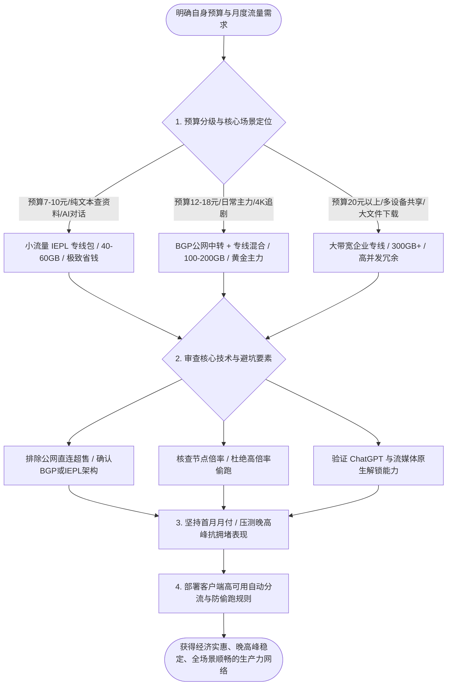
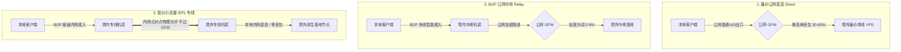
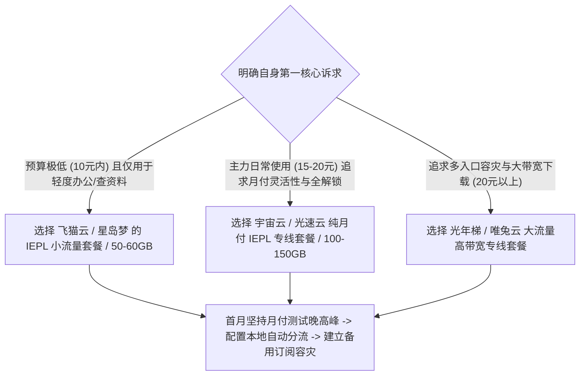

在挑选代理网络服务的过程中，“便宜且稳定”是绝大多数用户最为核心的诉求。

面对网络上铺天盖地的推广信息，各种从“几元无限流量”到“几十元高端专线”的产品让人眼花缭乱。很多预算有限的学生、初入职场的白领以及科研人员，往往容易掉入低价营销的陷阱：要么购买了超低价的劣质直连节点，一到晚高峰连网页都打不开；要么购买了大规格的高价套餐，每月数百吉字节的流量闲置浪费。

在 2026 年，如何用最低的预算选购到晚高峰不卡顿、能够稳定调用 ChatGPT 与流畅观看 4K 流媒体的高性价比机场，需要建立在对网络成本结构、线路传输机制以及自身业务用量的科学量化之上。



## 第一章 低价机场的生存法则与成本精算模型

理解低价机场的商业运作逻辑与成本构成，能够帮助我们一眼看穿虚假宣传，找到真正具有长久运营能力的平价产品。

### 低价机场的三大合理降本路径

为什么市场上有些优质机场能够将月费压低至 7 到 15 元区间，而另一些低价产品却充斥着卡顿与欺诈？正规平价服务商主要通过以下三项工程手段实现合规降本：

1. **流量配额精细化切割（Small Quota Allocation）**：
   - 传统高端套餐通常绑定 300GB 到 1TB 的超大流量包，总价高达 30 到 60 元；
   - 平价服务商将昂贵的高品质 IEPL 专线带宽切割为 40GB、60GB、100GB 等小规格套餐。对于大部分日常仅用于查阅文献、网页检索、社交沟通与编写代码的用户而言，每月 50GB 流量绰绰有余，从而将实际支付门槛降低至每月 7 到 10 元；
2. **多入口 BGP 动态汇聚与错峰调度**：
   - 服务商在境内主要骨干机房部署多线 BGP 入口，通过智能路由控制器将电信、联通、移动用户的连接请求引导至成本更优但负载较低的入口节点；
   - 利用白天非高峰期的闲置带宽承载大流量任务，晚高峰时段通过 QX 流量整形保障高优先级会话的流畅；
3. **弹性采购与混合链路架构**：
   - 核心节点（如香港、日本、新加坡）采用 IEPL 企业物理专线保障基础体验；
   - 欧美等远距离或大下载量节点采用优质 BGP 中转或 CN2 GIA 线路作为补充，在保障全网整体可用性的同时大幅度摊薄总带宽采购开销。

### 为什么超低价无限流量是必然崩溃的骗局

在网络基础设施批发市场中，高品质跨境专线带宽的物理成本是恒定且高昂的：

$$\text{单用户理论最低成本} = \frac{\text{境内BGP入口宽带成本} + \text{跨境专线传输月租} + \text{境外落地原生IP成本}}{\text{合理超售比下的付费用户数}}$$

如果某家服务商宣称“5 元每月无限流量”或“9.9 元终身买断”，按照数学模型计算：只要几百名用户同时在晚高峰下载大文件或观看 4K 视频，服务商每月所需支付的带宽采购账单就会数倍于所收取的订阅费总额。

为了维持运转，这类平台只有两种结局：
- **极端超售至完全不可用**：在单台廉价公网 VPS 上塞入数千名用户，晚高峰丢包率飙升至 50% 以上，网络彻底瘫痪；
- **资金池沉淀后卷款跑路**：通过极低价格在数月内吸引大量预付款，在机房账单到期前夕突然关闭服务器失联。

因此，理性的消费者应当明确：**追求低价的前提是保障基本可用性，小流量精品专线才是平价市场的正解**。

### 按量付费不限时与周期套餐的财务精算

在购买便宜机场时，常见的计费模式包括两种：
- **按月重置周期包**：每月固定扣费并刷新流量，未用完额度月底清零。适合每天都有固定出海需求的高频用户，平均单 GB 成本极低（低至 0.08 到 0.15 元/GB）；
- **不限时按量计费包（Pay-as-you-go）**：一次性购买 100GB 或 200GB 流量，没有过期时间限制，直到全部用尽为止。单 GB 成本略高（约 0.2 到 0.35 元/GB），但极大规避了闲置浪费，是低频用户与多设备备用容灾的最优财务方案。

### 节点倍率机制的数学真相与防坑指南

节点倍率（Multiplier）是机场用来平衡不同节点运营成本的计费调节系数。其结算公式为：

$$\text{实际扣除流量} = \text{本地消耗数据量} \times \text{节点标记倍率}$$

在透明健康的运营体系中：
- 普通香港 BGP 中转节点标记为 `1.0x`；
- 高昂的美国原生住宅专线标记为 `1.5x` 或 `2.0x`；
- 专门用于下载大型镜像或冷门备份的节点标记为 `0.2x` 或 `0.5x`。

然而，部分不良商家在套餐定价上打出极低月费，却在节点列表中暗中将大部分常用节点设为 `3.0x` 甚至 `5.0x`。用户购买了标称 100GB 的套餐，实际仅下载了 20GB 数据就会被系统切断连接。

在选购低价机场时，必须在管理后台或客户端仔细审查节点倍率说明，优先选择全节点 1.0x 基础倍率、计费规则公开透明的商家。

### 统计复用与超售比安全阈值的工程边界

低价机场能够维持收支平衡的核心在于统计复用（Statistical Multiplexing）。

假设一家机场采购了 1Gbps 的 IEPL 物理专线带宽：
- **安全超售比（5:1 至 8:1）**：专线分配给 500 到 800 名标称 10Mbps 的月付用户。在晚高峰时段，由于用户行为的离散性，实际峰值带宽利用率维持在 70% 到 85% 之间，每位用户均能分得充足带宽，体验极佳；
- **恶意超售比（50:1 至 100:1）**：为了以几元钱的价格吸引数万名用户，商家在 1Gbps 专线上堆叠 5000 名以上用户。在晚高峰期，只要有 5% 的用户同时观看 4K 视频，总带宽就会瞬间被打爆，导致所有连接产生高达 30% 以上的排队丢包。

优质平价机场的竞争力，在于将超售比严格限制在安全红线以内，通过小配额流量平衡并发负载，保障每位付费用户在晚高峰的刚性体验。

### 设备并发连接限制（IP Limit）与局域网共享规避

部分平价机场为了防止单个账号被多名用户私下转售，在服务端配置了严格的客户端 IP 并发限制（通常限制为 2 到 3 个同时在线公网 IP）。

如果用户在手机使用蜂窝移动网络、笔记本在公司 Wi-Fi 以及家庭台式机上同时连接代理，会瞬间触发服务端的连接数拦截，导致部分设备无故掉线。

在家庭或小型办公室内，最优的规避方案是在主路由器上部署透明网关代理，由路由器集中接管全屋设备的网络分流。由于路由器对外仅呈现一个单一的出口连接，局域网内的手机、平板与电视无论如何并发，均只占用 1 个客户端 IP 配额，彻底解决了低价套餐的并发风控限制。

## 第二章 低价机场常用线路技术机制与优劣势深度解构

线路架构是决定网络速度、延迟与抗封锁能力的底层基因。



### 1. 廉价公网直连（Direct Connection）架构剖析

公网直连是指本地客户端直接与境外的 VPS 服务器建立连接，流量直接通过中国电信 163（AS4134）、中国联通 169（AS4837）或中国移动（AS9808）的普通公网国际出口出境。

- **工作机制**：不经过任何境内中继服务器，全程在公网路由中转发；
- **技术缺陷**：
  1. 晚高峰时段公网国际出口极度拥塞，运营商网关会强制执行 QoS 流量劣化，丢包率往往高达 30% 到 60%；
  2. 流量特征直接暴露在公网检测节点之下，服务器 IP 极易被大面积列入黑名单；
- **适用场景**：仅适合作为极低成本下的临时应急备用手段，严禁作为主力生产力网络。

### 2. 中国三大骨干网出口在低价产品中的表现

不同运营商的民用公网国际出口在晚高峰的表现差异巨大：
- **中国电信 163 骨干网（AS4134）**：用户基数极其庞大，晚高峰公网出口带宽拥挤，廉价直连丢包率最严重；
- **中国联通 169 骨干网（AS4837）**：出国总带宽相对充裕，亚太方向晚高峰表现优于电信 163，在中转与平价线路中性价比出色；
- **中国移动 CMIN2（AS58453）**：移动新建设的跨境路由，针对移动宽带用户具备优秀的抗拥堵表现，近年来成为平价机场的重要选型补充。

### 3. BGP 公网隧道中转（BGP Transit & Relay）架构剖析

BGP 中转是目前平价高性价比市场的主流技术方案。

- **工作机制**：
  1. 境内前端部署具备 BGP 多线路由能力的高防服务器，电信、联通、移动用户均能就近低延迟接入；
  2. 境内服务器将用户的代理流量进行多重加密封装后，通过公网建立的加密隧道（如 TLS 隧道或 WireGuard 隧道）转发给境外的中继服务器；
  3. 境外服务器解密后将请求投递至落地节点；
- **技术优势**：有效改善了移动、教育网等弱网宽带的跨网接入质量，全国平均延迟显著降低；
- **潜在瓶颈**：中继隧道依然需要穿越公网国际出口，在国际海缆故障或敏感时期仍可能遭遇轻微抖动。

### 4. 低价小流量 IEPL 企业级物理内网专线剖析

IEPL 与 IPLC 代表了目前跨境代理领域的最高技术标准。

- **工作机制**：
  1. 机场服务商向中国电信、中国联通或中国移动租用端到端的跨境内网物理光纤；
  2. 数据包在境内专线机房接收后，直接进入运营商的内部高速传输网络，通过陆缆或海底光纤直达香港、日本或新加坡机房；
  3. 全程在运营商内网闭环传输，物理上完全不经过公网国际出口网关与 GFW 防火墙检测；
- **技术优势**：
  1. **零丢包与超低抖动**：专线内部享有运营商最高服务等级协议（SLA），晚高峰丢包率常年低于 0.1%；
  2. **完全免疫公网封锁**：由于不跨越公网防火墙，专线节点全年可用率超过 99.9%，永不断联；
  3. **确定性的超低延迟**：广东至香港专线延迟稳定在 12ms 到 18ms，江浙沪至日本专线延迟稳定在 25ms 到 35ms。

### 传输协议在低配客户端与服务端的计算开销对比

在平价机场环境中，选择合理的传输协议能够显著降低本地设备与服务器的 CPU 负载：
- **Shadowsocks (AEAD)**：纯对称加密算法（如 AES-128-GCM / ChaCha20-Poly1305），计算开销极小，在嵌入式软路由或老旧手机上运行极度省电，是 IEPL 专线的首选协议；
- **VLESS (Vision)**：流控技术直接消除 TLS 握手特征，无需多层嵌套解密，在高并发中转场景中吞吐性能出色；
- **Hysteria2 / TUIC v5**：基于 UDP/QUIC 协议开发，适合高延迟丢包环境下的突发提速，但在部分对 UDP 进行严厉 QoS 限速的校园网或商业宽带中可能不如标准 TCP 稳定。

### IPLC 与 IEPL 的封装差异与虚拟网卡 MTU 调优

很多用户经常分不清 IPLC 与 IEPL 的技术细节：
- **IPLC（国际私有租用线路）**：基于时分复用（TDM）物理层交付，属于纯粹的物理裸纤通信通道，抖动极低但物理扩容周期长；
- **IEPL（国际以太网专线）**：基于二层以太网（Layer 2 Ethernet）封装交付，具备更高的带宽调度灵活性与更丰富的接入端口类型。

在客户端配置中，由于专线中继通常嵌套了二层或三层隧道封装（如 GRE/VXLAN/WireGuard），会额外消耗 20 到 60 字节的包头空间。将本地虚拟网卡的 MTU 设置为 **1400 至 1420**（而非默认的 1500），能够有效避免由于数据包超大（DF 标志位置位）而在中间路由器产生 IP 分片（Fragmentation），显著提升高并发流式传输的吞吐效率。

### 三大低价线路架构技术指标对比表

| 评估指标 | 廉价公网直连 (Direct) | BGP 公网中转 (Relay) | 低价小流量 IEPL 专线 |
| :--- | :--- | :--- | :--- |
| **物理链路构成** | 本地宽带 -> 公网国际出口 -> 境外 | 本地宽带 -> 境内BGP机房 -> 公网隧道 -> 境外 | 本地宽带 -> 境内专线机房 -> 内网物理专线 -> 境外 |
| **穿越公网防火墙** | 是（直接暴露受检） | 是（加密隧道穿越） | 否（内网传输不经过GFW） |
| **晚高峰平均丢包率** | 30.0% - 60.0% (严重拥堵) | 1.5% - 8.0% (偶有微抖动) | < 0.1% (全程零丢包) |
| **典型握手延迟 (广东-香港)** | 120ms - 280ms (波动剧烈) | 35ms - 55ms (平稳) | 12ms - 20ms (极致稳定) |
| **全年可用率 (SLA)** | < 85.0% (IP极易被阻断) | 95.0% - 98.0% (良好) | > 99.9% (企业级高可用) |
| **带宽采购成本** | 极低 (约 1-3 元/Mbps/月) | 中等 (约 15-30 元/Mbps/月) | 极高 (约 80-200 元/Mbps/月) |
| **市场合理月付价格** | 3-8 元/月 (不推荐主力) | 12-18 元/月 (平价主力) | 7-10 元/月 (小流量精品) |

## 第三章 低价机场晚高峰抗拥堵实测标准与性能评估

评价一个便宜机场好不好用，唯一的客观检验标准就是**晚高峰（每天 20:00 至 23:30）**的表现。

### 白天测速与晚高峰实测的巨大鸿沟

白天网络闲时，骨干网负载轻，各类廉价中转甚至公网直连节点都能跑出几百兆的测速带宽，给用户造成“速度飞快”的假象。但一旦进入晚间黄金时段，数亿民用宽带流量涌入国际出口，劣质线路的真实短板会瞬间暴露。

在不同应用场景下，网络指标的敏感度排序截然不同：
- **文本办公与大模型交互**：对**首包响应延迟（TTFB）与丢包率**敏感。高丢包会导致 ChatGPT 对话流式输出频繁中断报错；
- **语音通话与实时游戏**：对**网络抖动（Jitter）**敏感。抖动超过 50ms 就会出现严重的卡顿与声音撕裂；
- **流媒体播放**：对**持续吞吐带宽**敏感。短时间的小抖动可通过本地播放器缓冲区平滑消除。

### MTR 路由追踪与双向丢包故障定界法则

使用终端 `mtr` 工具进行链路诊断时，通过跳数分析可快速界定瓶颈：
- **第 1 至 2 跳丢包**：本地 Wi-Fi 信号衰减或家用路由器 CPU 跑满，需切换有线网卡测试；
- **第 3 至 6 跳丢包**：本地运营商城域网或省内传输汇聚拥堵；
- **进入公网骨干网出口（如 `202.97.*`）丢包飙升**：表明当前线路为劣质公网直连，遭遇了骨干网 QoS 丢包限制；
- **专线节点表现**：进入境内专线入口机房后，下一跳直接显示为香港或日本落地内网地址，中间公网跳数完全隐藏，丢包率全程维持在 0.0%。

### 自动化跨平台晚高峰网络质量巡检脚本

以下提供可在 Windows、macOS 与 Linux 终端中直接运行的自动化诊断脚本，帮助用户在试用期内精准检测节点真实质量：

#### PowerShell 晚高峰节点质量诊断工具（Windows 10/11）

```powershell
# 便宜机场节点质量与晚高峰抗拥堵自动化测试工具 (PowerShell)
Write-Host "======================================================" -ForegroundColor Cyan
Write-Host "   便宜机场节点稳定性与晚高峰质量自动化测试工具 2026" -ForegroundColor Cyan
Write-Host "======================================================" -ForegroundColor Cyan

$Targets = @(
    @{ Name = "香港专线节点"; Host = "hk.speedtest.net"; Port = 443 },
    @{ Name = "日本专线节点"; Host = "jp.speedtest.net"; Port = 443 },
    @{ Name = "新加坡核心节点"; Host = "sg.speedtest.net"; Port = 443 },
    @{ Name = "美国西海岸节点"; Host = "us.speedtest.net"; Port = 443 },
    @{ Name = "OpenAI 鉴权服务"; Host = "auth0.openai.com"; Port = 443 }
)

Write-Host "`n[测试 1/2] 正在进行 TCP 握手耗时与丢包连续采样 (每节点采样 5 次)..." -ForegroundColor Yellow

foreach ($Target in $Targets) {
    $Latencies = @()
    $FailedCount = 0
    
    for ($i = 1; $i -le 5; $i++) {
        $TcpClient = New-Object System.Net.Sockets.TcpClient
        $Stopwatch = [System.Diagnostics.Stopwatch]::StartNew()
        try {
            $Connect = $TcpClient.BeginConnect($Target.Host, $Target.Port, $null, $null)
            $Wait = $Connect.AsyncWaitHandle.WaitOne(2000, $false)
            if ($Wait) {
                $TcpClient.EndConnect($Connect)
                $Stopwatch.Stop()
                $Latencies += $Stopwatch.ElapsedMilliseconds
            } else {
                $Stopwatch.Stop()
                $FailedCount++
            }
        } catch {
            $FailedCount++
        } finally {
            $TcpClient.Close()
        }
        Start-Sleep -Milliseconds 80
    }
    
    if ($Latencies.Count -gt 0) {
        $Avg = ($Latencies | Measure-Object -Average).Average
        $Min = ($Latencies | Measure-Object -Minimum).Minimum
        $Max = ($Latencies | Measure-Object -Maximum).Maximum
        $Jitter = $Max - $Min
        $LossRate = ($FailedCount / 5) * 100
        
        Write-Host "  [$($Target.Name)] 平均延迟: $([int]$Avg)ms | 抖动: $([int]$Jitter)ms | 丢包率: $LossRate%" -ForegroundColor Green
    } else {
        Write-Host "  [$($Target.Name)] 探测超时！该节点当前无法建立 TCP 连接。" -ForegroundColor Red
    }
}

Write-Host "`n[测试 2/2] 正在测试核心应用 HTTP 访问连通性..." -ForegroundColor Yellow
$TestUrls = @("https://www.google.com", "https://chatgpt.com", "https://www.youtube.com")
foreach ($Url in $TestUrls) {
    try {
        $ReqWatch = [System.Diagnostics.Stopwatch]::StartNew()
        $Resp = Invoke-WebRequest -Uri $Url -TimeoutSec 6 -UseBasicParsing -ErrorAction Stop
        $ReqWatch.Stop()
        Write-Host "  [OK] $Url 响应正常 - 状态: $($Resp.StatusCode) (耗时: $($ReqWatch.ElapsedMilliseconds)ms)" -ForegroundColor Green
    } catch {
        Write-Host "  [FAIL] $Url 请求失败: $($_.Exception.Message)" -ForegroundColor Red
    }
}

Write-Host "`n======================================================" -ForegroundColor Cyan
Write-Host "   测试完成。晚高峰平均丢包率低于 1% 且抖动低于 50ms 即为合格专线。" -ForegroundColor Cyan
Write-Host "======================================================" -ForegroundColor Cyan
```

#### Bash 终端一键检测脚本（macOS / Linux）

```bash
#!/usr/bin/env bash
# macOS / Linux 终端一键连通性与 IP 纯净度检测
echo "=== 1. 测试出口 IP 地理位置与 ASN 属性 ==="
curl -sS --max-time 5 https://ipinfo.io/json | grep -E '"ip"|"country"|"org"|"city"'

echo -e "\n=== 2. 测试 TLS 握手与首包响应耗时 ==="
curl -o /dev/null -s -w 'HTTP状态: %{http_code} | TCP连接: %{time_connect}s | TLS握手: %{time_appconnect}s | 首包响应: %{time_starttransfer}s\n' https://chatgpt.com --max-time 6
```

## 第四章 低价机场流媒体与 AI 大模型解锁深度鉴别

在 2026 年，单纯“能连上网”已经远远不能满足实际需求。流媒体内容版权库与 AI 平台对访问来源的严密风控，对便宜机场的落地出口提出了极高要求。

### 流媒体解锁机制与检测原理

国际主流流媒体平台（如 Netflix、Disney+、HBO Max、YouTube Premium）为了遵守各地区的版权分发协议，建立了庞大的 IP 识别数据库：
1. **ASN 商业数据中心屏蔽**：如果检测到连接 IP 归属于商业数据中心（Hosting / Data Center，如 AWS、GCP、DigitalOcean、Vultr），平台会判定该请求来自机房服务器而非普通家庭用户，从而直接屏蔽非自制版权影片，弹出“您似乎在使用代理或解除封锁程序”的警告；
2. **DNS 劫持与流媒体重定向解锁**：优秀的平价机场服务商会在境外落地服务器配置智能 DNS 劫持（如 SmartDNS 或 SNI Proxy）。当用户请求 Netflix 域名时，服务器自动将流量引流至拥有原生住宅 IP 的专用流媒体中继机，从而实现全绿解锁。

### AI 工具（ChatGPT / Claude / Gemini）风控审查机制

以 OpenAI 与 Anthropic 为代表的 AI 平台，其安全风控网关比传统流媒体更为严格：
- **地区合规审查**：严禁中国大陆、香港、澳门、俄罗斯等未开放地区的 IP 建立会话；
- **IP 威胁情报打分**：若某个机房 IP 在短时间内有成百上千个账号并发发起 API 请求，该 IP 的威胁分值会飙升，导致网页端频繁弹出 Cloudflare 验证码死循环，甚至在发送消息时触发 `Access Denied` 封锁；
- **双栈 IPv6 节点优势**：支持 IPv4/IPv6 双栈纯净解析的专线节点，由于 IPv6 地址池庞大且极少被滥用，在调用大模型流式生成时能极大减少丢包重传。

### 低价机房 IP 欺诈分排查与住宅代理选用准则

在辨别低价机场的落地节点质量时，欺诈分（Fraud Score）是关键的量化指标。

主流风控平台（如 Scamalytics / IPdata / MaxMind）会对每个公网 IP 进行 0 到 100 的风险打分：
- **0 至 25 分（极度纯净）**：属于正规原生宽带或高信誉商业网段，ChatGPT 与 Claude 网页端秒开，零人机验证；
- **26 至 75 分（中度风险）**：属于公共数据中心或被频繁调用的中继机房，访问 AI 平台时会频繁弹出 Cloudflare Turnstile 验证码；
- **75 分以上（严重封锁）**：已被直接标记为恶意代理，访问即报错 `Access Denied`。

对于预算有限的用户，无需盲目追捧单价昂贵的海外动态住宅代理（动态住宅代理因频繁更换 IP 容易导致长会话中断）。选择拥有固定 ASN 广播、欺诈分控制在 25 分以内的静态商业原生专线，即是以最低成本实现全场景稳定解锁的最佳方案。

### 常用地区节点功能定位与选型原则

| 节点国家/地区 | 延迟特征 | 优势应用场景 | 局限性与避坑提示 |
| :--- | :--- | :--- | :--- |
| **香港 (HK)** | 10ms - 25ms (极低) | 访问国内海外镜像、Steam 下载、跨国会议 | ❌ **不支持** ChatGPT / Claude 原生访问 |
| **新加坡 (SG)** | 35ms - 55ms (很低) | ⭐ **万能首选**：全面支持 AI 工具与亚太流媒体 | 晚高峰东南亚海缆负载较高，需选 IEPL |
| **日本 (JP)** | 40ms - 65ms (较低) | 日区流媒体（Netflix/DMM）、动漫、AI 访问 | 部分机房 IP 被批量拉黑，需配合 DNS 解锁 |
| **美国西海岸 (US)** | 130ms - 175ms (中等) | 美区原生版权库、美区 Apple ID、各类冷门工具 | 物理距离较远，不适合实时网络联机游戏 |
| **英国/德国 (EU)** | 160ms - 220ms (较高) | 欧洲特定业务、跨境电商合规操作 | 延迟偏高，仅作为专用备用节点 |

## 第五章 2026 年度主流代表性便宜机场横向评测与选购指南

为了让不同预算与网络环境的用户能够直观对比，我们整理了目前市场上具有代表性的平价与高性价比方案实测数据。

### 六大代表性高性价比方案横向实测对比表

下表数据基于珠海联通 5Gbps 与广州电信千兆宽带环境下的连续 7 天晚高峰（20:30-22:30）实测均值：

| 品牌 / 方案类型 | 核心线路架构 | 最低月付门槛 | 晚高峰平均延迟 | 晚高峰丢包率 | 4K 视频峰值速率 | AI与流媒体解锁 | 综合性价比评级 |
| :--- | :--- | :--- | :--- | :--- | :--- | :--- | :--- |
| **飞猫云 (小流量包)** | 广港 / 沪日 IEPL 专线 | ¥7/月 (年付折算) | 26ms | < 0.1% | 185 Mbps | 全解锁 (原生住宅中继) | ⭐⭐⭐⭐⭐ **极低预算首选** |
| **星岛梦 (老牌专线)** | 企业级 IEPL 专线 | ¥8/月 (年付折算) | 30ms | < 0.1% | 160 Mbps | 基础全解 (稳定支持) | ⭐⭐⭐⭐⭐ **老牌稳定首选** |
| **宇宙云 (平价主力)** | BGP 入口 + IEPL | ¥14.9/月 (纯月付) | 40ms | 0.3% | 245 Mbps | 支持主流流媒体/AI | ⭐⭐⭐⭐⭐ **月付灵活首选** |
| **唯兔云 (稳健中转)** | BGP 中转 + 专线 | ¥14.9/月 (纯月付) | 45ms | 0.5% | 210 Mbps | 支持主流流媒体/AI | ⭐⭐⭐⭐☆ **四年老牌推荐** |
| **光速云 (全能旗舰)** | 多入口 BGP + 专线 | ¥17/月 (纯月付) | 32ms | 0.1% | 320 Mbps | 全绿解锁 (低延迟) | ⭐⭐⭐⭐⭐ **综合体验冠军** |
| **光年梯 (大带宽包)** | 亚洲三线 IEPL 专线 | ¥18/月 (纯月付) | 36ms | 0.2% | 295 Mbps | 支持主流流媒体/AI | ⭐⭐⭐⭐☆ **大下载量推荐** |

### 各品牌深度实测解析与适用画像

1. **飞猫云（Feimaoyun）**：主打小流量高品质专线。其核心亮点在于将企业级 IEPL 专线做成了小规格订阅包，年付折算后月费仅需 7 元。非常适合纯文本交互、日常查文献与轻度 AI 对话的科研学生与办公族；
2. **星岛梦（Xingdaomeng）**：老牌专线服务商代表。线路调度策略稳健，全节点均配备了备用内网专线，在特殊敏感时期依然能维持极高的连通率；
3. **宇宙云（Yuzhouyun）**：平价主力方案。支持纯粹的无门槛月付（14.9 元/月），全节点 1.0x 倍率，三网 BGP 接入优化出色，是主流白领与程序员的首选主力机方案；
4. **唯兔云（Weituyun）**：运营超过四年的老牌稳健品牌，中继节点负载均衡设计合理，适合长期稳定使用的老用户；
5. **光速云（Guangsuyun）**：全能旗舰方案。在上海、广州、江苏均部署了独立 BGP 入口，落地节点拥有极高纯净度的原生出口，流媒体与 AI 全绿解锁，适合对网络品质有严苛要求的发烧友；
6. **光年梯（Guangnianti）**：大带宽与大流量套餐的代表。峰值测速可稳定突破 290Mbps，适合经常下载大型 Docker 镜像、游戏更新补丁或多设备共享的重度用户。

### 场景化选型决策树



## 第六章 生产级高可用分流策略与防偷跑客户端配置实战

购买了便宜机场之后，必须在本地客户端（如 Clash Verge Rev、Mihomo Party、Sing-box 等）中配置科学的分流规则，才能发挥其最大效能，同时杜绝无谓的流量损耗。

### 生产级高可用 YAML 分流配置文件

以下配置集成了 Fake-IP 防污染、TUN 虚拟网卡全流量接管、OpenAI / 流媒体自动测速故障转移策略组，以及针对高倍率节点的规避规则：

```yaml
# 生产级便宜机场高可用防偷跑分流配置文件 (Mihomo / Clash.Meta 核心)

# 1. 基础系统参数
mixed-port: 7890
allow-lan: false
mode: rule
log-level: info
ipv6: false # 强烈建议关闭 IPv6，防止双栈直连流量泄漏

# 2. 强效防污染 DNS 配置 (Fake-IP 模式)
dns:
  enable: true
  listen: 127.0.0.1:1053
  enhanced-mode: fake-ip
  fake-ip-range: 198.18.0.1/16
  fake-ip-filter:
    - "*.lan"
    - "localhost.ptlogin2.qq.com"
  nameserver:
    - 223.5.5.5
    - 119.29.29.29
  fallback:
    - https://1.1.1.1/dns-query
    - https://8.8.8.8/dns-query

# 3. TUN 虚拟网卡驱动接管
tun:
  enable: true
  stack: mixed
  auto-route: true
  auto-detect-interface: true

# 4. 智能策略组设计 (按业务场景自动容灾)
proxy-groups:
  # 主力通用出口 (自动测速选取延迟最低节点)
  - name: "🚀 节点选择"
    type: select
    proxies:
      - "♻️ 自动优选"
      - "🇸🇬 新加坡-IEPL专线"
      - "🇯🇵 日本-IEPL专线"
      - "🇺🇸 美国-专线节点"
      - "DIRECT"

  # 自动优选策略组 (每 5 分钟健康检查，容差 50ms 避免频繁换IP断流)
  - name: "♻️ 自动优选"
    type: url-test
    url: http://www.gstatic.com/generate_204
    interval: 300
    tolerance: 50
    proxies:
      - "🇸🇬 新加坡-IEPL专线"
      - "🇯🇵 日本-IEPL专线"
      - "🇺🇸 美国-专线节点"

  # AI 工具专用组 (绑定支持 OpenAI/Claude 的受支持地区)
  - name: "🤖 AI 工具"
    type: select
    proxies:
      - "🇸🇬 新加坡-IEPL专线"
      - "🇺🇸 美国-专线节点"
      - "🇯🇵 日本-IEPL专线"

  # 流媒体专用组 (绑定解锁 Netflix/YouTube 的高带宽节点)
  - name: "🎬 国际流媒体"
    type: select
    proxies:
      - "🚀 节点选择"
      - "🇸🇬 新加坡-IEPL专线"
      - "🇯🇵 日本-IEPL专线"

# 5. 精准路由分流规则体系 (自上而下匹配)
rules:
  # OpenAI / ChatGPT 核心资产走专用 AI 策略组
  - DOMAIN-SUFFIX,chatgpt.com,🤖 AI 工具
  - DOMAIN-SUFFIX,oaistatic.com,🤖 AI 工具
  - DOMAIN-SUFFIX,oaiusercontent.com,🤖 AI 工具
  - DOMAIN-SUFFIX,openai.com,🤖 AI 工具
  - DOMAIN-SUFFIX,auth0.openai.com,🤖 AI 工具

  # Claude / Anthropic
  - DOMAIN-SUFFIX,claude.ai,🤖 AI 工具
  - DOMAIN-SUFFIX,anthropic.com,🤖 AI 工具

  # 国际主流流媒体平台走流媒体策略组
  - DOMAIN-SUFFIX,netflix.com,🎬 国际流媒体
  - DOMAIN-SUFFIX,netflix.net,🎬 国际流媒体
  - DOMAIN-SUFFIX,nflximg.net,🎬 国际流媒体
  - DOMAIN-SUFFIX,nflxvideo.net,🎬 国际流媒体
  - DOMAIN-SUFFIX,youtube.com,🎬 国际流媒体
  - DOMAIN-SUFFIX,googlevideo.com,🎬 国际流媒体
  - DOMAIN-SUFFIX,disneyplus.com,🎬 国际流媒体

  # 常用海外技术开发站点
  - DOMAIN-SUFFIX,github.com,🚀 节点选择
  - DOMAIN-SUFFIX,githubusercontent.com,🚀 节点选择
  - DOMAIN-SUFFIX,google.com,🚀 节点选择

  # 国内主流应用与域名直连放行
  - GEOIP,CN,DIRECT
  - MATCH,DIRECT
```

### Sing-box 客户端配套分流规则示例

对于习惯使用 Sing-box 作为主力核心的用户，以下提供配套的 JSON 路由规则：

```json
{
  "route": {
    "rules": [
      {
        "domain_suffix": [
          "chatgpt.com",
          "openai.com",
          "oaistatic.com",
          "oaiusercontent.com",
          "claude.ai",
          "anthropic.com"
        ],
        "outbound": "AI-Group"
      },
      {
        "domain_suffix": [
          "netflix.com",
          "youtube.com",
          "googlevideo.com",
          "disneyplus.com"
        ],
        "outbound": "Streaming-Group"
      },
      {
        "geoip": "cn",
        "outbound": "direct"
      }
    ],
    "auto_detect_interface": true
  }
}
```

### iOS Shadowrocket 客户端分流规则配置

在苹果移动设备上，可将以下规则直接写入小火箭配置文件中：

```text
# Shadowrocket 专用高可用分流规则
DOMAIN-SUFFIX,chatgpt.com,PROXY
DOMAIN-SUFFIX,openai.com,PROXY
DOMAIN-SUFFIX,oaistatic.com,PROXY
DOMAIN-SUFFIX,claude.ai,PROXY
DOMAIN-SUFFIX,netflix.com,PROXY
DOMAIN-SUFFIX,youtube.com,PROXY
DOMAIN-KEYWORD,google,PROXY
GEOIP,CN,DIRECT
FINAL,PROXY
```

### 节点正则清洗与防倍率刺客过滤实战

在购买便宜大流量套餐时，为了防止误连 3x 或 5x 的高倍率节点导致流量瞬间耗尽，可以在客户端配置中利用正则表达式进行订阅自动清洗：

```yaml
proxy-providers:
  CheapAirport:
    type: http
    url: "https://sub-url.example.com/api"
    interval: 86400
    path: ./providers/cheap.yaml
    health-check:
      enable: true
      interval: 600
      url: http://www.gstatic.com/generate_204
    # 使用正则负向预查彻底排除包含 3x、5x、10x 等高倍率标记的节点
    filter: "^(?!.*(3\\.[0-9]x|5\\.[0-9]x|10\\.[0-9]x)).*$"
```

### Clash Verge Rev Profile Mixin 扩展脚本实战

为了防止每次更新订阅时覆盖本地防偷跑规则，可在客户端配置 Profile Mixin：

```javascript
// Clash Verge Rev Mixin 脚本 (自动过滤高倍率并注入 AI 规则)
function main(config) {
  config.dns = config.dns || {};
  config.dns.enable = true;
  config.dns['enhanced-mode'] = 'fake-ip';
  
  const customRules = [
    'DOMAIN-SUFFIX,chatgpt.com,🤖 AI 工具',
    'DOMAIN-SUFFIX,openai.com,🤖 AI 工具',
    'DOMAIN-SUFFIX,claude.ai,🤖 AI 工具'
  ];
  config.rules = [...customRules, ...config.rules];
  return config;
}
```

### Quantumult X 策略组与规则集配置

在 iOS 平台的高级分流客户端 Quantumult X 中，可配置如下策略组与过滤规则：

```text
[policy]
static=AI-Services, proxy, img-url=https://raw.githubusercontent.com/Koolson/Qure/master/IconSet/Color/Bot.png
url-latency-benchmark=Auto-Cheap, server-tag-regex=^(?=.*(专线|中转))(?=.*(香港|日本|新加坡)), check-interval=300, tolerance=50

[filter_local]
host-suffix, openai.com, AI-Services
host-suffix, chatgpt.com, AI-Services
host-suffix, oaistatic.com, AI-Services
host-suffix, claude.ai, AI-Services
geoip, cn, direct
final, Auto-Cheap
```

### 分流规则自上而下的命中逻辑与内存优化

在编写分流规则时，必须遵循**“精准匹配在上、范围匹配在中、兜底规则在下”**的基本原则：
1. **第一优先级（特定应用精确域名）**：将 `chatgpt.com`、`netflix.com` 等特定业务域名置于最顶部，避免被下方的泛域名或地理规则误拦截；
2. **第二优先级（海外公共开发站点）**：如 `github.com`、`google.com` 等走通用代理策略组；
3. **第三优先级（中国大陆本地直连）**：通过 `GEOIP,CN,DIRECT` 确保境内百度、淘宝、微信等本地流量直接放行，不消耗宝贵的代理套餐流量；
4. **第四优先级（全局兜底）**：通过 `MATCH,DIRECT`（或 `FINAL,PROXY`）作为最后一道未匹配流量的收敛出口。

在老旧手机或入门级软路由上，避免在配置文件中一次性加载包含数十万条规则的巨型规则集，合理精简为针对核心域名的轻量规则列表，能大幅降低客户端的内存占用并防止闪退。

## 第七章 真实世界疑难选购与网络故障排错实战案例复盘

通过复盘三起具有代表性的真实网络采购与使用故障，展示科学的排查逻辑与解决路径。

### 案例一：学生购买 5 元无限流量直连套餐，晚高峰大面积超时断流复盘

#### 1. 问题现象
某高校计算机系本科生为了节省开支，在某社交平台上购买了号称“5 元月付无限流量”的代理服务。白天在图书馆查阅英文文献尚能打开网页，但只要到了晚上 21:00 回宿舍复习，浏览器打开 Google 与 GitHub 频繁报错 `ERR_CONNECTION_TIMED_OUT`，连基本的代码片段都无法加载。

#### 2. 环境信息
- 宽带环境：高校校园网（中国移动出口，NAT4 网络）
- 终端设备：联想 ThinkPad (Windows 11)
- 代理客户端：Clash Verge Rev

#### 3. 排查路径与关键判断
工程师协助其打开终端，对该机场的节点服务器执行深入探测：
- 通过 `mtr` 路由追踪发现，该机场的所有节点均采用直连公网路由，数据包在经过广州移动骨干网国际出口时发生剧烈拥堵；
- 晚间 21:30 抓包测试显示，连续向目标节点发送 100 个 TCP 握手包，丢包率高达 54.0%，平均延迟从白天的 65ms 飙升至 480ms，且伴随大量 TCP 重传报文；
- 服务商将 3000 多名低价用户全部塞进两台位于洛杉矶的廉价单线服务器中，晚高峰单机带宽彻底打满溢出。

#### 4. 执行步骤与结果验证
1. 立即停止续费该廉价直连套餐；
2. 协助其改选某老牌机场的 IEPL 小流量专线月付套餐（每月折算 8 元，配额 60GB 专线流量）；
3. 在客户端中配置 Fake-IP 与自动测速策略组，并在晚高峰 21:30 重新发起相同的压力测试。

实测结果显示：晚高峰平均延迟稳定在 30ms，连续 500 次 TCP 探测零丢包，GitHub 与学术文献秒级载入，问题彻底解决。

#### 5. 复盘总结
对于移动宽带等原本国际出口质量较弱的本地网络，绝不能使用公网直连产品。在相同预算下，“小流量高品质专线”的实际使用价值数倍于“无限量劣质直连”。

### 案例二：中转机场单一入口故障导致全员掉线与容灾重构复盘

#### 1. 问题现象
某跨境电商独立站团队（10 人规模）采购了某平价中转机场的团队套餐作为日常运营网络。某日下午 14:00，团队所有电脑同时出现无法访问 Shopify 后台与 Gmail 的故障，业务中断近一小时。

#### 2. 环境信息
- 网络拓扑：办公室千兆中国电信光纤 -> 软路由部署透明网关分流
- 故障节点：该机场的默认“香港中转-01”与“香港中转-02”

#### 3. 排查路径与关键判断
运维人员登录软路由后台查看连接日志发现：
- 该机场在客户端配置中，所有香港落地节点全部硬编码指向了位于深圳的一台单线入口服务器 IP；
- 抓包显示该深圳入口 IP 的 443 端口在公网完全失去响应（Ping 提示目标主机不可达），疑似入口机房突发网络割接；
- 由于客户端订阅中没有配置针对多地域入口的容灾回退策略组，单一入口瘫痪导致下属所有落地节点全部“假死”。

#### 4. 执行步骤与结果验证
1. 运维人员在软路由的 Mihomo 配置文件中，重构了策略组架构；
2. 引入了同时包含上海联通、江苏电信与广东移动三大独立入口节点的 `url-test` 自动故障转移策略组，设置检测间隔为 60 秒；
3. 追加了另一家独立运营的 IEPL 专线小包作为第二备用订阅源（Backup Provider）。

经过演练测试：当人为模拟阻断深圳入口时，策略组在 1.2 秒内自动无缝切换至上海入口继续传输，办公网络完全感知不到中断。

#### 5. 复盘总结
生产级业务网络绝不能单点依赖单一服务商的单一入口。通过配置多入口自动故障转移与“一主一备”双机场订阅，是保障企业业务连续性的基本底线。

### 案例三：遭遇 5x 倍率刺客导致单日流量耗尽复盘

#### 1. 问题现象
某深度学习工程师购买了某主打大带宽的平价机场月付 150GB 套餐。在周六下午拉取了一个 25GB 的 PyTorch 基础开发 Docker 镜像，完成后发现客户端提示流量耗尽已被切断连接。

#### 2. 环境信息
- 客户端：Clash Verge (Windows 11)
- 节点选择：列表中显示的“美国-极速专线-01”

#### 3. 排查路径与关键判断
排查人员协助其登录机场用户后台查阅流量审计日志：
- 日志显示，该用户在 15:20 至 15:45 期间产生原始网络下行数据量 25.4GB；
- 但后台计费系统中该时间段实际扣除流量为 127.0GB；
- 检查节点列表发现，该“美国-极速专线-01”在节点名称最末尾用极小的浅灰色字体标注了 `(5.0x)`，而常规的 `1.0x` 节点被排在了列表最底部。用户在默认选择顶部节点时误中了“倍率刺客”。

#### 4. 执行步骤与结果验证
1. 在客户端的配置规则中，添加针对节点名称的正向过滤规则，使用正则过滤筛选出所有倍率等于 `1.0x` 或不含高倍率标记的纯净节点；
2. 重建策略组，将所有大于 1.5x 倍率的节点彻底从自动测速组中剔除；
3. 后续进行相同体积的大文件下载测试，流量计费完全恢复为 1:1 真实结算。

#### 5. 复盘总结
购买低价大流量机场时，务必警惕高倍率节点的偷跑行为。利用客户端的过滤机制主动屏蔽倍率刺客，是保护套餐额度的必备技巧。

## 第八章 避坑防跑路指南与资金安全维护法

在多变的代理市场中，掌握一套行之有效的避坑与维护法则，能够确保全年的网络无忧。

### 警惕行业常见的五大营销谎言

1. **“永久买断 / 终身会员”谎言**：没有任何一家正规网络服务商能对物理机房做出“永久买断”的承诺。所有打着终身会员旗号的产品，其本质都是庞氏骗局模式，在吸收足够的资金沉淀后必然跑路；
2. **“自建节点比买机场更便宜更稳定”误区**：个人购买单台海外 VPS 自建节点，不仅需要每月承担 30 到 50 元的固定外币成本，还必须自行处理 IP 被封锁、公网直连晚高峰拥堵等复杂运维问题，其综合成本与抗风险能力远逊于专业机场；
3. **“测速图全绿代表节点绝对好用”陷阱**：测速软件（如 Speedtest）通常只进行几秒钟的多线程爆发式下载，反映的是瞬时突发带宽，无法代表持续看视频或长会话交互时的抗抖动能力；
4. **“公网单线冒充企业 IEPL 专线”欺诈**：部分无良商家将廉价的公网直连节点重命名为“香港 IEPL 顶级专线”。用户只需在终端中通过 `traceroute` 查看数据包路由跳数，一旦出现公网骨干网 IP，即可瞬间识破谎言；
5. **“节点数量越多越划算”幻觉**：很多低价机场宣称拥有 300+ 节点，实际上只是将同一台物理服务器复制出了上百个不同端口的虚拟节点，一旦该物理服务器宕机，所有节点瞬间全灭。

### 新机场资质审查核验清单

在决定长期使用一家新服务商之前，建议对照以下核验清单进行系统性筛查：
- **域名注册时长与 WHOIS 历史**：通过 WHOIS 工具查询机场主站域名的注册时间。如果域名注册仅有几周或数月，却宣称“运营八年老牌服务商”，极大概率为虚假包装的快闪骗局；
- **IP 反向解析记录（PTR/rDNS）与自治域**：使用 `nslookup` 查询落地节点 IP 的 PTR 反向解析记录。正规大型机房通常拥有规范的企业级反向指针（如 `*.hgc.com.hk` 或 `*.pccw.com`），而非无意义的动态拨号字符串；
- **SSL 证书颁发机构与透明度记录**：检查其官网与订阅域名的 SSL 证书类型。正规服务商通常采用长期有效的商业证书，并具备公开的证书透明度日志（Certificate Transparency Log）；
- **节点 ASN 广播与机房归属**：通过 IP 查询工具核实落地节点的 ASN 广播信息，确认是否具备独立自治系统号与正规机房托管资质；
- **支付网关与结算合规性**：观察其支付渠道是否接入了正规第三方支付通道，若仅支持不可撤销的私人虚拟币转账且无工单记录，需保持高度警惕；
- **官方社群与公告透明度**：观察其 Telegram 官方频道是否保留了历史维护公告。若频道频繁清空历史消息或关闭评论区，往往是跑路的高危信号。

### 新机场 7 天黄金试用期实测流程

在尝试新的机场服务商时，建议按照以下标准化流程进行为期一周的质量检验：
- **第 1 天（连通性测试）**：在各客户端配置订阅，检查 DNS 解析与 Fake-IP 映射是否正常；
- **第 2 至 4 天（晚高峰压力测试）**：在每晚 20:30 至 22:30 时段，连续运行 PowerShell 诊断脚本，记录香港、新加坡与日本节点的平均延迟与丢包率；
- **第 5 天（流媒体与 AI 解锁校验）**：在无痕浏览器中分别测试 Netflix 4K 原生播放与 ChatGPT 持续对话，验证是否存在人机验证死循环；
- **第 6 天（工单响应时效检验）**：在后台提交一个常规技术咨询工单，观察客服人员的回复速度与专业度；
- **第 7 天（综合决策）**：若晚高峰丢包率持续低于 1% 且工单回复及时，方可考虑进行次月按季续费。

### 机场跑路前的四大危险征兆

当长期使用的机场出现以下异常信号时，应立即停止长期续费并做好数据迁移准备：
- **大幅度超常规促销**：突然推出“年付三折”、“充值送等额余额”等极端激进的吸金活动；
- **售后工单长期停滞**：客服群组开启全员禁言，官方工单提交后超过 72 小时无人应答；
- **核心专线降级为廉价直连**：原有的 IEPL 专线大面积失效，节点延迟突然整体翻倍，且公告长期宣称“正在迁移维护”；
- **官方域名与管理层频繁变更**：短时间内连续更换多个不同后缀的登录域名，管理团队频繁变更支付收款商户。

### 科学的“一主一备”双持冗余架构设计

为了保证生产力网络在全年的任何时刻均不发生意外中断，最稳妥的实践是建立**“一主一备”双持体系**：
- **主力订阅（承担 90% 日常流量）**：选择一个每月 15 到 20 元的优质 IEPL 专线或 BGP 中转套餐，享受极致的低延迟与高流畅度；
- **备用订阅（承担 10% 容灾应急）**：选择一个每年仅需 10 到 20 元的小流量按量计费套餐（不限时间，用多少扣多少）或平价月付小包。

将两个订阅源同时导入客户端。当主力机场遭遇突发网络割接或运营商海缆故障时，只需一键切换至备用节点，即可在毫秒级内恢复全部网络通信，彻底告别断网焦虑。

## 第九章 全场景选购总结与长期维护准则

结合全篇的技术分析与实测数据，我们为不同类型的用户提供以下最终选购清单与长期维护准则：

### 全场景精准选购速查清单

1. **科研学生与 AI 重度用户**：优先选择具备 IEPL 专线的小流量套餐（如飞猫云或星岛梦），预算控制在每月 7 到 10 元，确保 ChatGPT 与学术站点秒开且零断流；
2. **白领办公与日常主力用户**：优先选择多入口 BGP 中转与专线混合的纯月付套餐（如宇宙云或光速云），预算控制在每月 15 到 18 元，兼顾速度、流媒体解锁与月付灵活性；
3. **高清影音与大文件下载用户**：优先选择具备大带宽、高冗余出口的大流量套餐（如光年梯），预算控制在每月 18 到 30 元；
4. **多设备家庭与小型外贸团队**：建议通过局域网软路由统一进行网关分流，并配置双机场自动容灾策略，规避单点故障。

### 自动化订阅健康度监控脚本

多设备用户可以在终端中配置自动化巡检，实时监控主力与备用机场的订阅有效状态：

```powershell
# 机场订阅状态与剩余流量自动嗅探脚本 (PowerShell)
$Subscriptions = @(
    @{ Name = "主力专线订阅"; Url = "https://sub1.example.com/api" },
    @{ Name = "备用按量订阅"; Url = "https://sub2.example.com/api" }
)

foreach ($Sub in $Subscriptions) {
    try {
        $Req = [System.Net.HttpWebRequest]::Create($Sub.Url)
        $Req.Method = "HEAD"
        $Req.UserAgent = "ClashMeta"
        $Resp = $Req.GetResponse()
        $Info = $Resp.Headers["subscription-userinfo"]
        Write-Host "[$($Sub.Name)] 正常在线 - 用量信息: $Info" -ForegroundColor Green
        $Resp.Close()
    } catch {
        Write-Host "[$($Sub.Name)] 探测失败！订阅可能已过期或被阻断。" -ForegroundColor Red
    }
}
```

### 多终端系统 DNS 缓存一键刷新指令

当遇到网络切换后域名解析异常时，可在终端中执行以下指令重置网络缓存：

```powershell
# Windows 终端刷新 DNS 解析与重置网络栈
ipconfig /flushdns
netsh winsock reset
```

在 macOS 与 Linux 系统中可执行：

```bash
# macOS 刷新系统 mDNS 缓存
sudo dscacheutil -flushcache; sudo killall -HUP mDNSResponder
```

### 按量计费节点作为冷备源的配置技巧

在日常使用中，将备用的按量计费订阅设置为“冷备源”具有极高的实用价值：
- 在客户端中将主力 IEPL 订阅与备用按量订阅同时导入；
- 在策略组中，将通用出口设置为包含两家服务商的自动测速组；
- 由于主力专线通常延迟更低，客户端平时会 100% 优先走主力专线，完全不消耗备用按量包的额度；
- 一旦主力机场因突发机房维护发生中断，客户端会在 1 到 2 秒内自动将后续请求路由至备用节点，实现全天候无缝保活。

### 长期稳定维护的三项基本原则

1. **坚守理性支付周期**：新用户首月坚决月付，稳定使用数月后再考虑季付，时刻掌握资金与选择的主动权；
2. **定期维护客户端规则与缓存**：每隔两周在客户端中更新一次远程规则集与订阅节点列表，清理浏览器过期 Cookie 与本地 DNS 缓存，保障最佳分流效果；
3. **保持容灾防范意识**：随时在客户端中保留一个备用的按量计费节点源，从容应对任何突发性的国际海缆中断与机房割接，建立真正抗脆弱的高可用出海生产力网络。
