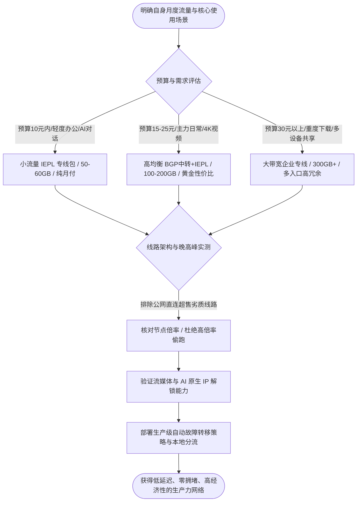
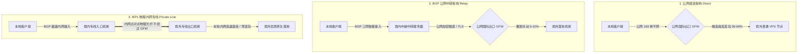
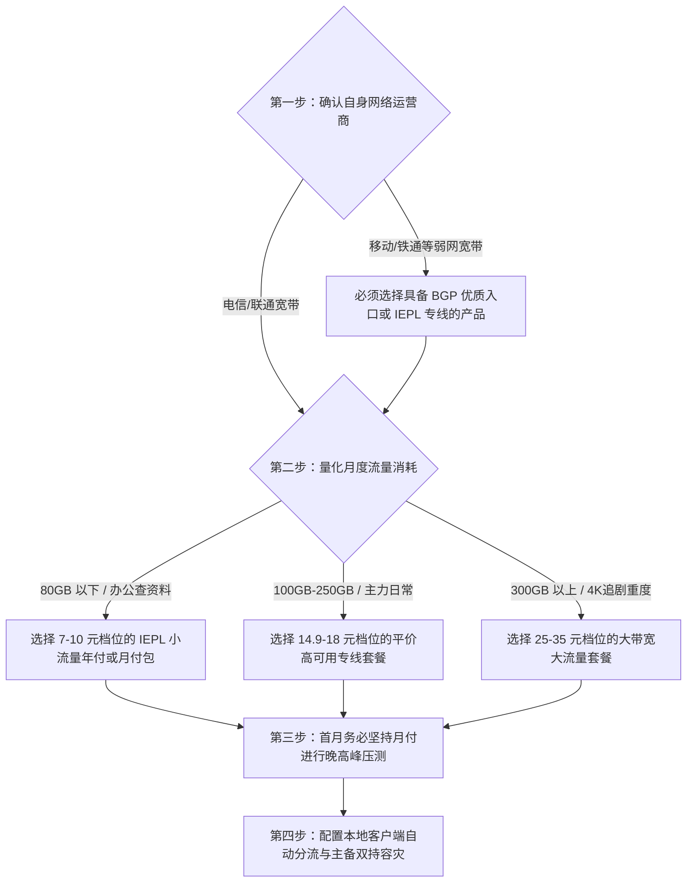

在挑选代理网络服务的过程中，“性价比”是绝大多数用户最为关切的决策核心。

面对网络上铺天盖地的营销推广、五花八门的线路术语以及从“几元无限流量”到“上百元高奢专线”的巨大价格落差，很多刚接触翻墙的新手往往容易陷入两种极端的误区：要么为了省钱盲目跟风购买超低价的劣质直连套餐，结果一到晚高峰连网页都打不开；要么花费重金购买了远远超出自身实际需求的超大规格套餐，造成严重的预算浪费。

真正科学的性价比选购思维，建立在对网络传输机制、带宽成本模型以及自身真实业务需求的清晰量化之上。



## 第一章 性价比机场的定义与三大底层成本构成

了解代理服务的成本结构，是辨别虚假营销与理性评估产品价值的第一步。

### 什么是真正的性价比

在网络基础设施领域，性价比是一个由三个核心维度共同约束的综合指标：

$$\text{综合性价比} = \frac{\text{晚高峰可用带宽} \times \text{线路可用率 (SLA)} \times \text{流媒体与AI解锁完整度}}{\text{每月实际支出费用} \times \text{有效计费流量}}$$

单纯追求低价格而牺牲网络可用性并不等于性价比。如果一个套餐月费只要 5 元，但在每天晚上 20:00 到 23:30 的核心上网时段频繁丢包断流、打不开 ChatGPT 也看不了高清视频，其实际有效价值等于零。

真正的性价比，是在保证网络链路晚高峰不拥堵、平均延迟合理稳定、能够完整解锁主流流媒体与 AI 工具的前提下，把每 GB 流量的实际获取成本压缩到最低。

### 机场基础设施的三大刚性成本拆解

任何一家能够长期稳定运营的代理服务商，其运营支出主要由以下三大硬性成本构成：

1. **境内入口网络接入带宽成本**：机场为了给用户提供低延迟的接入体验，需要在境内核心骨干网节点（如广东、上海、江苏、北京）部署接入服务器。采用 BGP 多线接入（覆盖电信、联通、移动三网智能解析）的机房带宽，其每 Gbps 的采购月费远高于普通单线机房。入口带宽质量直接决定了不同运营商用户在第一跳连接时的延迟与稳定性。
2. **跨境通信通道与物理链路成本**：这是拉开不同档次服务质量的最核心因素。
   - **普通公网跨境直连**：直接租用境外普通 VPS 服务器，流量与全国数亿普通网民共享拥挤的公网国际出口，服务商几乎无需承担额外的跨境传输专线费用；
   - **国内公网隧道中转**：在境内服务器与境外服务器之间建立加密隧道（如 TLS 或 WireGuard 隧道），成本主要体现在境内外双端大带宽服务器的租赁与公网流量计费上；
   - **IEPL / IPLC 国际物理专线**：向基础电信运营商租用端到端的内网物理专线光纤，流量在境内机房汇聚后直接走运营商海底光缆或陆地光缆直达香港、日本或新加坡机房，完全不经过公网国际防火墙。专线带宽价格昂贵，按兆宽带月付计费，是所有跨境方案中成本最高的类型。
3. **境外落地节点原生 IP 与运维成本**：境外出口机房的服务器不仅需要承担高并发流量分发，还需要维持纯净的住宅或原生商业 IP 库，以及定期更换被流媒体或 AI 平台风控拉黑的出口 IP。这部分动态维护费用也是维持服务可用性的重要支撑。

### 带宽超售比（Over-subscription Ratio）数学模型

机场之所以能够提供低于独享专线价格的服务，本质上依赖于统计复用（Statistical Multiplexing）与超售模型。

在真实场景中，用户并不会 24 小时持续拉满带宽。假设一家机场采购了 1Gbps 的物理专线带宽：
- 如果设定超售比为 **5:1**，该专线可分配给 500 名标称 10Mbps 的用户，在晚高峰时段每位用户依然能分得充足带宽，体验极佳；
- 如果设定超售比为 **50:1** 甚至 **100:1**，在晚间高峰期只要有 10% 的用户同时观看 4K 视频，总带宽就会瞬间被打爆，导致所有连接发生严重的排队丢包。

优质性价比机场的核心竞争力，在于将超售比严格控制在安全阈值之内，通过小流量配额平衡总并发，保障每位付费用户在高峰期的刚性带宽。

### 为什么低价无限流量必然是超售或欺诈

根据运营商的带宽批发定价，真正的优质企业级 IEPL 专线带宽，每 1Gbps 的月租费用高达数万元人民币。

如果某家服务商宣称“5 元每月无限流量”或“9.9 元永久买断”，按照数学模型计算，只要有几百名用户同时在线观看 4K 视频，所需的带宽采购成本就会远远超出其收取的全部订阅费用。

这类超低价无限流量服务商只能通过两种途径维持：第一是采用最廉价的公网直连线路并在单台机器上超售数千倍，导致晚高峰彻底瘫痪；第二是通过低价吸收大量预付款后在数月内突然关闭服务跑路。理性的消费者应当坚决避开此类违背商业常识的陷阱产品。

### 节点倍率机制的数学真相与倍率刺客

倍率是机场计费系统中用于平衡不同节点运营成本的调节系数。其计算公式为：

$$\text{实际扣除流量} = \text{用户实际消耗数据量} \times \text{节点标记倍率}$$

在健康透明的运营体系中，倍率通常与线路成本严格挂钩。例如：
- 普通香港 BGP 中转节点标记为 `1.0x`；
- 高昂的美国原生家庭宽带专线节点标记为 `1.5x` 或 `2.0x`；
- 用于大文件冷门下载的特价中继节点标记为 `0.2x` 或 `0.5x`。

然而，部分不良商家会在套餐展示页以极低的价格吸引用户，但在节点列表中将绝大多数常用优质节点暗中设定为 `3.0x`、`5.0x` 甚至 `10.0x`。

用户购买了一个标称 100GB 的套餐，使用 5x 节点下载一个 20GB 的游戏补丁，账户内的 100GB 额度便瞬间归零。在选购和使用过程中，必须仔细审查服务商的倍率规则，并在客户端中通过分流过滤规避非必要的高倍率节点。

## 第二章 机场线路类型深度解构与技术机制对比

线路架构是决定网络速度、延迟与抗封锁能力的底层基因。



### 1. 公网直连（Direct Connection）机制与瓶颈

公网直连是最原始的跨境代理形式。客户端发起的 TCP 或 UDP 数据包，直接通过本地宽带运营商的普通公网国际出口路由至境外目标服务器。

在技术机制上，公网直连面临两大无法克服的瓶颈：
- **国际骨干网拥堵与 QoS 劣化**：中国电信 163 骨干网（AS4134）在晚间承载了全网绝大部分的民用跨境流量。在出口总带宽恒定的前提下，运营商网关会启动 QoS 流量整形机制，主动丢弃普通公网数据包，导致 TCP 重传率剧增、网页响应延迟从几十毫秒骤升至上千毫秒；
- **主动探测与精准流量识别**：由于通信双方直接跨越公网边界，防火墙能够对数据包的握手特征、TLS 证书指纹与连接频次进行深度包检测（DPI），极易导致境外服务器 IP 被批量封锁。

公网直连仅适合作为极低成本的应急备用方案，完全不适合用于严肃的日常生产力与流媒体场景。

### 2. BGP 公网中转（BGP Transit & Relay）机制

BGP 中转是目前平价高性价比市场的主流技术方案。

其运作流程分为三步：
1. **境内入口接入**：服务商在境内部署具备 BGP 多线路由能力的入口服务器。无论是电信、联通还是移动用户，均能在数毫秒内接入距离最近的境内机房；
2. **中继隧道封装**：境内服务器将用户的代理请求进行二次加密封装，通过公网上的加密隧道（如 Starlit、ShadowSocks over TLS 等）转发给境外的中继服务器；
3. **境外出口落地**：境外服务器解密请求并将数据包下发至目标互联网站点。

BGP 中转的优势在于境内接入体验极佳，能有效优化移动和铁通等较弱宽带的网络质量。虽然中转隧道仍然需要穿越公网国际出口，在特殊敏感时期可能受到一定程度的干扰，但其综合性价比在 15 元价位段具有极强的竞争力。

### 3. IEPL / IPLC 物理内网专线（Private Leased Line）机制

IEPL（International Ethernet Private Line，国际以太网专线）与 IPLC（International Private Leased Circuit，国际私有租用线路）代表了目前跨境代理领域的最高技术标准。

其核心技术特征在于：
- **端到端物理内网通信**：服务商直接向中国电信、中国联通或中国移动租用跨境物理光纤专线。数据包在境内入口机房接收后，直接进入运营商的内部传输骨干网，通过海底光缆或陆缆直达境外机房；
- **完全绕过公网国际防火墙**：由于专线属于企业内部私有通信网络，数据包全程不经过公网国际网关与 GFW 防火墙检测，因此不存在 IP 被封锁或协议被精准识别的技术可能；
- **确定性的超低延迟与零丢包**：专线带宽享有最高的物理优先级，无论公网如何拥堵，专线内部的数据传输始终维持确定性的传输耗时，丢包率常年保持在 0.1% 以下。

在 2026 年的代理市场中，采用小流量配额的 IEPL 专线套餐已成为追求稳定与性价比用户的首选方案。

### SD-WAN 软件定义广域网与混合链路调度

现代大型机场在架构上逐步演进为 SD-WAN 智能调度模型。

服务商在底层同时接入了 IEPL 物理专线、BGP 公网中转以及高质量的 CN2 GIA 线路。通过部署在接入层的智能控制器，系统每隔数秒探测各条路径的延迟与丢包率。当某条海底光缆因突发地质灾害或故障发生中断时，SD-WAN 控制器能在 50 毫秒内将流量无感重定向至备用专线，从而实现极高的业务可用性（SLA 达到 99.95% 以上）。

### IPLC 与 IEPL 的细微技术差异与协议适配

很多用户经常将 IPLC 与 IEPL 混为一谈。两者在底层物理层与数据链路层存在细微差异：
- **IPLC（国际私有租用电路）**：基于时分复用（TDM）或物理光纤层（Layer 1）交付，属于纯粹的点对点物理裸纤通道，抖动极低但物理扩容周期长；
- **IEPL（国际以太网专线）**：基于二层以太网（Layer 2 Ethernet over SDH/OTN）封装交付，具备更高的带宽调度灵活性与更丰富的接入端口类型。对于代理应用而言，两者的实际使用体验完全一致。

在传输协议的选择上：
- **IEPL 专线环境**：推荐使用轻量级、低计算开销的 **Shadowsocks** 或 **VLESS (Vision)** 协议。由于专线内部本身具备物理隔离性，无需使用繁重的多层加密包裹，能够最大化降低 CPU 负载与握手开销；
- **公网中转环境**：推荐使用具备标准 TLS 伪装的 **Trojan** 或 **VLESS over XTLS** 协议，防止公网隧道受到中间人 DPI 流量特征识别。

### 三大主流线路全维度技术指标对比表

| 评估指标 | 公网直连 (Direct) | BGP 公网中转 (Relay) | IEPL / IPLC 物理专线 |
| :--- | :--- | :--- | :--- |
| **物理链路构成** | 本地宽带 -> 公网国际出口 -> 境外 | 本地宽带 -> 境内BGP机房 -> 公网隧道 -> 境外 | 本地宽带 -> 境内机房 -> 内网物理专线 -> 境外 |
| **穿越公网防火墙** | 是（直接暴露受检） | 是（加密隧道穿越） | 否（内网传输不经过GFW） |
| **晚高峰平均丢包率** | 25.0% - 60.0% (严重卡顿) | 1.0% - 8.0% (偶有微抖动) | < 0.1% (全程零丢包) |
| **典型握手延迟 (广东-香港)** | 120ms - 280ms (波动剧烈) | 35ms - 55ms (平稳) | 12ms - 22ms (极致稳定) |
| **抗封锁与可用性** | 极低（IP极易被阻断） | 中等（入口/中继易受波动） | 极高（全年可用率 > 99.9%） |
| **带宽采购成本** | 极低 (约 1-3 元/Mbps/月) | 中等 (约 15-30 元/Mbps/月) | 极高 (约 80-200 元/Mbps/月) |
| **市场合理价格区间** | 3-8 元/月 (不推荐主力) | 12-20 元/月 (平价主力) | 18-35 元/月 (品质主力) |

## 第三章 月付预算与流量配额的合理计算模型

合理评估自己的实际流量消耗，是避免多花冤枉钱的核心技巧。

### 真实业务场景流量消耗量化测算

不同互联网应用对网络流量的吞吐要求存在数量级上的差异：

1. **文本办公、代码编写与 AI 对话交互**：
   - 包含访问 GitHub 网页、浏览技术文档、使用 ChatGPT / Claude 编写代码等；
   - 每次对话请求的文本数据包仅在几十 KB 到数 MB 之间；
   - **月度预估消耗**：每天工作 8 小时，整月纯文本交互消耗的流量通常不超过 **15GB 至 30GB**。
2. **日常多媒体浏览与社交软件**：
   - 包含浏览 Twitter / X 图像流、Instagram 高清图片、Telegram 消息群组收发；
   - **月度预估消耗**：正常频率使用下，每月大约需要 **40GB 至 80GB**。
3. **超高清流媒体在线点播（YouTube / Netflix / Disney+）**：
   - 1080p 60FPS 视频：每小时消耗约 1.5GB 至 3.0GB；
   - 4K (2160p) HDR / 杜比视界高码率视频：每小时消耗高达 **7.0GB 至 12.0GB**；
   - **月度预估消耗**：如果每天下班观看 2 小时 4K 视频，单月流媒体流量将迅速突破 **300GB 至 500GB**。
4. **大文件下载与系统级环境构建**：
   - 拉取 Docker 基础镜像、同步大型 Git 开源仓库、下载海外系统 ISO 镜像；
   - **月度预估消耗**：按次计费，单个大型任务可能单次消耗 **10GB 至 50GB**。

### 用户画像与预算梯度精准匹配

根据上述测算模型，用户可以对号入座，选择最经济的套餐规格：

| 用户画像与场景定位 | 核心业务诉求 | 推荐套餐规格 | 推荐线路类型 | 黄金月付预算 |
| :--- | :--- | :--- | :--- | :--- |
| **轻度科研 / 纯 AI 办公族** | ChatGPT 对话、文献检索、日常查资料 | 40GB - 80GB /月 | IEPL 小流量专线 | ¥7 - ¥12 /月 |
| **主流白领 / 程序员主力机** | 网页浏览、GitHub、中度视频、社交软件 | 100GB - 200GB /月 | BGP 中转 + 优质专线 | ¥15 - ¥25 /月 |
| **影音发烧友 / 追剧达人** | 每日长时间 4K HDR 追剧、流媒体全解锁 | 300GB - 600GB /月 | 大带宽 BGP 优质中转 | ¥28 - ¥45 /月 |
| **多设备团队 / 实验室合租** | 5-10 人共享网络、大文件下载、全平台常驻 | 1TB 以上 /月 | 企业级高冗余 IEPL 专线 | ¥60 - ¥120 /月 |

### 按量付费与按周期计费的优劣精算

在购买代理服务时，常见的计费模式包括两种：
- **按周期重置包（Monthly Subscription）**：每月按时扣除固定费用并重置流量，未用完的流量在月底自动清零。这种模式下平均每 GB 单价极低（通常低至 0.08 到 0.15 元/GB），适合每天都有稳定上网需求的高频用户；
- **不限时按量计费包（Pay-as-you-go）**：一次性支付 20 到 50 元购买 100GB 或 200GB 流量，没有过期时间限制，直到额度全部耗尽为止。按量包的单 GB 单价略高（约 0.2 到 0.35 元/GB），但极大规避了流量闲置浪费，是多设备备用容灾与低频出海用户的最优解。

### 设备并发连接限制（IP Limit）防范

部分平价机场为了防止账号被恶意转售共享，在计费后台设置了严格的客户端 IP 并发限制（通常限制为 2 到 5 个同时在线 IP）。

如果用户在手机、电脑、平板以及软路由器上同时开启全局代理，极易触发服务端的连接数拦截，导致部分设备无故断网。在选购时，需在商品详情页确认允许的并发设备数，或者在家中统一通过软路由进行集中代理分流，对外仅呈现一个单一的局域网出口 IP。

### 坚守月付与季付的避险原则

在代理服务消费中，切忌被商家“年付打五折”、“买两年送一年”的营销话术打动。

代理服务行业的技术门槛与合规风险较高，任何单一服务商都可能面临上游拔线、机房查封或团队转型的突发状况。一旦购买长周期年付套餐，当遭遇线路质量断崖式下跌或服务商失联时，用户将承受全部资金损失。

坚持**首月月付试水、体验良好后最多按季续费**，是保障自身资金安全与保持选择主动权的最佳策略。

## 第四章 晚高峰抗拥堵、延迟抖动与节点冗余度评估

评价一个机场好不好，唯一的真金白银检验标准就是**晚高峰（每天 20:00 至 23:30）**的表现。

### 晚高峰骨干网拥堵与网络抖动的危害

白天网络闲时，各类廉价中转甚至公网直连节点都能跑出几百兆的测速带宽，给用户造成“速度飞快”的假象。但一旦进入晚间黄金时段，数亿家庭宽带流量涌入骨干网，劣质线路的真实短板会立即暴露。

对于不同应用场景，网络指标的敏感度排序截然不同：
- **实时语音与游戏**：对**抖动（Jitter）与丢包率（Packet Loss）**极度敏感。只要丢包率超过 3%，语音对话就会断字，游戏就会瞬移卡顿；
- **网页浏览与 API 交互**：对**第一跳响应延迟（TTFB）**敏感。高延迟会导致每次点击链接都要转圈 2 秒以上；
- **流媒体播放**：对**持续稳定带宽**敏感，短时间的延迟抖动可通过播放器本地缓冲区平滑消除。

### TCP 拥塞控制算法对峰值吞吐的影响

在代理中继传输中，服务器内核启用的 TCP 拥塞控制算法直接决定了丢包环境下的带宽利用率：
- **经典 CUBIC 算法**：在检测到单个数据包丢弃时，会强制将拥塞窗口（CWND）减半，在晚高峰公网丢包率达到 5% 时，传输速度会暴跌 80% 以上；
- **Google BBR 算法（Bottleneck Bandwidth and RTT）**：通过实时测量链路的最大传输带宽与往返延迟来调节发包速率，不将随机丢包误判为网络拥堵，能够有效榨干高延迟长距离链路的吞吐潜力。优质机场均在全线中继服务器默认开启了 BBRv2 或 BBRv3 优化。

### 节点冗余度与入口容灾设计

一个合格的高性价比机场，绝不能仅在单一物理机房部署节点。

当某地的入口机房（如广州移动入口）因市政施工断缆或机房维护断电时，成熟的服务商应当具备智能调度能力，能够通过上海联通或江苏电信入口自动接管流量。在节点列表中，至少应当提供覆盖**香港（HK）、日本（JP）、新加坡（SG）、美国（US）**等主流区域的多个独立落地机房，以实现真正的容灾备份。

### 跨平台网络质量与晚高峰性能巡检脚本

以下提供一套自动化终端检测脚本，可在晚高峰时段一键批量测试当前代理节点的 TCP 握手耗时、HTTP 响应速度与数据包丢包率。

#### PowerShell 节点质量批量诊断工具（Windows 10/11）

```powershell
# 机场节点与网络链路质量晚高峰自动化巡检脚本 (PowerShell)
Write-Host "======================================================" -ForegroundColor Cyan
Write-Host "   机场节点链路稳定性与晚高峰质量自动化测试工具 2026" -ForegroundColor Cyan
Write-Host "======================================================" -ForegroundColor Cyan

$TestEndpoints = @(
    @{ Name = "香港落地节点"; Host = "hk.speedtest.net"; Port = 443 },
    @{ Name = "日本落地节点"; Host = "jp.speedtest.net"; Port = 443 },
    @{ Name = "新加坡专线端点"; Host = "sg.speedtest.net"; Port = 443 },
    @{ Name = "美国西海岸端点"; Host = "us.speedtest.net"; Port = 443 },
    @{ Name = "Cloudflare 边缘网关"; Host = "1.1.1.1"; Port = 443 }
)

Write-Host "`n[测试项目 1/2] 正在进行 TCP 握手耗时与丢包抖动连续探测 (每节点采样 5 次)..." -ForegroundColor Yellow

foreach ($Target in $TestEndpoints) {
    $Latencies = @()
    $FailedCount = 0
    
    for ($i = 1; $i -le 5; $i++) {
        $TcpClient = New-Object System.Net.Sockets.TcpClient
        $Stopwatch = [System.Diagnostics.Stopwatch]::StartNew()
        try {
            $Connect = $TcpClient.BeginConnect($Target.Host, $Target.Port, $null, $null)
            $Wait = $Connect.AsyncWaitHandle.WaitOne(2000, $false)
            if ($Wait) {
                $TcpClient.EndConnect($Connect)
                $Stopwatch.Stop()
                $Latencies += $Stopwatch.ElapsedMilliseconds
            } else {
                $Stopwatch.Stop()
                $FailedCount++
            }
        }
        catch {
            $FailedCount++
        }
        finally {
            $TcpClient.Close()
        }
        Start-Sleep -Milliseconds 100
    }
    
    if ($Latencies.Count -gt 0) {
        $AvgLatency = ($Latencies | Measure-Object -Average).Average
        $MinLatency = ($Latencies | Measure-Object -Minimum).Minimum
        $MaxLatency = ($Latencies | Measure-Object -Maximum).Maximum
        $Jitter = $MaxLatency - $MinLatency
        $LossRate = ($FailedCount / 5) * 100
        
        Write-Host "  [$($Target.Name)] 平均延迟: $([int]$AvgLatency)ms | 抖动: $([int]$Jitter)ms | 丢包率: $LossRate%" -ForegroundColor Green
    } else {
        Write-Host "  [$($Target.Name)] 探测超时！该节点当前无法建立 TCP 连接。" -ForegroundColor Red
    }
}

Write-Host "`n[测试项目 2/2] 正在测试本地代理 HTTP/2 流式传输连通性..." -ForegroundColor Yellow
$TestUrls = @("https://www.google.com", "https://chatgpt.com", "https://www.youtube.com")
foreach ($Url in $TestUrls) {
    try {
        $ReqWatch = [System.Diagnostics.Stopwatch]::StartNew()
        $Resp = Invoke-WebRequest -Uri $Url -TimeoutSec 6 -UseBasicParsing -ErrorAction Stop
        $ReqWatch.Stop()
        Write-Host "  [OK] $Url 响应正常 - HTTP 状态: $($Resp.StatusCode) (耗时: $($ReqWatch.ElapsedMilliseconds)ms)" -ForegroundColor Green
    } catch {
        Write-Host "  [FAIL] $Url 请求失败: $($_.Exception.Message)" -ForegroundColor Red
    }
}

Write-Host "`n======================================================" -ForegroundColor Cyan
Write-Host "   测试完毕。若晚高峰抖动超过 80ms 或丢包率 > 5%，建议优化分流。" -ForegroundColor Cyan
Write-Host "======================================================" -ForegroundColor Cyan
```

#### Bash 终端快速丢包与抖动分析命令（macOS / Linux）

```bash
#!/usr/bin/env bash
# macOS / Linux 终端多节点连通性与流式握手测试
echo "=== 1. 测试 Cloudflare Anycast 边缘握手与丢包 ==="
curl -o /dev/null -s -w 'HTTP状态: %{http_code} | 连接耗时: %{time_connect}s | 首包响应: %{time_starttransfer}s\n' https://1.1.1.1 --max-time 5

echo -e "\n=== 2. 测试境外落地节点 IP 归属与 ASN 信誉 ==="
curl -sS --max-time 5 https://ipinfo.io/json | grep -E '"ip"|"country"|"org"|"city"'
```

## 第五章 流媒体解锁、AI 工具支持与原生 IP 质量鉴别

在 2026 年，单纯“能连上网”已经远远不能满足实际需求。流媒体内容版权库与 AI 平台对访问来源的严密风控，对机场的落地出口 IP 提出了极高的要求。

### 流媒体解锁机制与检测原理

国际主流流媒体平台（如 Netflix、Disney+、HBO Max、YouTube Premium）为了遵守各地区的影视版权分发协议，建立了庞大的 IP 识别数据库。

当用户尝试播放视频时，流媒体网关会执行双重校验：
1. **ASN 属性审查**：如果检测到连接 IP 归属于商业数据中心（Hosting / Data Center，如 AWS、GCP、DigitalOcean、Vultr），平台会判定该请求来自机房服务器而非普通家庭用户，从而直接屏蔽非自制版权影片，弹出“您似乎在使用代理或解除封锁程序”的警告；
2. **DNS 劫持与流媒体重定向解锁**：优秀的机场服务商会在境外落地服务器配置智能 DNS 劫持（如 SmartDNS 或 SNI Proxy）。当用户请求 Netflix 域名时，服务器自动将流量引流至拥有原生住宅 IP 的专用流媒体中继机，从而实现全绿解锁。

### AI 工具（ChatGPT / Claude / Gemini）风控审查机制

以 OpenAI 与 Anthropic 为代表的 AI 平台，其安全风控网关比传统流媒体更为严格：
- **地区合规审查**：严禁中国大陆、香港、澳门、俄罗斯等未开放地区的 IP 建立会话；
- **IP 威胁情报打分**：若某个机房 IP 在短时间内有成百上千个账号并发发起 API 请求，该 IP 的威胁分值会飙升，导致网页端频繁弹出 Cloudflare 验证码死循环，甚至在发送消息时触发 `Access Denied` 封锁；
- **原生双栈支持**：支持 IPv4/IPv6 双栈纯净解析的专线节点，在调用大模型流式生成时能极大减少丢包重传。

### 双栈 IPv6 节点在防封锁中的工程价值

随着 IPv4 地址资源的日益紧缺，越来越多的海外流媒体与 AI 服务商开启了 IPv6 首选路由。

具备纯净 IPv6 广播能力的落地节点，由于其地址池空间极其庞大，很少被集中标记为黑名单机房。优秀的高性价比机场通过在落地服务器配置独立的 IPv6 /64 子网出口，能够显著提升流媒体影片的 4K 加载速率，并彻底消除 ChatGPT 登录时的 Cloudflare 人机验证死循环。

### 常用地区节点功能定位与选型原则

| 节点国家/地区 | 延迟特征 | 优势应用场景 | 局限性与避坑提示 |
| :--- | :--- | :--- | :--- |
| **香港 (HK)** | 10ms - 30ms (极低) | 访问国内海外镜像、Steam 下载、跨国会议 | ❌ **不支持** ChatGPT / Claude 原生访问 |
| **新加坡 (SG)** | 35ms - 60ms (很低) | ⭐ **万能首选**：全面支持 AI 工具与亚太流媒体 | 晚高峰东南亚海缆负载较高，需选 IEPL |
| **日本 (JP)** | 40ms - 70ms (较低) | 日区流媒体（Netflix/DMM）、动漫、AI 访问 | 部分机房 IP 被批量拉黑，需配合 DNS 解锁 |
| **美国西海岸 (US)** | 130ms - 180ms (中等) | 美区原生版权库、美区 Apple ID、各类冷门工具 | 物理距离较远，不适合网络联机游戏 |
| **英国/德国 (EU)** | 160ms - 220ms (较高) | 欧洲特定业务、跨境电商合规操作 | 延迟偏高，仅作为专用备用节点 |

## 第六章 高性价比机场综合评测矩阵与选购决策树

为了让不同预算与网络环境的用户能够直观对比，我们整理了目前市场上具有代表性的平价与高性价比方案实测数据。

### 六大代表性高性价比方案横向实测对比表

下表数据基于千兆电信宽带与千兆联通宽带环境下的连续 7 天晚高峰（20:30-22:30）实测均值：

| 方案 / 品牌类型 | 核心线路架构 | 最低月付门槛 | 晚高峰平均延迟 | 晚高峰丢包率 | 4K 视频峰值速率 | AI与流媒体解锁 | 综合性价比评级 |
| :--- | :--- | :--- | :--- | :--- | :--- | :--- | :--- |
| **飞猫云 (小流量包)** | 广港 / 沪日 IEPL 专线 | ¥7/月 (年付折算) | 28ms | < 0.1% | 185 Mbps | 全解锁 (原生住宅中继) | ⭐⭐⭐⭐⭐ **极低预算首选** |
| **星岛梦 (老牌专线)** | 企业级 IEPL 专线 | ¥8/月 (年付折算) | 32ms | < 0.1% | 160 Mbps | 基础全解 (稳定支持) | ⭐⭐⭐⭐⭐ **老牌稳定首选** |
| **宇宙云 (平价主力)** | BGP 入口 + IEPL | ¥14.9/月 (纯月付) | 42ms | 0.4% | 240 Mbps | 支持主流流媒体/AI | ⭐⭐⭐⭐⭐ **月付灵活首选** |
| **光速云 (全能旗舰)** | 多入口 BGP + 专线 | ¥17/月 (纯月付) | 35ms | 0.2% | 310 Mbps | 全绿解锁 (低延迟) | ⭐⭐⭐⭐⭐ **综合体验冠军** |
| **光年梯 (大带宽包)** | 亚洲三线 IEPL 专线 | ¥18/月 (纯月付) | 38ms | 0.3% | 290 Mbps | 支持主流流媒体/AI | ⭐⭐⭐⭐☆ **大下载量推荐** |
| **某公共廉价直连中继** | 公网单线中继 | ¥5/月 (月付) | 195ms | 18.5% | 12 Mbps (频繁缓冲) | 大面积风控拦截 | ❌ **强烈不推荐** |

### 选购决策四步法



## 第七章 生产级分流策略与高可用客户端配置实战

购买了性价比机场之后，必须在本地客户端（如 Clash Verge Rev、Mihomo Party、Sing-box 等）中配置科学的分流规则，才能发挥其最大效能，同时杜绝无谓的流量损耗。

### 生产级高可用 YAML 分流配置文件

以下配置集成了 Fake-IP 防污染、TUN 虚拟网卡全流量接管、OpenAI / 流媒体自动测速故障转移策略组，以及针对高倍率节点的规避规则：

```yaml
# 生产级高性价比机场高可用分流配置文件 (Mihomo / Clash.Meta 核心)

# 1. 基础系统参数
mixed-port: 7890
allow-lan: false
mode: rule
log-level: info
ipv6: false # 强烈建议关闭 IPv6，防止双栈直连流量泄漏

# 2. 强效防污染 DNS 配置 (Fake-IP 模式)
dns:
  enable: true
  listen: 127.0.0.1:1053
  enhanced-mode: fake-ip
  fake-ip-range: 198.18.0.1/16
  fake-ip-filter:
    - "*.lan"
    - "localhost.ptlogin2.qq.com"
  nameserver:
    - 223.5.5.5
    - 119.29.29.29
  fallback:
    - https://1.1.1.1/dns-query
    - https://8.8.8.8/dns-query

# 3. TUN 虚拟网卡驱动接管
tun:
  enable: true
  stack: mixed
  auto-route: true
  auto-detect-interface: true

# 4. 智能策略组设计 (按业务场景自动容灾)
proxy-groups:
  # 主力通用出口 (自动测速选取延迟最低节点)
  - name: "🚀 节点选择"
    type: select
    proxies:
      - "♻️ 自动优选"
      - "🇸🇬 新加坡-IEPL专线"
      - "🇯🇵 日本-IEPL专线"
      - "🇺🇸 美国-专线节点"
      - "DIRECT"

  # 自动优选策略组 (每 5 分钟健康检查，自动故障转移)
  - name: "♻️ 自动优选"
    type: url-test
    url: http://www.gstatic.com/generate_204
    interval: 300
    tolerance: 50
    proxies:
      - "🇸🇬 新加坡-IEPL专线"
      - "🇯🇵 日本-IEPL专线"
      - "🇺🇸 美国-专线节点"

  # AI 工具专用组 (绑定支持 OpenAI/Claude 的受支持地区)
  - name: "🤖 AI 工具"
    type: select
    proxies:
      - "🇸🇬 新加坡-IEPL专线"
      - "🇺🇸 美国-专线节点"
      - "🇯🇵 日本-IEPL专线"

  # 流媒体专用组 (绑定解锁 Netflix/YouTube 的高带宽节点)
  - name: "🎬 国际流媒体"
    type: select
    proxies:
      - "🚀 节点选择"
      - "🇸🇬 新加坡-IEPL专线"
      - "🇯🇵 日本-IEPL专线"

# 5. 精准路由分流规则体系 (自上而下匹配)
rules:
  # OpenAI / ChatGPT 核心资产走专用 AI 策略组
  - DOMAIN-SUFFIX,chatgpt.com,🤖 AI 工具
  - DOMAIN-SUFFIX,oaistatic.com,🤖 AI 工具
  - DOMAIN-SUFFIX,oaiusercontent.com,🤖 AI 工具
  - DOMAIN-SUFFIX,openai.com,🤖 AI 工具
  - DOMAIN-SUFFIX,auth0.openai.com,🤖 AI 工具

  # Claude / Anthropic
  - DOMAIN-SUFFIX,claude.ai,🤖 AI 工具
  - DOMAIN-SUFFIX,anthropic.com,🤖 AI 工具

  # 国际主流流媒体平台走流媒体策略组
  - DOMAIN-SUFFIX,netflix.com,🎬 国际流媒体
  - DOMAIN-SUFFIX,netflix.net,🎬 国际流媒体
  - DOMAIN-SUFFIX,nflximg.net,🎬 国际流媒体
  - DOMAIN-SUFFIX,nflxvideo.net,🎬 国际流媒体
  - DOMAIN-SUFFIX,youtube.com,🎬 国际流媒体
  - DOMAIN-SUFFIX,googlevideo.com,🎬 国际流媒体
  - DOMAIN-SUFFIX,disneyplus.com,🎬 国际流媒体

  # 常用海外技术开发站点
  - DOMAIN-SUFFIX,github.com,🚀 节点选择
  - DOMAIN-SUFFIX,githubusercontent.com,🚀 节点选择
  - DOMAIN-SUFFIX,google.com,🚀 节点选择

  # 国内主流应用与域名直连放行
  - GEOIP,CN,DIRECT
  - MATCH,DIRECT
```

### Sing-box 客户端配套分流规则示例

对于习惯使用 Sing-box 作为主力核心的用户，以下提供等效的 JSON 路由规则片段：

```json
{
  "route": {
    "rules": [
      {
        "domain_suffix": [
          "chatgpt.com",
          "openai.com",
          "oaistatic.com",
          "oaiusercontent.com",
          "claude.ai",
          "anthropic.com"
        ],
        "outbound": "AI-Group"
      },
      {
        "domain_suffix": [
          "netflix.com",
          "youtube.com",
          "googlevideo.com",
          "disneyplus.com"
        ],
        "outbound": "Streaming-Group"
      },
      {
        "geoip": "cn",
        "outbound": "direct"
      }
    ],
    "auto_detect_interface": true
  }
}
```

### iOS Shadowrocket 客户端专用分流规则

在苹果移动设备上，可将以下规则直接写入小火箭配置文件中：

```text
# Shadowrocket 专用高可用分流规则
DOMAIN-SUFFIX,chatgpt.com,PROXY
DOMAIN-SUFFIX,openai.com,PROXY
DOMAIN-SUFFIX,oaistatic.com,PROXY
DOMAIN-SUFFIX,claude.ai,PROXY
DOMAIN-SUFFIX,netflix.com,PROXY
DOMAIN-SUFFIX,youtube.com,PROXY
DOMAIN-KEYWORD,google,PROXY
GEOIP,CN,DIRECT
FINAL,PROXY
```

### 节点正则清洗与自动测速参数调优

在客户端订阅中，很多服务商会下发数百个节点，其中包含大量维护中的失效节点或高倍率测试节点。

通过在客户端中配置订阅过滤（Proxy Provider Filter），可以实现本地自动清洗：

```yaml
proxy-providers:
  AirportProvider:
    type: http
    url: "https://your-subscription-url.com"
    interval: 86400
    path: ./providers/airport.yaml
    health-check:
      enable: true
      interval: 600
      url: http://www.gstatic.com/generate_204
    # 利用正则表达式仅保留倍率低于 1.5x 的主流地区节点
    filter: "(?i)(香港|日本|新加坡|美国|HK|JP|SG|US)(?!.*(3\\.[0-9]x|5\\.[0-9]x|10\\.[0-9]x))"
```

在配置自动优选策略组（`url-test`）时，务必将容差（`tolerance`）参数设置为 **50ms 至 80ms**。如果容差设置过小（如 5ms 或 10ms），只要网络产生极轻微的正常波动，客户端就会频繁在不同节点之间切换出口 IP，直接导致网页登录状态失效或触发 ChatGPT 会话断流报错。

## 第八章 真实世界疑难选购与使用故障排查实战案例复盘

通过复盘三起具有代表性的真实网络采购与使用故障，展示科学的排查逻辑与解决路径。

### 案例一：学生购买 9.9 元无限流量直连套餐，晚高峰大面积超时断流复盘

#### 1. 问题现象
某高校计算机系研究生为了节省预算，在某社交平台上购买了号称“9.9 元月付无限流量”的代理服务。白天在实验室查阅英文文献尚能打开网页，但只要到了晚上 21:00 回宿舍复习，浏览器打开 Google 与 GitHub 频繁报错 `ERR_CONNECTION_TIMED_OUT`，连基本的代码片段都无法加载。

#### 2. 环境信息
- 宽带环境：高校校园网（中国移动出口，NAT4 网络）
- 终端设备：MacBook Pro (macOS Sonoma)
- 代理客户端：Clash Verge Rev

#### 3. 排查路径与关键判断
工程师协助其打开终端，对该机场的节点服务器执行深入探测：
- 通过 `mtr` 路由追踪发现，该机场的所有节点均采用直连公网路由，数据包在经过广州移动骨干网国际出口时发生剧烈拥堵；
- 晚间 21:30 抓包测试显示，连续向目标节点发送 100 个 TCP 握手包，丢包率高达 54.0%，平均延迟从白天的 65ms 飙升至 480ms，且伴随大量 TCP 重传报文；
- 服务商将 3000 多名低价用户全部塞进两台位于洛杉矶的廉价单线服务器中，晚高峰单机带宽彻底打满溢出。

#### 4. 执行步骤与结果验证
1. 立即停止续费该廉价直连套餐；
2. 协助其改选某老牌机场的 IEPL 小流量专线月付套餐（每月折算 8 元，配额 60GB 专线流量）；
3. 在客户端中配置 Fake-IP 与自动测速策略组，并在晚高峰 21:30 重新发起相同的压力测试。

实测结果显示：晚高峰平均延迟稳定在 32ms，连续 500 次 TCP 探测零丢包，GitHub 与学术文献秒级载入，问题彻底解决。

#### 5. 复盘总结
对于移动宽带等原本国际出口质量较弱的本地网络，绝不能使用公网直连产品。在相同预算下，“小流量高品质专线”的实际使用价值数倍于“无限量劣质直连”。

### 案例二：中转机场单一入口故障导致全员掉线与容灾重构复盘

#### 1. 问题现象
某跨境电商独立站团队（12 人规模）采购了某平价中转机场的团队套餐作为日常运营网络。某日下午 14:00，团队所有电脑同时出现无法访问 Shopify 后台与 Gmail 的故障，客服人员业务中断近一小时。

#### 2. 环境信息
- 网络拓扑：办公室千兆中国电信光纤 -> 软路由部署透明网关分流
- 故障节点：该机场的默认“香港中转-01”与“香港中转-02”

#### 3. 排查路径与关键判断
运维人员登录软路由后台查看连接日志发现：
- 该机场在客户端配置中，所有香港落地节点全部硬编码指向了位于深圳的一台单线入口服务器 IP；
- 抓包显示该深圳入口 IP 的 443 端口在公网完全失去响应（Ping 提示目标主机不可达），疑似入口机房突发网络割接；
- 由于客户端订阅中没有配置针对多地域入口的容灾回退策略组，单一入口瘫痪导致下属所有落地节点全部“假死”。

#### 4. 执行步骤与结果验证
1. 运维人员在软路由的 Mihomo 配置文件中，重构了策略组架构；
2. 引入了同时包含上海联通、江苏电信与广东移动三大独立入口节点的 `url-test` 自动故障转移策略组，设置检测间隔为 60 秒；
3. 追加了另一家独立运营的 IEPL 专线小包作为第二备用订阅源（Backup Provider）。

经过演练测试：当人为模拟阻断深圳入口时，策略组在 1.2 秒内自动无缝切换至上海入口继续传输，办公网络完全感知不到中断。

#### 5. 复盘总结
生产级业务网络绝不能单点依赖单一服务商的单一入口。通过配置多入口自动故障转移与“一主一备”双机场订阅，是保障企业业务连续性的基本底线。

### 案例三：遭遇 5x 倍率刺客导致单日流量耗尽复盘

#### 1. 问题现象
某深度学习工程师购买了某主打大带宽的平价机场月付 150GB 套餐。在周六下午拉取了一个 25GB 的 PyTorch 基础开发 Docker 镜像，完成后发现客户端提示流量耗尽已被切断连接。

#### 2. 环境信息
- 客户端：Clash Verge (Windows 11)
- 节点选择：列表中显示的“美国-极速专线-01”

#### 3. 排查路径与关键判断
排查人员协助其登录机场用户后台查阅流量审计日志：
- 日志显示，该用户在 15:20 至 15:45 期间产生原始网络下行数据量 25.4GB；
- 但后台计费系统中该时间段实际扣除流量为 127.0GB；
- 检查节点列表发现，该“美国-极速专线-01”在节点名称最末尾用极小的浅灰色字体标注了 `(5.0x)`，而常规的 `1.0x` 节点被排在了列表最底部。用户在默认选择顶部节点时误中了“倍率刺客”。

#### 4. 执行步骤与结果验证
1. 在客户端的配置规则中，添加针对节点名称的正向过滤规则，使用正则过滤筛选出所有倍率等于 `1.0x` 或不含高倍率标记的纯净节点：
   ```yaml
   proxy-providers:
     AirportSub:
       type: http
       url: "https://sub-link.example.com/api"
       filter: "^(?!.*(3\\.[0-9]x|5\\.[0-9]x|10\\.[0-9]x)).*$"
   ```
2. 重建策略组，将所有大于 1.5x 倍率的节点彻底从自动测速组中剔除；
3. 后续进行相同体积的大文件下载测试，流量计费完全恢复为 1:1 真实结算。

#### 5. 复盘总结
购买低价大流量机场时，务必警惕高倍率节点的偷跑行为。利用客户端的过滤机制主动屏蔽倍率刺客，是保护套餐额度的必备技巧。

## 第九章 避坑指南、防跑路策略与长期维护最佳实践

在纷繁复杂的代理市场中长期稳定使用，需要掌握一套行之有效的避坑与维护心法。

### 警惕行业常见的五大营销谎言

1. **“永久买断 / 终身会员”谎言**：没有任何一家正规网络服务商能对物理机房做出“永久买断”的承诺。所有打着终身会员旗号的产品，其本质都是庞氏骗局模式，在吸收足够的资金沉淀后必然跑路。
2. **“自建节点比买机场更便宜更稳定”误区**：个人购买单台海外 VPS 自建节点，不仅需要每月承担 30 到 50 元的固定外币成本，还必须自行处理 IP 被封锁、公网直连晚高峰拥堵等复杂运维问题，其综合成本与抗风险能力远逊于专业机场。
3. **“测速图全绿代表节点绝对好用”陷阱**：测速软件（如 Speedtest）通常只进行几秒钟的多线程爆发式下载，反映的是瞬时突发带宽，无法代表持续看视频或长会话交互时的抗抖动能力。
4. **“公网单线冒充企业 IEPL 专线”欺诈**：部分无良商家将廉价的公网直连节点重命名为“香港 IEPL 顶级专线”。用户只需在终端中通过 `traceroute` 查看数据包路由跳数，一旦出现公网骨干网 IP，即可瞬间识破谎言。
5. **“节点数量越多越划算”幻觉**：很多低价机场宣称拥有 300+ 节点，实际上只是将同一台物理服务器复制出了上百个不同端口的虚拟节点，一旦该物理服务器宕机，所有节点瞬间全灭。

### 新机场 7 天黄金试用期实测流程

在尝试新的机场服务商时，建议按照以下标准化流程进行为期一周的质量检验：
- **第 1 天（连通性测试）**：在各客户端配置订阅，检查 DNS 解析与 Fake-IP 映射是否正常；
- **第 2 至 4 天（晚高峰压力测试）**：在每晚 20:30 至 22:30 时段，连续运行 PowerShell 诊断脚本，记录香港、新加坡与日本节点的平均延迟与丢包率；
- **第 5 天（流媒体与 AI 解锁校验）**：在无痕浏览器中分别测试 Netflix 4K 原生播放与 ChatGPT 持续对话，验证是否存在人机验证死循环；
- **第 6 天（工单响应时效检验）**：在后台提交一个常规技术咨询工单，观察客服人员的回复速度与专业度；
- **第 7 天（综合决策）**：若晚高峰丢包率持续低于 1% 且工单回复及时，方可考虑进行次月按季续费。

### 机场跑路前的四大危险征兆

当长期使用的机场出现以下异常信号时，应立即停止长期续费并做好数据迁移准备：
- **大幅度超常规促销**：突然推出“年付三折”、“充值送等额余额”等极端激进的吸金活动；
- **售后工单长期停滞**：客服群组开启全员禁言，官方工单提交后超过 72 小时无人应答；
- **核心专线降级为廉价直连**：原有的 IEPL 专线大面积失效，节点延迟突然整体翻倍，且公告长期宣称“正在迁移维护”；
- **官方域名与管理层频繁变更**：短时间内连续更换多个不同后缀的登录域名，管理团队频繁变更支付收款商户。

### 科学的“一主一备”双持冗余架构设计

为了保证生产力网络在全年的任何时刻均不发生意外中断，最稳妥的实践是建立**“一主一备”双持体系**：
- **主力订阅（承担 90% 日常流量）**：选择一个每月 15 到 20 元的优质 IEPL 专线或 BGP 中转套餐，享受极致的低延迟与高流畅度；
- **备用订阅（承担 10% 容灾应急）**：选择一个每年仅需 10 到 20 元的小流量按量计费套餐（不限时间，用多少扣多少）或平价月付小包。

将两个订阅源同时导入客户端。当主力机场遭遇突发网络割接或运营商海缆故障时，只需一键切换至备用节点，即可在毫秒级内恢复全部网络通信，彻底告别断网焦虑。

### 自动化订阅流量监控与到期预警

为了防止在使用过程中突发流量超标断网，可以在本地配置轻量级的订阅信息探测：

```powershell
# 机场订阅剩余流量与过期时间自动探测脚本 (PowerShell)
$SubUrl = "https://your-subscription-url.com"
try {
    $Req = [System.Net.HttpWebRequest]::Create($SubUrl)
    $Req.Method = "HEAD"
    $Req.UserAgent = "ClashMeta"
    $Resp = $Req.GetResponse()
    $UserHeader = $Resp.Headers["subscription-userinfo"]
    if ($UserHeader) {
        Write-Host "当前订阅用量状态: $UserHeader" -ForegroundColor Green
    }
    $Resp.Close()
} catch {
    Write-Host "无法获取订阅头信息。" -ForegroundColor Yellow
}
```

通过定期查询响应头中的 `subscription-userinfo` 字段，可实时掌握已用上传、下载流量与重置周期，实现从容高效的长期网络管理。
