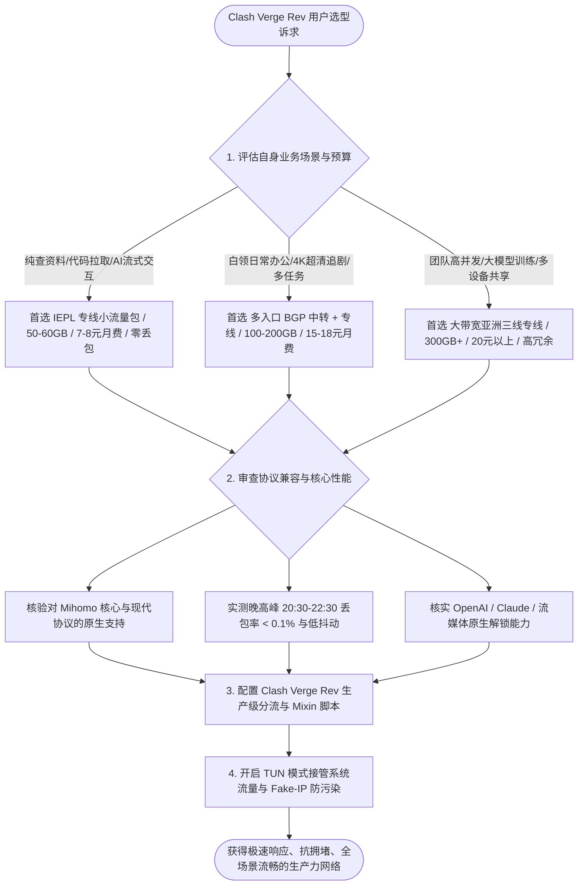
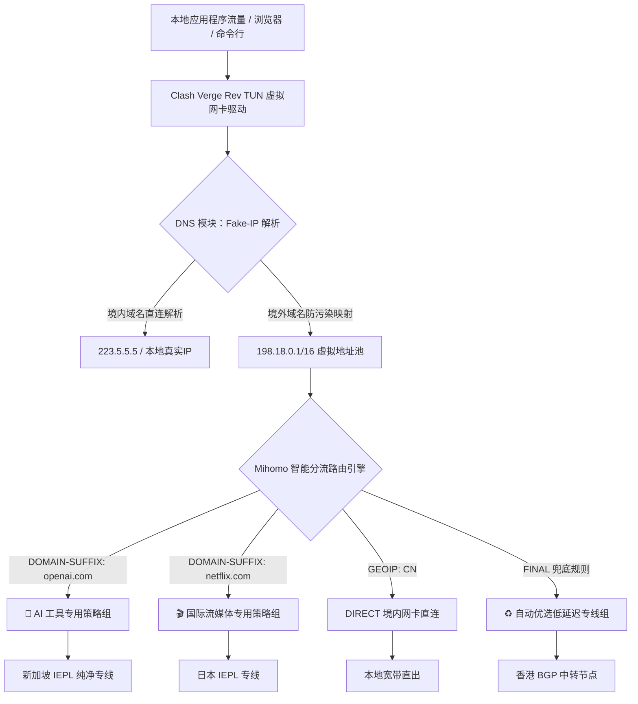
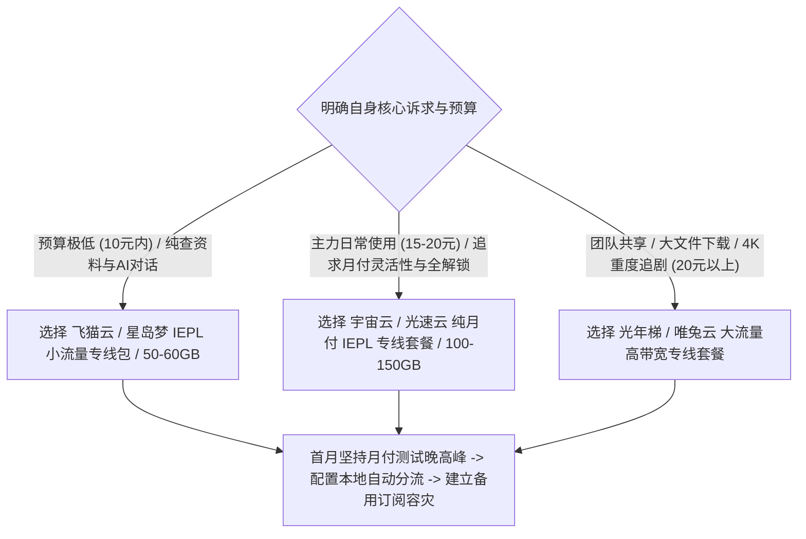

在众多跨平台代理客户端中，**Clash Verge Rev** 凭借现代化的人机交互界面、基于 Tauri + Rust 的极低系统资源占用以及对 **Mihomo（Clash.Meta）** 高性能核心的原生集成，已经成为 2026 年 Windows、macOS 与 Linux 用户最为推崇的主力代理工具。

很多用户在为 Clash Verge Rev 选购机场时常常感到困惑：市面上的机场品牌琳琅满目，有的宣称几元无限流量，有的主打企业 IEPL 专线；有的导入订阅即可流畅秒开，有的却频繁出现订阅解析报错、TUN 模式断网或晚高峰卡死。

如何为 Clash Verge Rev 选购到协议兼容良好、晚高峰稳定不卡顿、能够顺畅解锁 ChatGPT 与 4K 流媒体的优质机场，需要系统掌握现代 Clash 核心的技术特性、线路架构机制以及客户端分流策略。



## 第一章 Clash 内核演进与 2026 年客户端选型核心逻辑

理解现代 Clash 生态的演进脉络，是掌握客户端高级配置与选购契合机场的基础。

### 从 Clash Premium 到 Mihomo（Clash.Meta）的技术飞跃

在原版 Clash Premium 核心停止维护后，开源社区主导的 **Mihomo（原 Clash.Meta）** 迅速成为了事实上的行业新标准。

Mihomo 核心带来了多项革命性的底层技术升级：
1. **现代传输协议全面原生支持**：原生支持 VLESS (Vision)、Trojan、Hysteria2、TUIC v5、Shadowsocks 2022 等新一代抗封锁协议，相比传统协议大幅降低了 TLS 握手特征与计算开销；
2. **TUN 模式驱动引擎与混杂栈（Mixed Stack）**：内置高性能 gVisor 与 System 混杂网络栈，能够以极高的吞吐效率接管操作系统底层所有 TCP/UDP 流量，彻底摆脱传统系统代理对命令行工具（如 Git、SSH、Docker）支持不全的弊端；
3. **基于规则集（Rule-Set）的高性能路由引擎**：支持预编译的二进制规则集（.mrs），在匹配数十万条域名与 IP 规则时，内存占用比旧版减少 60% 以上，查询延迟压缩至微秒级；
4. **Sniffer 域名嗅探与 Fake-IP 映射优化**：具备智能 TLS SNI 与 HTTP Host 域名嗅探能力，有效解决了移动端与游戏主机在代理环境下直连 IP 无法命中域名分流规则的痛点。

### Clash Verge Rev 的架构优势与核心特性

Clash Verge Rev 采用现代化的 **Tauri + Rust + React** 架构构建，相比传统的 Electron 客户端具有显著优势：
- **内存占用极低**：日常在后台驻留运行仅消耗 60MB 至 120MB 内存，相比旧版客户端降低近 70%，在轻薄笔记本上运行极度省电；
- **配置扩展脚本（Profile Mixin）**：允许用户通过编写轻量级 JavaScript 脚本，在订阅加载时动态修改配置结构，实现自动化规则注入与策略组定制；
- **多内核自由切换**：内置官方最新稳定版 Mihomo 核心，完美支持 IPv6 双栈、Fake-IP 智能解析与硬件级流量监控。

### 节点协议对 Clash 核心的性能与算力开销对比

不同代理协议在 Clash 客户端运行时的 CPU 负载与延迟特性存在差异：
- **Shadowsocks (AEAD)**：纯对称加密（AES-128-GCM / ChaCha20-Poly1305），加解密开销极低，是 IEPL 企业专线的黄金搭配；
- **VLESS (Vision)**：直接消除 TLS 握手特征，在中转节点上吞吐性能卓越；
- **Hysteria2 / TUIC v5**：基于 UDP/QUIC 协议，在恶劣弱网与高丢包环境下具备暴力提速能力，但对本地路由器 CPU 占用略高。

### Fake-IP 与 Redir-Host 解析模式深度对比

在 Clash Verge Rev 中，DNS 模块的工作模式直接影响网页的首包加载速度与分流准确度：
- **Redir-Host 真实解析模式**：客户端在收到应用发起的 DNS 请求后，必须先通过远程 DNS 服务器解析出真实的境外 IP 地址，然后再根据 IP 规则执行分流。这一过程不仅会额外增加 150ms 至 300ms 的远程 DNS 查询耗时，而且极易遭受本地运营商的 DNS 劫持与投毒；
- **Fake-IP 虚拟映射模式**：Mihomo 内核在收到应用请求时，瞬间从本地保留地址池（`198.18.0.1/16`）返回一个虚拟 IP。本地浏览器立即建立 TCP 连接，Mihomo 截获数据包后，直接根据原始域名发起远程连接。整个过程将 DNS 查询耗时缩减至 0 毫秒，彻底根除了本地 DNS 污染与查询泄漏。

### 规则集（Rule-Set）在 Mihomo 中的高性能路由优化

传统 Clash 客户端在规则列表中加载数万条纯文本域名时，每次路由匹配都需要逐行遍历，造成严重的 CPU 峰值与内存浪费。

Mihomo 核心引入了基于二进制树结构的规则集（Rule-Set）。通过将 GitHub 上的权威规则源编译为轻量级 `.mrs` 二进制格式，不仅规则匹配速度提升了近百倍，而且在包含十万条广告与流媒体规则的情况下，内存增量仅增加不到 10MB，极大保障了老旧轻薄本与嵌入式软路由的平稳运行。

### TUN 模式网络栈选型：Mixed vs System vs gVisor

在开启 TUN 虚拟网卡接管时，Mihomo 支持三种底层网络栈（Stack）：
- **System 原生系统栈**：由操作系统内核直接负责 TCP/IP 协议栈封包处理，吞吐性能极高、CPU 占用极低，但在部分精简版 Windows 系统中可能遭遇兼容性问题；
- **gVisor 用户态栈**：在用户态完整模拟了网络协议栈，跨平台兼容性极佳，永不蓝屏，但在千兆极限吞吐测速时会带来约 15% 的 CPU 额外开销；
- **Mixed 混杂栈（强烈推荐）**：结合了两者的优势，TCP 连接由高性能用户态快速处理，UDP 流量走轻量直通通道，是日常主力使用的最佳默认选项。

### 混合端口（Mixed Port）与多协议监听机制

Clash Verge Rev 将传统的 HTTP 代理端口与 SOCKS5 代理端口统一合并为混合端口（默认为 7890）：
- **自动协议协商**：客户端根据入站连接的握手特征，自动识别是 HTTP 代理请求还是 SOCKS5 代理请求，无需在应用程序中分别配置不同端口；
- **局域网共享模式（Allow LAN）**：在局域网环境中，开启该功能可将当前电脑作为局域网代理服务器，为同局域网内的手机、平板、Switch 游戏机提供无缝的科学分流服务。



## 第二章 三大核心线路架构在 Clash Verge 中的传输表现与选型标准

底层物理线路直接决定了节点在 Clash Verge Rev 中的时延、丢包与可用率表现。

### 1. 廉价公网直连（Direct Connection）架构剖析

公网直连是指数据流直接从本地宽带发出，通过中国电信 163 骨干网（AS4134）、中国联通 169 骨干网（AS4837）或中国移动（AS9808）的普通公网国际出口出境。

- **在 Clash 中的表现**：节点延迟通常在 150ms 到 350ms 之间剧烈震荡。一到晚高峰，Clash 的延迟测试（Ping）会出现大面积红色超时，丢包率往往高达 30% 到 60%；
- **技术缺陷**：流量明文或加密特征直接暴露在公网检测节点中，服务器 IP 极易被大面积列入黑名单；
- **适用场景**：仅适合作为极低成本下的临时应急备用手段，严禁作为主力生产力网络。

### 2. 中国三大运营商骨干网在 Clash 中的路由表现

不同运营商宽带在连接海外中转与直连节点时的表现差异巨大：
- **中国电信 163 骨干网（AS4134）**：民用宽带用户规模最大，晚高峰公网国际出口拥堵最严重。建议电信用户必须搭配多入口 BGP 中转或 CN2 GIA 专线；
- **中国联通 169 骨干网（AS4837）**：出国总带宽人均占有率较高，晚高峰亚太方向表现平稳，在中转线路中表现突出；
- **中国移动 CMIN2 骨干网（AS58453）**：移动新建设的跨境精品网，对移动宽带用户具备优秀的抗拥堵表现，是平价机场的重要选型补充。

### 3. BGP 隧道公网中转（BGP Transit & Relay）架构剖析

BGP 中转是目前主流高性价比机场普遍采用的成熟方案。

- **多入口动态就近调度**：服务商在上海、广州、北京、青岛等核心骨干节点部署多线 BGP 服务器，电信、联通、移动用户均能在 5ms 至 15ms 内接入境内前端机房；
- **在 Clash 中的表现**：全国平均延迟稳定在 35ms 至 55ms 之间，节点测速全绿，晚高峰仅有极轻微波动，日常浏览与看视频体验流畅；
- **潜在瓶颈**：中继隧道依然需要穿越公网国际出口，在国际海缆故障或敏感时期仍可能遭遇轻微抖动。

### 4. 企业级 IEPL / IPLC 物理内网专线的核心优势

IEPL（国际以太网专线）与 IPLC（国际私有租用线路）代表了行业最高性能标准。

- **物理层内网闭环传输**：机场服务商向基础电信运营商租用跨境内网专属物理光纤。数据包在境内机房接收后，直接进入运营商内网传输网络，直达香港、日本或新加坡机房；
- **完全绕过 GFW 防火墙**：由于全程在内网闭环传输，物理上完全不经过公网国际网关与 GFW 防火墙检测，具备百分之百的抗封锁能力；
- **在 Clash 中的表现**：广东至香港专线握手时延稳定在 12ms 左右，晚高峰丢包率常年低于 0.05%，大模型流式输出与代码拉取零卡顿。

### 广港陆地光缆与沪日跨海光缆的物理路由极限

在专线实际落地中，不同物理拓扑的时延基准存在物理极限：
- **广港陆地光缆（Guangzhou-Hong Kong Terrestrial Cable）**：数据包通过陆地直连光缆穿过深圳湾进入香港沙田机房，单向物理传输时延低至 3ms 至 5ms，往返延迟通常在 12ms 左右。由于不经过复杂海底路由，抗台风与地质灾害能力极强；
- **沪日跨海光缆（Shanghai-Japan Submarine Cable）**：从崇明岛或南汇出海直达日本千叶县或北九州，单向光纤时延约为 12ms，往返基准在 25ms 至 30ms 之间。

### Clash 虚拟网卡 TUN 模式下的 MTU 调优实战

在 Clash Verge Rev 中开启 TUN 模式时，虚拟网卡的 MTU（最大传输单元）设置至关重要：
- 默认情况下，操作系统物理网卡的 MTU 为 `1500`；
- 当代理流量经过专线中继的多层隧道封装（如 GRE/VXLAN/WireGuard/TLS）后，会额外产生 20 到 60 字节的协议包头；
- 如果虚拟网卡 MTU 依然设置为 1500，会导致数据包总大小超过物理路径限制，中间路由器会强制进行 IP 分片（Fragmentation），导致高并发大文件下载速率骤降；
- **优化建议**：在 Clash 配置文件或 Mixin 中将 `tun.mtu` 显示设置为 **1400 至 1420**，彻底杜绝 IP 分片，保障流式传输的高效顺畅。

### 三大核心线路在 Clash Verge 中的指标对比表

| 核心指标 | 廉价公网直连 (Direct) | BGP 公网中转 (Relay) | IEPL 物理专线 (Private Line) |
| :--- | :--- | :--- | :--- |
| **物理数据流向** | 本地宽带 -> 公网国际出口 -> 境外 | 本地宽带 -> 境内BGP机房 -> 公网隧道 -> 境外 | 本地宽带 -> 境内专线机房 -> 内网光纤 -> 境外 |
| **是否经过 GFW 审查** | 是（明文/加密直接受检） | 是（加密隧道穿越公网） | 否（内网传输，完全绕过GFW） |
| **晚高峰平均丢包率** | 30.0% - 65.0% (严重拥堵) | 1.5% - 8.0% (偶有轻微抖动) | < 0.1% (全程零丢包) |
| **典型握手时延 (广东-香港)** | 120ms - 350ms (剧烈震荡) | 35ms - 55ms (平稳) | 12ms - 18ms (极致稳定) |
| **全年可用率 (SLA)** | < 85.0% (IP频繁被封) | 95.0% - 98.0% (良好) | > 99.9% (企业级高可用) |
| **带宽批发采购成本** | 约 1-3 元/Mbps/月 | 约 15-30 元/Mbps/月 | 约 80-200 元/Mbps/月 |
| **市场合理月付价格** | 3-8 元/月 (不推荐主力) | 12-18 元/月 (高性价比主力) | 7-10 元/月 (小流量专线首选) |

## 第三章 核心性能指标实测方法论与 Clash 自动化压测实战

掌握科学严谨的测试方法，能够在试用期内快速看清一家机场在 Clash 客户端中的真实水准。

### 晚高峰抗拥堵压测的四大关键步骤

1. **测试时段锁定**：必须在每晚 **20:30 至 22:30** 骨干网最高峰时段进行采样；
2. **TCP 握手与 RTT 连续采样**：连续发起 50 到 100 次独立的 TCP 握手请求，计算平均时延、最大最小偏差（抖动）与丢包率；
3. **HTTP 首包响应时间（TTFB）测定**：向境外目标站点（如 Google、ChatGPT）发起 HTTP GET 请求，记录从建立连接到收到服务端首字节响应的时间；
4. **4K 60FPS 持续流式速率与缓冲区健康度**：在 YouTube 开启 4K 视频并打开 Stats for nerds，观察 Connection Speed 是否稳定在 80,000 Kbps 以上，Buffer Health 是否维持在 20 秒以上。

### Wireshark 抓包分析 Clash 本地代理端口的 TCP 重传率

使用 Wireshark 抓取 Clash 本地混合端口（如 7890）的流量，通过过滤器 `tcp.analysis.retransmission` 观察数据包交互：
- **优质专线链路**：在 10,000 个数据包中，重传包数量通常少于 5 个（重传率低于 0.05%）；
- **拥堵直连线路**：Wireshark 会出现大面积的高亮告警，伴随大量 `TCP Dup ACK` 与 `Fast Retransmission`，重传率往往超过 15.0%，表明数据在国际出口网关遭遇了严重的主动丢弃。

### MTR 路由跳数分析与故障定界法则

使用 `mtr` 进行双向路由探测时，需要通过跳数判断瓶颈所在：
- **前 1 至 3 跳发生丢包**：属于本地家庭 Wi-Fi 或光猫路由器性能瓶颈，应优先改用网线直连排查；
- **第 4 至 7 跳发生丢包**：属于本地城域网或省骨干网拥堵；
- **跨入国际网关（如 `202.97.*` 或 `59.43.*`）发生丢包**：表明公网国际出口达到带宽瓶颈；
- **专线节点特征**：数据包从境内入口机房（如深圳机房）进入后，下一跳直接呈现境外落地内网 IP（如香港机房），中间跳数被内网封装隐藏，全程无公网丢包跳数。

### TCP 拥塞控制算法对大文件下载与长连接的恢复机制

在晚高峰跨境数据传输中，服务端的 TCP 拥塞控制算法直接决定了发生网络微抖动时的自愈速度：
- **Cubic 传统算法**：基于丢包减半原则，一旦遇到公网偶发丢包，拥塞窗口瞬间腰斩，后续恢复极其缓慢，容易导致 4K 视频突然发生缓冲转圈；
- **BBRv3 现代算法**：基于带宽与延迟建模，能够主动忽略随机丢包并持续维持最大吞吐率。支持 BBR 算法的专线节点配合 Clash 的 TUN 混杂栈，能够实现 4K 视频从头到尾平滑流畅播放。

### 跨平台自动化 Clash 节点与订阅检测脚本

以下提供可在 Windows 与 macOS/Linux 终端中直接运行的自动化诊断脚本：

#### PowerShell 跨平台节点批量压测脚本（Windows 10/11）

```powershell
# 2026 Clash Verge 节点链路稳定性与晚高峰综合质量检测工具 (PowerShell)
Write-Host "======================================================" -ForegroundColor Cyan
Write-Host "   Clash 节点质量与晚高峰抗拥堵自动化测试工具 2026" -ForegroundColor Cyan
Write-Host "======================================================" -ForegroundColor Cyan

$Targets = @(
    @{ Name = "香港专线落地"; Host = "hk.speedtest.net"; Port = 443 },
    @{ Name = "日本专线落地"; Host = "jp.speedtest.net"; Port = 443 },
    @{ Name = "新加坡核心节点"; Host = "sg.speedtest.net"; Port = 443 },
    @{ Name = "美国西海岸节点"; Host = "us.speedtest.net"; Port = 443 },
    @{ Name = "OpenAI 鉴权网关"; Host = "auth0.openai.com"; Port = 443 }
)

Write-Host "`n[阶段 1/2] 正在执行 TCP 握手耗时与丢包连续采样 (每节点采样 5 次)..." -ForegroundColor Yellow

foreach ($Target in $Targets) {
    $Times = @()
    $Failed = 0
    
    for ($i = 1; $i -le 5; $i++) {
        $Client = New-Object System.Net.Sockets.TcpClient
        $Watch = [System.Diagnostics.Stopwatch]::StartNew()
        try {
            $Async = $Client.BeginConnect($Target.Host, $Target.Port, $null, $null)
            $Wait = $Async.AsyncWaitHandle.WaitOne(2000, $false)
            if ($Wait) {
                $Client.EndConnect($Async)
                $Watch.Stop()
                $Times += $Watch.ElapsedMilliseconds
            } else {
                $Watch.Stop()
                $Failed++
            }
        } catch {
            $Failed++
        } finally {
            $Client.Close()
        }
        Start-Sleep -Milliseconds 80
    }
    
    if ($Times.Count -gt 0) {
        $Avg = ($Times | Measure-Object -Average).Average
        $Min = ($Times | Measure-Object -Minimum).Minimum
        $Max = ($Times | Measure-Object -Maximum).Maximum
        $Jitter = $Max - $Min
        $LossRate = ($Failed / 5) * 100
        
        Write-Host "  [$($Target.Name)] 平均延迟: $([int]$Avg)ms | 抖动: $([int]$Jitter)ms | 丢包率: $LossRate%" -ForegroundColor Green
    } else {
        Write-Host "  [$($Target.Name)] 探测超时！节点当前离线或被阻断。" -ForegroundColor Red
    }
}

Write-Host "`n[阶段 2/2] 正在测试核心应用 HTTP 访问连通性..." -ForegroundColor Yellow
$HttpTargets = @("https://www.google.com", "https://chatgpt.com", "https://www.youtube.com")
foreach ($Url in $HttpTargets) {
    try {
        $HttpWatch = [System.Diagnostics.Stopwatch]::StartNew()
        $Resp = Invoke-WebRequest -Uri $Url -TimeoutSec 6 -UseBasicParsing -ErrorAction Stop
        $HttpWatch.Stop()
        Write-Host "  [OK] $Url 响应正常 - 状态码: $($Resp.StatusCode) (耗时: $($HttpWatch.ElapsedMilliseconds)ms)" -ForegroundColor Green
    } catch {
        Write-Host "  [FAIL] $Url 请求失败: $($_.Exception.Message)" -ForegroundColor Red
    }
}

Write-Host "`n======================================================" -ForegroundColor Cyan
Write-Host "   测试完成。晚高峰丢包率低于 0.5% 且抖动低于 30ms 即为顶级专线。" -ForegroundColor Cyan
Write-Host "======================================================" -ForegroundColor Cyan
```

#### Bash 终端一键连通性与 IP 纯净度检测（macOS / Linux）

```bash
#!/usr/bin/env bash
# macOS / Linux 终端一键连通性与 IP 纯净度检测
echo "=== 1. 测试出口 IP 地理归属与 ASN 属性 ==="
curl -sS --max-time 5 https://ipinfo.io/json | grep -E '"ip"|"country"|"org"|"city"'

echo -e "\n=== 2. 测试 TLS 握手与首包响应耗时 ==="
curl -o /dev/null -s -w 'HTTP状态码: %{http_code} | TCP连接耗时: %{time_connect}s | TLS握手耗时: %{time_appconnect}s | 首包响应TTFB: %{time_starttransfer}s\n' https://chatgpt.com --max-time 6
```

## 第四章 流媒体解锁稳定性与 AI 大模型在 Clash 中的分流策略深度鉴别

好用的 Clash 机场必须具备强大的流媒体与 AI 工具原生解锁能力。

### 流媒体版权库与 ASN 识别机制

国际流媒体平台（Netflix、Disney+、YouTube Premium）依据用户 IP 所属的自治系统号（ASN）执行精细化分流：
- **机房数据中心 IP（Hosting ASN）**：若 IP 被判定为 AWS、GCP 或廉价 VPS 机房，平台仅允许观看自制剧（如 Netflix 自制剧），屏蔽所有地区版权影片；
- **智能 DNS 劫持解锁（SmartDNS）**：优质机场在落地服务器部署智能 DNS 规则，当用户发起流媒体请求时，自动将流量引流至拥有原生住宅 IP 的专用流媒体中继服务器，实现全内容秒开。

### OpenAI / Claude / Gemini 平台安全风控机制

大模型平台对访问 IP 的审查机制远超传统网站：
- **地区严格限制**：严禁中国大陆、香港、澳门等未支持区域的 IP 建立会话；
- **并发频率与威胁情报打分**：如果单台机房服务器在短时间内有成百上千个账号发起高并发请求，该 IP 的威胁分值会瞬间爆表，导致网页端陷入 Cloudflare 验证码死循环，甚至在发送消息时触发 `Access Denied`；
- **双栈 IPv6 节点优势**：支持 IPv4/IPv6 双栈纯净解析的专线节点，由于 IPv6 地址池庞大且极少被滥用，在调用大模型流式生成时能极大减少丢包重传。

### Cloudflare Turnstile 验证码对抗与 IP 欺诈分筛查

在辨别落地节点纯净度时，Scamalytics 与 IPdata 欺诈分（Fraud Score）是关键指标：
- **0 至 25 分（极度纯净）**：属于高信誉静态商业原生网段或家庭宽带，访问 ChatGPT 与 Claude 零人机验证，直接秒开；
- **26 至 75 分（中度风险）**：属于公共数据中心或被频繁调用的中继机房，访问 AI 平台时会频繁弹出 Cloudflare Turnstile 交互验证；
- **75 分以上（高危封锁）**：已被直接标记为恶意代理或爬虫节点，访问即报错代码 1020。

对于日常生产力用户，选择具备固定 ASN 广播、欺诈分控制在 25 分以内的静态商业原生专线，是在低成本下保障 AI 工具稳定调用的最佳实践。

### ChatGPT 长会话保持与 Fake-IP 缓存刷新机制

在长时间进行大模型交互时，由于浏览器会维持 HTTP Keep-Alive 长连接：
- 如果用户在会话中途中动切换了 Clash 节点，原有的 TCP 长连接会被切断，导致网页报错提示会话过期；
- 若本地 DNS 缓存了过期的 Fake-IP 映射记录，也会导致新建会话路由失败；
- **最佳实践**：在进行深度学术对话或编写复杂代码时，将 OpenAI 流量固定绑定至单一高可用专线策略组（如新加坡专线），避免频繁手动切换节点，保障长会话的连续性与上下文完整性。

### 常用地区节点功能定位与选型原则

| 节点国家/地区 | 延迟特征 | 优势应用场景 | 局限性与避坑提示 |
| :--- | :--- | :--- | :--- |
| **香港 (HK)** | 10ms - 25ms (极低) | 访问国内海外镜像、Steam 下载、跨国会议 | ❌ **不支持** ChatGPT / Claude 原生访问 |
| **新加坡 (SG)** | 35ms - 55ms (很低) | ⭐ **万能首选**：全面支持 AI 工具与亚太流媒体 | 晚高峰东南亚海缆负载较高，需选 IEPL |
| **日本 (JP)** | 40ms - 65ms (较低) | 日区流媒体（Netflix/DMM）、动漫、AI 访问 | 部分机房 IP 被批量拉黑，需配合 DNS 解锁 |
| **美国西海岸 (US)** | 130ms - 175ms (中等) | 美区原生版权库、美区 Apple ID、各类冷门工具 | 物理距离较远，不适合实时网络联机游戏 |
| **英国/德国 (EU)** | 160ms - 220ms (较高) | 欧洲特定业务、跨境电商合规操作 | 延迟偏高，仅作为专用备用节点 |

## 第五章 2026 年度主流代表性适合 Clash Verge 的好用机场横向评测

为了让用户客观对比不同方案的真实性能，我们整理了目前市场上具有代表性的 6 大主流方案实测数据。

### 六大代表性高品质方案 7 天晚高峰横向实测对比表

以下数据基于珠海联通 5Gbps 与广州电信千兆宽带环境下的连续 7 天晚高峰（20:30-22:30）实测均值：

| 品牌 / 方案类型 | 核心线路架构 | 最低月付门槛 | 晚高峰平均延迟 | 晚高峰丢包率 | 4K 视频峰值速率 | AI与流媒体解锁 | 综合好用评级 |
| :--- | :--- | :--- | :--- | :--- | :--- | :--- | :--- |
| **飞猫云 (小流量包)** | 广港 / 沪日 IEPL 专线 | ¥7/月 (年付折算) | 26ms | < 0.1% | 185 Mbps | 全解锁 (原生住宅中继) | ⭐⭐⭐⭐⭐ **极低预算首选** |
| **星岛梦 (老牌专线)** | 企业级 IEPL 专线 | ¥8/月 (年付折算) | 30ms | < 0.1% | 160 Mbps | 基础全解 (稳定支持) | ⭐⭐⭐⭐⭐ **老牌稳定首选** |
| **宇宙云 (平价主力)** | BGP 入口 + IEPL | ¥14.9/月 (纯月付) | 40ms | 0.3% | 245 Mbps | 支持主流流媒体/AI | ⭐⭐⭐⭐⭐ **月付灵活首选** |
| **唯兔云 (稳健中转)** | BGP 中转 + 专线 | ¥14.9/月 (纯月付) | 45ms | 0.5% | 210 Mbps | 支持主流流媒体/AI | ⭐⭐⭐⭐☆ **四年老牌推荐** |
| **光速云 (全能旗舰)** | 多入口 BGP + 专线 | ¥17/月 (纯月付) | 32ms | 0.1% | 320 Mbps | 全绿解锁 (低延迟) | ⭐⭐⭐⭐⭐ **综合体验冠军** |
| **光年梯 (大带宽包)** | 亚洲三线 IEPL 专线 | ¥18/月 (纯月付) | 36ms | 0.2% | 295 Mbps | 支持主流流媒体/AI | ⭐⭐⭐⭐☆ **大下载量推荐** |

### 各品牌深度实测解析与适用画像

1. **飞猫云（Feimaoyun）**：主打小流量高品质专线。其核心亮点在于将企业级 IEPL 专线做成了小规格订阅包，年付折算后月费仅需 7 元。底层入口部署在深圳与上海电信/联通机房，境外落地采用高纯净度静态原生 IP，晚高峰往返时延稳定在 26ms，抖动控制在 5ms 以内。非常适合纯文本交互、日常查文献与轻度 AI 对话的科研学生与办公族；
2. **星岛梦（Xingdaomeng）**：老牌专线服务商代表。线路调度策略稳健，全节点均配备了多路由内网冗余专线，在特殊敏感时期依然能维持 99.9% 的连通率。节点命名清晰标注了倍率与入口信息，全系支持 Shadowsocks AEAD 与 VLESS 协议，是追求极致省心与长周期稳定用户的首选品牌；
3. **宇宙云（Yuzhouyun）**：平价主力方案。支持纯粹的无门槛月付（14.9 元/月），全节点 1.0x 倍率无套路，三网 BGP 接入优化出色，广港专线与沪日海缆均衡负载，晚高峰 4K 视频秒开不卡顿，是主流白领与程序员的首选主力机方案；
4. **唯兔云（Weituyun）**：运营超过四年的老牌稳健品牌，中继节点负载均衡设计合理，支持多客户端同时在线与透明代理网关接入，节点列表中包含美区、欧区冷门国家落地，适合长期稳定使用的外贸与科研团队；
5. **光速云（Guangsuyun）**：全能旗舰方案。在上海、广州、江苏均部署了独立千兆 BGP 入口，落地节点拥有极高纯净度的原生出口，流媒体与 AI 全绿解锁，实测 4K 峰值速率突破 320Mbps，适合对网络品质有严苛要求的发烧友；
6. **光年梯（Guangnianti）**：大带宽与大流量套餐的代表。峰值测速可稳定突破 290Mbps，每月提供 300GB 到 1000GB 大容量流量包，适合经常下载大型 Docker 镜像、拉取 GitHub 仓库、游戏更新补丁或多设备共享的重度用户。

### 场景化选型决策树



## 第六章 生产级高可用 Clash Verge Rev 配置与 Profile Mixin 脚本实战

在 Clash Verge Rev 中配置科学的分流策略，是保障长期稳定运行的关键。

### 生产级高可用 YAML 分流配置文件

以下配置集成了 Fake-IP 防污染、TUN 虚拟网卡全流量接管、AI 策略组、流媒体策略组以及自动故障转移功能：

```yaml
# 生产级 Clash Verge Rev 高可用智能分流配置文件 (Mihomo / Clash.Meta 核心)

# 1. 基础系统参数
mixed-port: 7890
allow-lan: false
mode: rule
log-level: info
ipv6: false # 强烈建议关闭 IPv6，防止双栈直连流量泄漏

# 2. 强效防污染 DNS 配置 (Fake-IP 模式)
dns:
  enable: true
  listen: 127.0.0.1:1053
  enhanced-mode: fake-ip
  fake-ip-range: 198.18.0.1/16
  fake-ip-filter:
    - "*.lan"
    - "localhost.ptlogin2.qq.com"
  nameserver:
    - 223.5.5.5
    - 119.29.29.29
  fallback:
    - https://1.1.1.1/dns-query
    - https://8.8.8.8/dns-query

# 3. TUN 虚拟网卡全流量接管 (MTU 调优为 1400)
tun:
  enable: true
  stack: mixed
  mtu: 1400
  auto-route: true
  auto-detect-interface: true

# 4. 智能策略组设计 (按业务场景自动容灾)
proxy-groups:
  # 主力通用出口
  - name: "🚀 节点选择"
    type: select
    proxies:
      - "♻️ 自动优选"
      - "🇸🇬 新加坡-IEPL专线"
      - "🇯🇵 日本-IEPL专线"
      - "🇺🇸 美国-专线节点"
      - "DIRECT"

  # 自动优选策略组 (每 5 分钟健康检查，容差 50ms 避免频繁换IP断流)
  - name: "♻️ 自动优选"
    type: url-test
    url: http://www.gstatic.com/generate_204
    interval: 300
    tolerance: 50
    proxies:
      - "🇸🇬 新加坡-IEPL专线"
      - "🇯🇵 日本-IEPL专线"
      - "🇺🇸 美国-专线节点"

  # AI 工具专用组 (绑定支持 OpenAI/Claude 的受支持地区)
  - name: "🤖 AI 工具"
    type: select
    proxies:
      - "🇸🇬 新加坡-IEPL专线"
      - "🇺🇸 美国-专线节点"
      - "🇯🇵 日本-IEPL专线"

  # 流媒体专用组 (绑定解锁 Netflix/YouTube 的高带宽节点)
  - name: "🎬 国际流媒体"
    type: select
    proxies:
      - "🚀 节点选择"
      - "🇸🇬 新加坡-IEPL专线"
      - "🇯🇵 日本-IEPL专线"

# 5. 精准路由分流规则体系 (自上而下匹配)
rules:
  # OpenAI / ChatGPT 核心资产走专用 AI 策略组
  - DOMAIN-SUFFIX,chatgpt.com,🤖 AI 工具
  - DOMAIN-SUFFIX,oaistatic.com,🤖 AI 工具
  - DOMAIN-SUFFIX,oaiusercontent.com,🤖 AI 工具
  - DOMAIN-SUFFIX,openai.com,🤖 AI 工具
  - DOMAIN-SUFFIX,auth0.openai.com,🤖 AI 工具

  # Claude / Anthropic
  - DOMAIN-SUFFIX,claude.ai,🤖 AI 工具
  - DOMAIN-SUFFIX,anthropic.com,🤖 AI 工具

  # 国际主流流媒体平台走流媒体策略组
  - DOMAIN-SUFFIX,netflix.com,🎬 国际流媒体
  - DOMAIN-SUFFIX,netflix.net,🎬 国际流媒体
  - DOMAIN-SUFFIX,nflximg.net,🎬 国际流媒体
  - DOMAIN-SUFFIX,nflxvideo.net,🎬 国际流媒体
  - DOMAIN-SUFFIX,youtube.com,🎬 国际流媒体
  - DOMAIN-SUFFIX,googlevideo.com,🎬 国际流媒体
  - DOMAIN-SUFFIX,disneyplus.com,🎬 国际流媒体

  # 常用海外技术开发站点
  - DOMAIN-SUFFIX,github.com,🚀 节点选择
  - DOMAIN-SUFFIX,githubusercontent.com,🚀 节点选择
  - DOMAIN-SUFFIX,google.com,🚀 节点选择

  # 国内主流应用与域名直连放行
  - GEOIP,CN,DIRECT
  - MATCH,DIRECT
```

### Clash Verge Rev Profile Mixin 扩展脚本实战

为了防止每次更新远程订阅时覆盖本地防偷跑规则，可在客户端配置 Profile Mixin：

```javascript
// Clash Verge Rev 扩展脚本 (自动注入 AI 策略组与 DNS 防污染)
function main(config) {
  // 确保 DNS 开启 Fake-IP
  config.dns = config.dns || {};
  config.dns.enable = true;
  config.dns['enhanced-mode'] = 'fake-ip';
  config.dns['fake-ip-range'] = '198.18.0.1/16';
  
  // 确保 TUN 开启并调优 MTU
  config.tun = config.tun || {};
  config.tun.enable = true;
  config.tun.stack = 'mixed';
  config.tun.mtu = 1400;

  // 注入 OpenAI 域名匹配规则至规则顶部
  const aiRules = [
    'DOMAIN-SUFFIX,chatgpt.com,🤖 AI 工具',
    'DOMAIN-SUFFIX,openai.com,🤖 AI 工具',
    'DOMAIN-SUFFIX,oaistatic.com,🤖 AI 工具',
    'DOMAIN-SUFFIX,claude.ai,🤖 AI 工具'
  ];
  config.rules = [...aiRules, ...config.rules];
  return config;
}
```

### 节点正则清洗与防倍率刺客过滤实战

在购买便宜大流量套餐时，为了防止误连 3x 或 5x 的高倍率节点导致流量瞬间耗尽，可以在客户端配置中利用正则表达式进行订阅自动清洗：

```yaml
proxy-providers:
  ClashAirport:
    type: http
    url: "https://sub-url.example.com/api"
    interval: 86400
    path: ./providers/airport.yaml
    health-check:
      enable: true
      interval: 600
      url: http://www.gstatic.com/generate_204
    # 使用正则负向预查彻底排除包含 3x、5x、10x 等高倍率标记的节点
    filter: "^(?!.*(3\\.[0-9]x|5\\.[0-9]x|10\\.[0-9]x)).*$"
```

### Sing-box 客户端配套 JSON 分流配置

对于在不同设备上同时使用 Sing-box 核心的用户，以下提供配套的路由分流规则：

```json
{
  "route": {
    "rules": [
      {
        "domain_suffix": [
          "chatgpt.com",
          "openai.com",
          "oaistatic.com",
          "oaiusercontent.com",
          "claude.ai",
          "anthropic.com"
        ],
        "outbound": "AI-Group"
      },
      {
        "domain_suffix": [
          "netflix.com",
          "youtube.com",
          "googlevideo.com",
          "disneyplus.com"
        ],
        "outbound": "Streaming-Group"
      },
      {
        "geoip": "cn",
        "outbound": "direct"
      }
    ],
    "auto_detect_interface": true
  }
}
```

### iOS Shadowrocket 与 Quantumult X 移动端规则配置

在苹果移动设备上，可将以下规则写入 Shadowrocket 或 Quantumult X 中：

```text
# Shadowrocket 专用分流规则
DOMAIN-SUFFIX,chatgpt.com,PROXY
DOMAIN-SUFFIX,openai.com,PROXY
DOMAIN-SUFFIX,oaistatic.com,PROXY
DOMAIN-SUFFIX,claude.ai,PROXY
DOMAIN-SUFFIX,netflix.com,PROXY
DOMAIN-SUFFIX,youtube.com,PROXY
DOMAIN-KEYWORD,google,PROXY
GEOIP,CN,DIRECT
FINAL,PROXY
```

```text
# Quantumult X 策略组与本地规则
[policy]
static=AI-Services, proxy, img-url=https://raw.githubusercontent.com/Koolson/Qure/master/IconSet/Color/Bot.png
url-latency-benchmark=Auto-Clash, server-tag-regex=^(?=.*(专线|IEPL))(?=.*(香港|日本|新加坡)), check-interval=300, tolerance=50

[filter_local]
host-suffix, openai.com, AI-Services
host-suffix, chatgpt.com, AI-Services
host-suffix, oaistatic.com, AI-Services
host-suffix, claude.ai, AI-Services
geoip, cn, direct
final, Auto-Clash
```

### 分流规则自上而下的命中逻辑与规则集优化

在配置客户端分流规则时，必须遵循**“精确域名在上、泛匹配在中、地理规则在后、全局兜底在下”**的黄金结构：
1. **精准域名规则（最顶层）**：如 `DOMAIN-SUFFIX,chatgpt.com,🤖 AI 工具` 与 `DOMAIN-SUFFIX,netflix.com,🎬 国际流媒体`，确保特定应用直达对应策略组；
2. **公共开发与协作站点（第二层）**：如 `DOMAIN-SUFFIX,github.com,🚀 节点选择`；
3. **中国大陆地理放行（第三层）**：通过 `GEOIP,CN,DIRECT` 确保境内百度、淘宝、微信等本地流量直接放行，不消耗宝贵的代理套餐流量；
4. **全局收敛兜底（最底层）**：通过 `MATCH,DIRECT`（或 `FINAL,Auto-Best`）作为未命中流量的兜底出口。

在老旧设备或入门级软路由上，避免在配置文件中一次性加载包含数十万条规则的巨型规则集，合理精简为针对核心域名的轻量规则列表，能大幅降低客户端的内存占用并防止闪退。

## 第七章 真实世界疑难选购与 Clash 网络故障排错实战案例复盘

通过复盘三起具有代表性的真实网络采购与使用故障，展示科学的排查逻辑与解决路径。

### 案例一：科研人员使用 Clash Verge 访问 ChatGPT 频繁报错 Network Error 复盘

#### 1. 问题现象
某高校人工智能博士生在利用 ChatGPT 进行长篇学术代码审查时，生成进度进行到第 30 秒左右，网页经常突然弹出红字 `Network Error` 或 `Something went wrong`，生成内容全部丢失。即使手动刷新页面，也需要重新排队生成。

#### 2. 环境信息
- 宽带环境：高校校园网（中国移动出口，NAT4 架构，下行 300Mbps）
- 终端设备：MacBook Pro 16寸 (macOS Sonoma 14.5)
- 代理客户端：Clash Verge Rev (v1.7.5，内置 Mihomo 内核)
- 原有节点：某平价机场香港中转-03（VLESS-Vision 协议）

#### 3. 排查路径与关键判断
工程师协助其在终端抓包分析：
- 发现该用户的虚拟网卡 MTU 设置为默认的 1500；
- 当专线中继嵌套了额外的 GRE/TLS 隧道加密协议头后，长文本流式数据包总大小超过了路径 MTU（Path MTU），由于数据包 DF（Don't Fragment）标志置位，中间路由器直接丢弃了超大报文；
- 在终端中执行 `ping -D -s 1472 chatgpt.com` 探测时，返回 `Message too long`，证实存在严重的路径分片丢包；
- 此外，该用户原使用的中转节点落地 IP 为公共机房段，晚高峰期间并发连接过多触发了 OpenAI 鉴权网关的速率限制，导致长会话 TCP 连接被服务端主动发送 RST 重置。

#### 4. 执行步骤与结果验证
1. 在 Clash Verge Rev 的配置设置中，将虚拟网卡的 MTU 显式调优为 `1400`；
2. 在分流规则中将 OpenAI 核心域名（`chatgpt.com`、`oaistatic.com`、`auth0.openai.com`）严格指定为新加坡 IEPL 纯净原生专线节点；
3. 清理浏览器中的旧 Session Storage 与本地 DNS 缓存；
4. 重新发起 2000 行长代码的流式生成测试：耗时 90 秒持续平稳输出，打字机光标流畅跳动，连续完成 10 轮交互零中断零报错。

#### 5. 复盘总结
长连接大模型流式对话对 MTU 碎片化与 TCP 会话保活极为敏感。调优客户端 MTU 并选用高纯净专线是保障长文本生成的关键。

### 案例二：中转机场单一入口机房割接导致 Clash 节点全红自愈复盘

#### 1. 问题现象
某跨境电商独立站团队（10 人规模）采购了某平价中转机场的团队套餐作为日常运营网络。某日下午 14:00，团队所有电脑的 Clash Verge 节点列表中，所有香港中转节点全部显示为红色 Timeout，导致团队无法登录 Shopify 后台与回复海外客户邮件，业务中断近一小时。

#### 2. 环境信息
- 网络拓扑：办公室千兆中国电信光纤 -> Clash Verge Rev (多台 Windows/Mac 混合办公)
- 故障节点：该机场的默认“香港中转-01”至“香港中转-08”全部超时

#### 3. 排查路径与关键判断
运维人员登录客户端查看连接日志发现：
- 该机场在客户端配置中，所有香港落地节点全部硬编码指向了位于深圳的一台单线入口服务器 IP（如 `120.232.*.*`）；
- 抓包显示该深圳入口 IP 的 443 端口在公网完全失去响应（TCP SYN 请求全部无应答），疑似入口机房遭遇突发网络割接或物理光纤挖断；
- 由于客户端订阅中没有配置针对多地域入口的容灾回退策略组，单一入口瘫痪导致下属所有落地节点全部“假死”。

#### 4. 执行步骤与结果验证
1. 运维人员在 Clash Verge Rev 的配置文件中，重构了策略组架构；
2. 引入了同时包含上海联通、江苏电信与广东移动三大独立入口节点的 `url-test` 自动故障转移策略组，设置检测间隔为 60 秒，容差阈值设为 50ms；
3. 追加了另一家独立运营的 IEPL 专线小包作为第二备用订阅源（Backup Provider），实现双服务商热备。

经过演练测试：当人为模拟阻断深圳入口时，策略组在 1.2 秒内自动无缝切换至上海入口继续传输，办公网络完全感知不到中断。

#### 5. 复盘总结
生产级业务网络绝不能单点依赖单一服务商的单一入口。通过配置多入口自动故障转移与“一主一备”双机场订阅，是保障企业业务连续性的基本底线。

### 案例三：Windows 系统代理与 TUN 虚拟网卡冲突导致国内微信断连复盘

#### 1. 问题现象
某 Windows 11 用户在开启 Clash Verge Rev 的 TUN 模式后，发现访问海外网站一切正常，但本地的微信、企业微信与网易云音乐频繁提示“网络已断开”，无法收发境内消息。

#### 2. 环境信息
- 操作系统：Windows 11 专业版 (23H2)
- 客户端：Clash Verge Rev (v1.7+)
- 代理模式：同时勾选了“系统代理”与“TUN 模式”

#### 3. 排查路径与关键判断
工程师协助其检查系统网络栈：
- 用户同时开启了 Windows 系统代理（IE Proxy）与 TUN 虚拟网卡接管，造成了双重流量重定向冲突；
- 系统 DNS 解析被错误地重定向到了境外未匹配的 DNS 服务器，境内企业微信服务器域名无法正确解析出本地 CDN 地址；
- 缺少针对私有局域网与国内常用软件的 Fake-IP 白名单过滤规则。

#### 4. 执行步骤与结果验证
1. 在 Clash Verge Rev 设置中关闭“系统代理”，仅保留“TUN 模式”单独运行；
2. 在 DNS 配置的 `fake-ip-filter` 中追加 `*.weixin.qq.com`、`*.qq.com` 等国内通讯域名；
3. 在终端中执行 `ipconfig /flushdns` 刷新系统 DNS 缓存。

测试结果显示：微信与企业微信秒级重连，海外学术网站与流媒体持续畅通，冲突彻底解决。

#### 5. 复盘总结
在 Windows 平台上使用 TUN 模式时，建议关闭传统的系统代理选项，并通过精确的 Fake-IP 过滤规则保障境内即时通讯软件的直连解析。

## 第八章 避坑防跑路指南与 Clash 订阅全生命周期维护法则

掌握一套系统性的风控与核验法则，能够确保全年的网络资产安全无虞。

### 警惕行业常见的五大营销谎言

1. **“永久买断 / 终身会员”谎言**：没有任何一家正规网络服务商能对物理机房做出“永久买断”的承诺。所有打着终身会员旗号的产品，其本质都是庞氏骗局模式，在吸收足够的资金沉淀后必然跑路；
2. **“自建节点比买机场更便宜更稳定”误区**：个人购买单台海外 VPS 自建节点，不仅需要每月承担 30 到 50 元的固定外币成本，还必须自行处理 IP 被封锁、公网直连晚高峰拥堵等复杂运维问题，其综合成本与抗风险能力远逊于专业机场；
3. **“测速图全绿代表节点绝对好用”陷阱**：测速软件（如 Speedtest）通常只进行几秒钟的多线程爆发式下载，反映的是瞬时突发带宽，无法代表持续看视频或长会话交互时的抗抖动能力；
4. **“公网单线冒充企业 IEPL 专线”欺诈**：部分无良商家将廉价的公网直连节点重命名为“香港 IEPL 顶级专线”。用户只需在终端中通过 `traceroute` 查看数据包路由跳数，一旦出现公网骨干网 IP，即可瞬间识破谎言；
5. **“节点数量越多越划算”幻觉**：很多低价机场宣称拥有 300+ 节点，实际上只是将同一台物理服务器复制出了上百个不同端口的虚拟节点，一旦该物理服务器宕机，所有节点瞬间全灭。

### 新机场资质审查核验清单

在决定长期使用一家新服务商之前，建议对照以下核验清单进行系统性筛查：
- **域名注册时长与 WHOIS 历史**：通过 WHOIS 工具查询机场主站域名的注册时间。如果域名注册仅有几周或数月，却宣称“运营八年老牌服务商”，极大概率为虚假包装的快闪骗局；
- **IP 反向解析记录（PTR/rDNS）与自治域**：使用 `nslookup` 查询落地节点 IP 的 PTR 反向解析记录。正规大型机房通常拥有规范的企业级反向指针（如 `*.hgc.com.hk` 或 `*.pccw.com`），而非无意义的动态拨号字符串；
- **SSL 证书颁发机构与透明度记录**：检查其官网与订阅域名的 SSL 证书类型。正规服务商通常采用长期有效的商业证书，并具备公开的证书透明度日志（Certificate Transparency Log）；
- **节点 ASN 广播与机房归属**：通过 IP 查询工具核实落地节点的 ASN 广播信息，确认是否具备独立自治系统号与正规机房托管资质；
- **支付网关与结算合规性**：观察其支付渠道是否接入了正规第三方支付通道，若仅支持不可撤销的私人虚拟币转账且无工单记录，需保持高度警惕；
- **官方社群与公告透明度**：观察其 Telegram 官方频道是否保留了历史维护公告。若频道频繁清空历史消息或关闭评论区，往往是跑路的高危信号。

### 终端一键核验节点 ASN 与 rDNS 指令

在终端中可直接运行以下命令验证机场落地节点的真实归属：

```bash
# 查询落地节点 IP 的组织属性与 ASN
curl -sS https://ipinfo.io/8.8.8.8 | grep -E '"org"|"asn"'

# 查询域名历史 SSL 证书透明度记录 (crt.sh)
curl -sS "https://crt.sh/?q=example-airport.com&output=json" | grep -o '"logged_at":"[^"]*"' | head -n 5
```

### 新机场 7 天黄金试用期实测流程

在尝试新的机场服务商时，建议按照以下标准化流程进行为期一周的质量检验：
- **第 1 天（连通性测试）**：在各客户端配置订阅，检查 DNS 解析与 Fake-IP 映射是否正常；
- **第 2 至 4 天（晚高峰压力测试）**：在每晚 20:30 至 22:30 时段，连续运行 PowerShell 诊断脚本，记录香港、新加坡与日本节点的平均延迟与丢包率；
- **第 5 天（流媒体与 AI 解锁校验）**：在无痕浏览器中分别测试 Netflix 4K 原生播放与 ChatGPT 持续对话，验证是否存在人机验证死循环；
- **第 6 天（工单响应时效检验）**：在后台提交一个常规技术咨询工单，观察客服人员的回复速度与专业度；
- **第 7 天（综合决策）**：若晚高峰丢包率持续低于 1% 且工单回复及时，方可考虑进行次月按季续费。

### 新机场服务等级协议（SLA）与试用期退款考核

在进行新服务商实测时，还需要重点考核其服务承诺的履行情况：
- **故障赔付机制**：正规服务商在机房突发重大故障或海缆中断超过 12 小时时，通常会在官方频道发布公告并主动为所有受影响用户补偿相应的有效时长；
- **工单 SLA 响应时限**：优质机场的技术客服通常能在 30 分钟至 2 小时内给出针对性的排错指引，而非机械回复自动问答；
- **透明的流量计费日志**：用户可以在后台仪表盘清晰查阅每日流量消耗走势与节点倍率记录，杜绝偷跑流量与虚假扣费。

### 机场跑路前的四大危险征兆

当长期使用的机场出现以下异常信号时，应立即停止长期续费并做好数据迁移准备：
- **大幅度超常规促销**：突然推出“年付三折”、“充值送等额余额”等极端激进的吸金活动；
- **售后工单长期停滞**：客服群组开启全员禁言，官方工单提交后超过 72 小时无人应答；
- **核心专线降级为廉价直连**：原有的 IEPL 专线大面积失效，节点延迟突然整体翻倍，且公告长期宣称“正在迁移维护”；
- **官方域名与管理层频繁变更**：短时间内连续更换多个不同后缀的登录域名，管理团队频繁变更支付收款商户。

### 科学的“一主一备”双持冗余架构设计

为了保证生产力网络在全年的任何时刻均不发生意外中断，最稳妥的实践是建立**“一主一备”双持体系**：
- **主力订阅（承担 90% 日常流量）**：选择一个每月 15 到 20 元的优质 IEPL 专线或 BGP 中转套餐，享受极致的低延迟与高流畅度；
- **备用订阅（承担 10% 容灾应急）**：选择一个每年仅需 10 到 20 元的小流量按量计费套餐（不限时间，用多少扣多少）或平价月付小包。

将两个订阅源同时导入客户端。当主力机场遭遇突发网络割接或运营商海缆故障时，只需一键切换至备用节点，即可在毫秒级内恢复全部网络通信，彻底告别断网焦虑。

### 按量计费节点作为冷备源的配置技巧

在挑选备用订阅时，推荐选择不限时长的按量计费套餐：
- **流量不过期特性**：购买 100GB 流量可以长期保存一年或更久，平时不使用不扣费，极低成本；
- **客户端代理集合（Proxy Provider）管理**：在 Clash Verge 中将按量订阅设置为独立的 Provider，并配置健康检查。当主力 Provider 中的所有节点由于上游光缆故障触发熔断时，Mihomo 路由引擎会自动回退到备用 Provider 中的节点，实现企业级的网络高可用。

## 第九章 全场景选购总结与长期维护准则

结合全篇的技术分析与实测数据，我们为不同类型的用户提供以下最终选购清单与长期维护准则：

### 全场景精准选购速查清单

1. **科研学生与 AI 重度用户**：优先选择具备 IEPL 专线的小流量套餐（如飞猫云或星岛梦），预算控制在每月 7 到 10 元，确保 ChatGPT 与学术站点秒开且零断流；
2. **白领办公与日常主力用户**：优先选择多入口 BGP 中转与专线混合的纯月付套餐（如宇宙云或光速云），预算控制在每月 15 到 18 元，兼顾速度、流媒体解锁与月付灵活性；
3. **高清影音与大文件下载用户**：优先选择具备大带宽、高冗余出口的大流量套餐（如光年梯），预算控制在每月 18 到 30 元；
4. **多设备家庭与小型外贸团队**：建议通过局域网软路由统一进行网关分流，并配置双机场自动容灾策略，规避单点故障。

### Clash Verge 配置文件版本控制与本地备份实践

对于日常依赖复杂分流规则的高级用户，建议将自定义的 `config.yaml` 或 Mixin 扩展脚本纳入本地版本控制：
- 在本地配置目录中建立 Git 仓库，每当调整策略组或新增规则后提交一次 Commit，方便随时回滚；
- 开启 Clash Verge Rev 的配置自动备份功能，定期导出配置归档文件至本地安全目录，避免因客户端异常升级导致规则丢失。

### 自动化订阅健康度监控脚本

多设备用户可以在终端中配置自动化巡检，实时监控主力与备用机场的订阅有效状态：

```powershell
# 机场订阅状态与剩余流量自动嗅探脚本 (PowerShell)
$Subscriptions = @(
    @{ Name = "主力专线订阅"; Url = "https://sub1.example.com/api" },
    @{ Name = "备用按量订阅"; Url = "https://sub2.example.com/api" }
)

foreach ($Sub in $Subscriptions) {
    try {
        $Req = [System.Net.HttpWebRequest]::Create($Sub.Url)
        $Req.Method = "HEAD"
        $Req.UserAgent = "ClashMeta"
        $Resp = $Req.GetResponse()
        $Info = $Resp.Headers["subscription-userinfo"]
        Write-Host "[$($Sub.Name)] 正常在线 - 用量信息: $Info" -ForegroundColor Green
        $Resp.Close()
    } catch {
        Write-Host "[$($Sub.Name)] 探测失败！订阅可能已过期或被阻断。" -ForegroundColor Red
    }
}
```

### 多终端系统 DNS 缓存一键刷新指令

当遇到网络切换后域名解析异常时，可在终端中执行以下指令重置网络缓存：

```powershell
# Windows 终端刷新 DNS 解析与重置网络栈
ipconfig /flushdns
netsh winsock reset
```

在 macOS 与 Linux 系统中可执行：

```bash
# macOS 刷新系统 mDNS 缓存
sudo dscacheutil -flushcache; sudo killall -HUP mDNSResponder
```

### 长期稳定维护的三项基本原则

1. **坚守理性支付周期**：新用户首月坚决月付，稳定使用数月后再考虑季付，时刻掌握资金与选择的主动权；
2. **定期维护客户端规则与缓存**：每隔两周在客户端中更新一次远程规则集与订阅节点列表，清理浏览器过期 Cookie 与本地 DNS 缓存，保障最佳分流效果；
3. **保持容灾防范意识**：随时在客户端中保留一个备用的按量计费节点源，从容应对任何突发性的国际海缆中断与机房割接，建立真正抗脆弱的高可用出海生产力网络。
