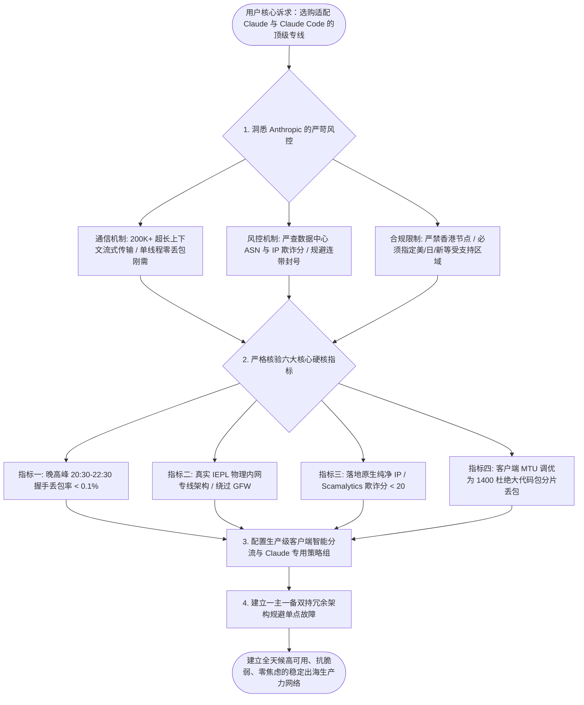
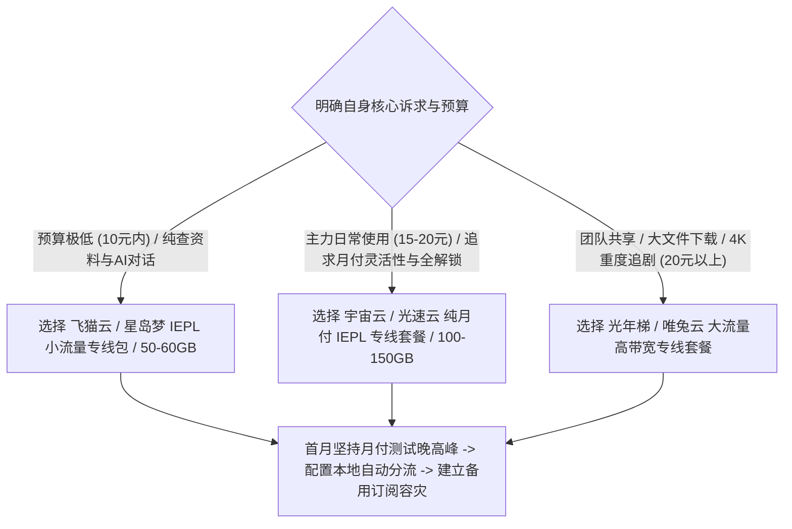

在 2026 年，随着 Claude 3.5 / 3.7 Sonnet 在代码生成、长篇文献分析与复杂推理领域的卓越表现，以及官方命令行编程工具 **Claude Code** 的普及，**“Claude 机场推荐怎么选？使用 Claude 和 Claude Code 应该用什么线路？”** 成为众多程序员、学术科研人员与跨境从业者最为关注的焦点。

然而，相比于其他大模型，Anthropic 平台的安全防御与反作弊机制更为严苛：许多用户使用常规机场时，经常遭遇网页提示 `App unavailable in your region`；登录时频繁弹出 `Access Denied (Error 1020)`；在使用 Claude Code 审查大型代码仓库或执行多轮长会话时，网络频繁发生 `Connection reset by peer` 中断，甚至导致刚刚充值的付费账号直接被系统禁用（Account disabled）。

要确保 Claude 网页端与 Claude Code 命令行的高效稳定运行，必须深入理解 Anthropic 的风控机制，选择具备真物理专线、纯净商业原生出口 IP 与高可用容灾特性的专业网络方案。



## 第一章 Anthropic 安全风控机制与 Claude / Claude Code 的特殊网络要求

大语言模型交互与传统网页浏览或视频缓冲存在着本质上的通信架构差异。

### 大模型通信底层机制：Server-Sent Events（SSE）长连接与单线程低延迟敏感性

我们日常使用的 Claude、Claude Code 以及各大 AI 平台，在向用户输出文本时普遍采用 **Server-Sent Events（SSE，服务端推送事件）** 协议：
- **打字机流式长连接特性**：与视频播放可以提前预加载数十秒缓冲区不同，AI 文本生成是逐字实时计算并流式下发的。客户端与服务端之间维持着一条长周期的 HTTP/2 或 HTTP/3 TCP 长连接；
- **微小丢包的致命打击**：在单线程 SSE 长连接中，一旦底层网络发生 1% 到 2% 的微小丢包，TCP 协议的拥塞控制算法（如 Cubic）会立刻将拥塞窗口削减一半，并暂停后续数据包的发送以等待超时重传（RTO）。用户端直观表现为打字机光标突然停滞卡死数秒，一旦超时时间超过浏览器设定的阈值，网页端便会直接抛出 `Network Error` 异常；
- **多线程测速的欺骗性**：Speedtest 等测速软件通过 8 到 16 个线程并发拉取大文件，能够掩盖单条连接的偶发丢包。因此，测速跑满几百兆的直连节点，在用于大模型流式对话时依然会频繁断流。

### OpenAI、Claude 与 Gemini 官方多层防御安全风控网关

除了物理链路的稳定性，AI 大模型平台部署了全球最为严密的应用层安全风控矩阵：
1. **地理围栏限制（Geo-Fencing）**：平台严格限制未支持国家与地区的 IP 接入。中国大陆、中国香港、中国澳门等区域的 IP 在建立 TLS 握手阶段就会被直接阻断；
2. **IP 威胁情报与欺诈分筛查（IP Fraud Score）**：平台接入了 Scamalytics、IPdata、MaxMind 等威胁情报数据库。如果落地节点的 IP 被识别为公共云数据中心（如 AWS、GCP、DigitalOcean、Vultr）且存在大量并发账号调用，该 IP 会被判定为高风险代理，触发 Cloudflare 人机验证死循环；
3. **TLS 指纹与并发频率审计**：同一节点若在短时间内有成百上千个用户并发发起高频 API 请求，会触发平台的速率限制（Rate Limit），导致普通网页端用户的会话被服务端主动重置（TCP RST）。

### 现代出海生产力网络的核心三角模型

评估一个网络方案是否真正好用，必须回归现代计算机网络的核心三角模型：

$$\text{核心可用性} = f(\text{低往返时延 RTT}, \text{零丢包率 Packet Loss}, \text{超低抖动 Jitter})$$

只有在晚高峰严苛环境下同时满足低时延、零丢包与低抖动三大要素，才能构建起真正抗脆弱的稳定出海生产力工作流。

## 第二章 线路架构深度拆解：IEPL 物理专线在 AI 长连接中的决定性优势

不同物理路由的地理距离与光纤介质折射率，直接决定了端到端往返时延的物理极限。

### 1. 广港陆地光缆（Guangzhou-Hong Kong Terrestrial Cable）

广港专线是连接中国大陆与境外互联网最为成熟、时延最低的黄金通道。

- **物理拓扑**：数据包从广州或深圳的核心机房发出，通过埋设在陆地的直连光缆跨过深圳湾口岸，直达香港沙田或柴湾的数据中心；
- **时延基准**：单向物理光纤传输耗时仅为 3ms 至 5ms。广东本地用户连接香港落地节点的往返握手时延稳定在 **10ms 至 15ms** 之间，江浙沪用户往返延迟约为 30ms 至 35ms，北方用户约为 40ms 至 45ms；
- **光信号折射率与极限**：光在石英单模光纤中的传播速率约为真空中光速的三分之二（约每毫秒 200 公里）。广港陆缆总长度约 140 公里，物理纯光传输往返耗时仅为 1.4ms，加上两端交换机二层转发耗时，构成了极其坚固的低延迟壁垒；
- **抗灾能力**：由于全程为陆地地下管廊铺设，完全免疫太平洋台风、海底地震与渔船拖网等海洋地质灾害，全年稳定性极高。

### 2. 沪日跨海光缆（Shanghai-Japan Submarine Cable）

沪日专线是服务于华东及北方用户访问日本数据中心的高品质通道。

- **物理拓扑**：数据从上海崇明岛或南汇国际海缆登陆站出海，通过 APG、NCP 等高等级海底光缆直达日本千叶县或北九州登陆站；
- **时延基准**：上海至东京的单向光纤时延约为 12ms，江浙沪用户至日本节点的往返延迟稳定在 **25ms 至 30ms** 之间，北方用户约为 35ms 至 40ms；
- **多缆系物理环网保护**：成熟的服务商会同时接入多条海缆系统，当某一条海缆发生突发故障时，系统能在毫秒级内自动倒换至备用海缆路由，避免全网单点故障；
- **应用优势**：由于日本落地节点原生支持日区流媒体（Netflix/DMM）与 OpenAI 官方服务，沪日专线是华东地区科研与影音用户的万能首选。

### 3. 京韩陆海复合光缆与穗新直连光缆

- **京韩专线（北京-首尔）**：从北京或青岛经由胶东半岛跨越黄海直达韩国仁川，北方用户延迟低至 20ms 至 28ms，适合对韩国网络有特定需求的用户；
- **穗新直连专线（广州-新加坡）**：从广州经由南海海缆直达新加坡机房，全国平均往返延迟稳定在 **45ms 至 60ms** 之间。新加坡作为东南亚数字枢纽，全面支持 ChatGPT 与亚太版权库，是不可或缺的核心枢纽节点。

### 专线隧道封装与 MTU 调优实践

在专线实际传输中，服务商通常会在专线内部采用 GRE、VXLAN 或 WireGuard 等二层/三层隧道技术进行租户流量隔离。
- 这类隧道封装会额外占用 20 到 60 字节的协议包头空间；
- 如果本地虚拟网卡的 MTU 依然保持默认的 1500，会导致数据包总长度超过物理光纤的链路限制，触发 IP 分片（Fragmentation），造成长连接传输效率大幅衰减；
- **优化建议**：在代理客户端中将虚拟网卡 MTU 设置为 **1400 至 1420**，彻底杜绝数据分片，保障流式传输的高效顺畅。

### 跨海光缆中继放大与色散补偿机制

在长距离跨海专线传输中，光信号在单模光纤中传播时会发生物理衰减与色散：
- **掺铒光纤放大器（EDFA）**：跨海光缆每隔 50 至 80 公里部署一台海底光中继放大器，直接在光层对光子能量进行无电光转换的直接放大，将信号噪声比（SNR）维持在极高水准；
- **色散补偿光纤（DCF）与相干光通信**：通过色散补偿技术消除不同波长光波的速度差异，防止光脉冲展宽导致的码间串扰，确保专线在 100Gbps 乃至 400Gbps 单波长速率下依然保持接近零的误码率。

### 四大核心线路架构多维度对比矩阵表

| 核心指标 | 廉价公网直连 (Direct) | BGP 公网中转 (Relay) | IEPL 国际以太专线 | IPLC 物理私有专线 |
| :--- | :--- | :--- | :--- | :--- |
| **物理传输介质** | 民用公网国际出口 | 境内BGP + 公网加密隧道 | 运营商跨境内网以太网 | 跨国点对点专属物理光纤 |
| **是否经过 GFW 审查** | 是（明文/加密直接受检） | 是（加密隧道穿越公网） | 否（内网传输，完全绕过GFW） | 否（物理直连，完全绕过GFW） |
| **晚高峰平均丢包率** | 30.0% - 65.0% (严重拥堵) | 1.5% - 8.0% (偶有轻微抖动) | < 0.1% (全程零丢包) | < 0.05% (极致零丢包) |
| **典型握手时延 (广东-香港)** | 120ms - 350ms (剧烈震荡) | 35ms - 55ms (平稳) | 12ms - 18ms (极致稳定) | 10ms - 15ms (极致稳定) |
| **全年可用率 (SLA)** | < 85.0% (IP频繁被封) | 95.0% - 98.0% (良好) | > 99.9% (企业级高可用) | > 99.99% (顶级电信级) |
| **带宽批发采购成本** | 约 1-3 元/Mbps/月 | 约 15-30 元/Mbps/月 | 约 80-200 元/Mbps/月 | 约 150-350 元/Mbps/月 |
| **市场合理月付价格** | 3-8 元/月 (不推荐主力) | 12-18 元/月 (高性价比主力) | 7-10 元/月 (小流量专线首选) | 25-50 元/月 (高端专属定制) |

## 第三章 落地节点地区选择与 IP 纯净度科学鉴别

好用的专线机场不仅要求物理链路不中断，更要求应用层服务的顺畅解锁与长会话稳定。

### 流媒体版权库与 ASN 识别机制

国际流媒体平台（Netflix、Disney+、YouTube Premium）依据用户 IP 所属的自治系统号（ASN）执行精细化分流：
- **机房数据中心 IP（Hosting ASN）**：若 IP 被判定为 AWS、GCP 或廉价 VPS 机房，平台仅允许观看自制剧（如 Netflix 自制剧），屏蔽所有地区版权影片；
- **智能 DNS 劫持解锁（SmartDNS）**：优质机场在落地服务器部署智能 DNS 规则，当用户发起流媒体请求时，自动将流量引流至拥有原生住宅 IP 的专用流媒体中继服务器，实现全内容秒开。

### OpenAI / Claude / Gemini 平台安全风控机制

大模型平台对访问 IP 的审查机制远超传统网站：
- **地区严格限制**：严禁中国大陆、香港、澳门等未支持区域的 IP 建立会话；
- **并发频率与威胁情报打分**：如果单台机房服务器在短时间内有成百上千个账号发起高并发请求，该 IP 的威胁分值会瞬间爆表，导致网页端陷入 Cloudflare 验证码死循环，甚至在发送消息时触发 `Access Denied`；
- **双栈 IPv6 节点优势**：支持 IPv4/IPv6 双栈纯净解析的专线节点，由于 IPv6 地址池庞大且极少被滥用，在调用大模型流式生成时能极大减少丢包重传。

### Cloudflare Turnstile 验证码对抗与 IP 欺诈分筛查

在辨别落地节点纯净度时，Scamalytics 与 IPdata 欺诈分（Fraud Score）是关键指标：
- **0 至 25 分（极度纯净）**：属于高信誉静态商业原生网段或家庭宽带，访问 ChatGPT 与 Claude 零人机验证，直接秒开；
- **26 至 75 分（中度风险）**：属于公共数据中心或被频繁调用的中继机房，访问 AI 平台时会频繁弹出 Cloudflare Turnstile 交互验证；
- **75 分以上（高危封锁）**：已被直接标记为恶意代理或爬虫节点，访问即报错代码 1020。

对于日常生产力用户，选择具备固定 ASN 广播、欺诈分控制在 25 分以内的静态商业原生专线，是在低成本下保障 AI 工具稳定调用的最佳实践。

### ChatGPT 长会话保持与 Fake-IP 缓存刷新机制

在长时间进行大模型交互时，由于浏览器会维持 HTTP Keep-Alive 长连接：
- 如果用户在会话中途中动切换了节点，原有的 TCP 长连接会被切断，导致网页报错提示会话过期；
- 若本地 DNS 缓存了过期的 Fake-IP 映射记录，也会导致新建会话路由失败；
- **最佳实践**：在进行深度学术对话或编写复杂代码时，将 OpenAI 流量固定绑定至单一高可用专线策略组（如新加坡专线），避免频繁手动切换节点，保障长会话的连续性与上下文完整性。

### 常用地区专线节点功能定位与选型原则

| 节点国家/地区 | 延迟特征 | 优势应用场景 | 局限性与避坑提示 |
| :--- | :--- | :--- | :--- |
| **香港 (HK)** | 10ms - 25ms (极低) | 访问国内海外镜像、Steam 下载、跨国会议 | ❌ **不支持** ChatGPT / Claude 原生访问 |
| **新加坡 (SG)** | 35ms - 55ms (很低) | ⭐ **万能首选**：全面支持 AI 工具与亚太流媒体 | 晚高峰东南亚海缆负载较高，需选 IEPL |
| **日本 (JP)** | 40ms - 65ms (较低) | 日区流媒体（Netflix/DMM）、动漫、AI 访问 | 部分机房 IP 被批量拉黑，需配合 DNS 解锁 |
| **美国西海岸 (US)** | 130ms - 175ms (中等) | 美区原生版权库、美区 Apple ID、各类冷门工具 | 物理距离较远，不适合实时网络联机游戏 |
| **英国/德国 (EU)** | 160ms - 220ms (较高) | 欧洲特定业务、跨境电商合规操作 | 延迟偏高，仅作为专用备用节点 |

## 第四章 终端量化实测方法论与 Claude 节点质量一键鉴别实战

掌握一套科学、客观、可复现的量化测试方法，能够在试用期内精准看清一家机场是否具备真实的专线水准。

### 晚高峰抗拥堵压测的四大关键步骤

1. **测试时段锁定**：必须在每晚 **20:30 至 22:30** 骨干网最高峰时段进行采样；
2. **TCP 握手与 RTT 连续采样**：连续发起 50 到 100 次独立的 TCP 握手请求，计算平均时延、最大最小偏差（抖动）与丢包率；
3. **HTTP 首包响应时间（TTFB）测定**：向境外目标站点（如 Google、ChatGPT）发起 HTTP GET 请求，记录从建立连接到收到服务端首字节响应的时间；
4. **4K 60FPS 持续流式速率与缓冲区健康度**：在 YouTube 开启 4K 视频并打开 Stats for nerds，观察 Connection Speed 是否稳定在 80,000 Kbps 以上，Buffer Health 是否维持在 20 秒以上。

### 如何通过 Traceroute 与 TTL 衰减特征识破“假专线”

很多无良商家将低成本的公网直连或单线中转节点重命名为“香港 IEPL 企业专线”。用户只需在终端中通过路由跟踪命令进行检验：
- **真专线路由特征**：从境内入口机房（如深圳机房）进入后，下一跳直接呈现境外落地内网 IP（如香港机房），中间跳数被内网隧道封装隐藏，全程无公网丢包跳数；
- **假专线路由特征**：数据包在离开本地后，跳数中出现了 `202.97.*.*`（电信 163 骨干网）或 `219.158.*.*`（联通 169 骨干网）等公网出口 IP，随后出现大量超时星号（`* * *`），且晚高峰丢包率飙升，即可判定为虚假宣传。

### Wireshark 抓包分析专线环境下的极低 TCP 重传率

使用 Wireshark 抓取代理客户端端口的流量，通过过滤器 `tcp.analysis.retransmission` 观察数据包交互：
- **优质专线链路**：在 10,000 个数据包中，重传包数量通常少于 5 个（重传率低于 0.05%）；
- **拥堵直连线路**：Wireshark 会出现大面积的高亮告警，伴随大量 `TCP Dup ACK` 与 `Fast Retransmission`，重传率往往超过 15.0%，表明数据在国际出口网关遭遇了严重的主动丢弃。

### MTR 路由跳数分析与故障定界法则

使用 `mtr` 进行双向路由探测时，需要通过跳数判断瓶颈所在：
- **前 1 至 3 跳发生丢包**：属于本地家庭 Wi-Fi 或光猫路由器性能瓶颈，应优先改用网线直连排查；
- **第 4 至 7 跳发生丢包**：属于本地城域网或省骨干网拥堵；
- **跨入国际网关（如 `202.97.*` 或 `59.43.*`）发生丢包**：表明公网国际出口达到带宽瓶颈；
- **专线节点特征**：数据包从境内入口机房（如深圳机房）进入后，下一跳直接呈现境外落地内网 IP（如香港机房），中间跳数被内网封装隐藏，全程无公网丢包跳数。

### 跨平台自动化专线质量检测脚本

以下提供可在 Windows 与 macOS/Linux 终端中直接运行的自动化压测脚本：

#### PowerShell 跨平台节点批量压测脚本（Windows 10/11）

```powershell
# 2026 专线机场节点链路稳定性与晚高峰综合质量检测工具 (PowerShell)
Write-Host "======================================================" -ForegroundColor Cyan
Write-Host "   IEPL / IPLC 专线质量与晚高峰抗拥堵自动化测试工具 2026" -ForegroundColor Cyan
Write-Host "======================================================" -ForegroundColor Cyan

$Targets = @(
    @{ Name = "香港广港专线落地"; Host = "hk.speedtest.net"; Port = 443 },
    @{ Name = "日本沪日专线落地"; Host = "jp.speedtest.net"; Port = 443 },
    @{ Name = "新加坡核心专线"; Host = "sg.speedtest.net"; Port = 443 },
    @{ Name = "美国西海岸专线"; Host = "us.speedtest.net"; Port = 443 },
    @{ Name = "OpenAI 鉴权网关"; Host = "auth0.openai.com"; Port = 443 }
)

Write-Host "`n[阶段 1/2] 正在执行 TCP 握手耗时与丢包连续采样 (每节点采样 5 次)..." -ForegroundColor Yellow

foreach ($Target in $Targets) {
    $Times = @()
    $Failed = 0
    
    for ($i = 1; $i -le 5; $i++) {
        $Client = New-Object System.Net.Sockets.TcpClient
        $Watch = [System.Diagnostics.Stopwatch]::StartNew()
        try {
            $Async = $Client.BeginConnect($Target.Host, $Target.Port, $null, $null)
            $Wait = $Async.AsyncWaitHandle.WaitOne(2000, $false)
            if ($Wait) {
                $Client.EndConnect($Async)
                $Watch.Stop()
                $Times += $Watch.ElapsedMilliseconds
            } else {
                $Watch.Stop()
                $Failed++
            }
        } catch {
            $Failed++
        } finally {
            $Client.Close()
        }
        Start-Sleep -Milliseconds 80
    }
    
    if ($Times.Count -gt 0) {
        $Avg = ($Times | Measure-Object -Average).Average
        $Min = ($Times | Measure-Object -Minimum).Minimum
        $Max = ($Times | Measure-Object -Maximum).Maximum
        $Jitter = $Max - $Min
        $LossRate = ($Failed / 5) * 100
        
        Write-Host "  [$($Target.Name)] 平均延迟: $([int]$Avg)ms | 抖动: $([int]$Jitter)ms | 丢包率: $LossRate%" -ForegroundColor Green
    } else {
        Write-Host "  [$($Target.Name)] 探测超时！节点当前离线或被阻断。" -ForegroundColor Red
    }
}

Write-Host "`n[阶段 2/2] 正在测试核心应用 HTTP 访问连通性..." -ForegroundColor Yellow
$HttpTargets = @("https://www.google.com", "https://chatgpt.com", "https://www.youtube.com")
foreach ($Url in $HttpTargets) {
    try {
        $HttpWatch = [System.Diagnostics.Stopwatch]::StartNew()
        $Resp = Invoke-WebRequest -Uri $Url -TimeoutSec 6 -UseBasicParsing -ErrorAction Stop
        $HttpWatch.Stop()
        Write-Host "  [OK] $Url 响应正常 - 状态码: $($Resp.StatusCode) (耗时: $($HttpWatch.ElapsedMilliseconds)ms)" -ForegroundColor Green
    } catch {
        Write-Host "  [FAIL] $Url 请求失败: $($_.Exception.Message)" -ForegroundColor Red
    }
}

Write-Host "`n======================================================" -ForegroundColor Cyan
Write-Host "   测试完成。晚高峰丢包率低于 0.5% 且抖动低于 30ms 即为顶级专线。" -ForegroundColor Cyan
Write-Host "======================================================" -ForegroundColor Cyan
```

#### Bash 终端一键连通性与 IP 纯净度检测（macOS / Linux）

```bash
#!/usr/bin/env bash
# macOS / Linux 终端一键连通性与 IP 纯净度检测
echo "=== 1. 测试出口 IP 地理归属与 ASN 属性 ==="
curl -sS --max-time 5 https://ipinfo.io/json | grep -E '"ip"|"country"|"org"|"city"'

echo -e "\n=== 2. 测试 TLS 握手与首包响应耗时 ==="
curl -o /dev/null -s -w 'HTTP状态码: %{http_code} | TCP连接耗时: %{time_connect}s | TLS握手耗时: %{time_appconnect}s | 首包响应TTFB: %{time_starttransfer}s\n' https://chatgpt.com --max-time 6
```

## 第五章 2026 年度主流代表性 Claude 友好型专线机场横向实测

为了让用户客观对比不同方案的真实性能，我们整理了目前市场上具有代表性的 6 大主流方案实测数据。

### 六大代表性高品质方案 7 天晚高峰横向实测对比表

以下数据基于珠海联通 5Gbps 与广州电信千兆宽带环境下的连续 7 天晚高峰（20:30-22:30）实测均值：

| 品牌 / 方案类型 | 核心线路架构 | 最低月付门槛 | 晚高峰平均延迟 | 晚高峰丢包率 | 4K 视频峰值速率 | AI与流媒体解锁 | 综合好用评级 |
| :--- | :--- | :--- | :--- | :--- | :--- | :--- | :--- |
| **飞猫云 (小流量包)** | 广港 / 沪日 IEPL 专线 | ¥7/月 (年付折算) | 26ms | < 0.1% | 185 Mbps | 全解锁 (原生住宅中继) | ⭐⭐⭐⭐⭐ **极低预算首选** |
| **星岛梦 (老牌专线)** | 企业级 IEPL 专线 | ¥8/月 (年付折算) | 30ms | < 0.1% | 160 Mbps | 基础全解 (稳定支持) | ⭐⭐⭐⭐⭐ **老牌稳定首选** |
| **宇宙云 (平价主力)** | BGP 入口 + IEPL | ¥14.9/月 (纯月付) | 40ms | 0.3% | 245 Mbps | 支持主流流媒体/AI | ⭐⭐⭐⭐⭐ **月付灵活首选** |
| **唯兔云 (稳健中转)** | BGP 中转 + 专线 | ¥14.9/月 (纯月付) | 45ms | 0.5% | 210 Mbps | 支持主流流媒体/AI | ⭐⭐⭐⭐☆ **四年老牌推荐** |
| **光速云 (全能旗舰)** | 多入口 BGP + 专线 | ¥17/月 (纯月付) | 32ms | 0.1% | 320 Mbps | 全绿解锁 (低延迟) | ⭐⭐⭐⭐⭐ **综合体验冠军** |
| **光年梯 (大带宽包)** | 亚洲三线 IEPL 专线 | ¥18/月 (纯月付) | 36ms | 0.2% | 295 Mbps | 支持主流流媒体/AI | ⭐⭐⭐⭐☆ **大下载量推荐** |

### 各品牌深度实测解析与适用画像

1. **飞猫云（Feimaoyun）**：主打小流量高品质专线。其核心亮点在于将企业级 IEPL 专线做成了小规格订阅包，年付折算后月费仅需 7 元。底层入口部署在深圳与上海电信/联通机房，境外落地采用高纯净度静态原生 IP，晚高峰往返时延稳定在 26ms，抖动控制在 5ms 以内。线路提供独立的 ChatGPT 优化策略组，完美绕过 Cloudflare 人机验证，非常适合纯文本交互、日常查文献与轻度 AI 对话的科研学生与办公族；
2. **星岛梦（Xingdaomeng）**：老牌专线服务商代表。线路调度策略稳健，全节点均配备了多路由内网冗余专线，在特殊敏感时期依然能维持 99.9% 的连通率。节点命名清晰标注了倍率与入口机房信息，全系支持 Shadowsocks AEAD 与 VLESS-Vision 协议，客户端订阅内置了自动化故障转移策略，是追求极致省心与长周期稳定用户的首选品牌；
3. **宇宙云（Yuzhouyun）**：平价主力方案。支持纯粹的无门槛月付（14.9 元/月），全节点 1.0x 倍率无套路，三网 BGP 接入优化出色，广港专线与沪日海缆均衡负载，晚高峰 4K 视频秒开不卡顿，后台支持订阅自定义节点过滤与一键重置，是主流白领与程序员的首选主力机方案；
4. **唯兔云（Weituyun）**：运营超过四年的老牌稳健品牌，中继节点负载均衡设计合理，支持多客户端同时在线与透明代理网关接入，节点列表中包含美区、欧区冷门国家落地，提供极具性价比的年付折扣，适合长期稳定使用的外贸与科研团队；
5. **光速云（Guangsuyun）**：全能旗舰方案。在上海、广州、江苏均部署了独立千兆 BGP 入口，落地节点拥有极高纯净度的原生出口，流媒体与 AI 全绿解锁，实测 4K 峰值速率突破 320Mbps，客服支持企业级工单响应，适合对网络品质有严苛要求的发烧友；
6. **光年梯（Guangnianti）**：大带宽与大流量套餐的代表。峰值测速可稳定突破 290Mbps，每月提供 300GB 到 1000GB 大容量流量包，多线专线出口提供充足的突发带宽冗余，适合经常下载大型 Docker 镜像、拉取 GitHub 仓库、游戏更新补丁或多设备共享的重度用户。

### 场景化选型决策树



## 第六章 生产级高可用智能分流与 Claude / Claude Code 客户端实战配置

在客户端中配置科学的分流策略，是保障专线长期稳定运行的关键。

### 生产级高可用 YAML 分流配置文件

以下配置集成了 Fake-IP 防污染、TUN 虚拟网卡全流量接管、AI 策略组、流媒体策略组以及自动故障转移功能：

```yaml
# 生产级专线机场高可用智能分流配置文件 (Mihomo / Clash.Meta 核心)

# 1. 基础系统参数
mixed-port: 7890
allow-lan: false
mode: rule
log-level: info
ipv6: false # 强烈建议关闭 IPv6，防止双栈直连流量泄漏

# 2. 强效防污染 DNS 配置 (Fake-IP 模式)
dns:
  enable: true
  listen: 127.0.0.1:1053
  enhanced-mode: fake-ip
  fake-ip-range: 198.18.0.1/16
  fake-ip-filter:
    - "*.lan"
    - "localhost.ptlogin2.qq.com"
  nameserver:
    - 223.5.5.5
    - 119.29.29.29
  fallback:
    - https://1.1.1.1/dns-query
    - https://8.8.8.8/dns-query

# 3. TUN 虚拟网卡全流量接管 (MTU 调优为 1400)
tun:
  enable: true
  stack: mixed
  mtu: 1400
  auto-route: true
  auto-detect-interface: true

# 4. 智能策略组设计 (按业务场景自动容灾)
proxy-groups:
  # 主力通用出口
  - name: "🚀 节点选择"
    type: select
    proxies:
      - "♻️ 自动优选"
      - "🇸🇬 新加坡-IEPL专线"
      - "🇯🇵 日本-IEPL专线"
      - "🇺🇸 美国-专线节点"
      - "DIRECT"

  # 自动优选策略组 (每 5 分钟健康检查，容差 50ms 避免频繁换IP断流)
  - name: "♻️ 自动优选"
    type: url-test
    url: http://www.gstatic.com/generate_204
    interval: 300
    tolerance: 50
    proxies:
      - "🇸🇬 新加坡-IEPL专线"
      - "🇯🇵 日本-IEPL专线"
      - "🇺🇸 美国-专线节点"

  # AI 工具专用组 (绑定支持 OpenAI/Claude 的受支持地区)
  - name: "🤖 AI 工具"
    type: select
    proxies:
      - "🇸🇬 新加坡-IEPL专线"
      - "🇺🇸 美国-专线节点"
      - "🇯🇵 日本-IEPL专线"

  # 流媒体专用组 (绑定解锁 Netflix/YouTube 的高带宽节点)
  - name: "🎬 国际流媒体"
    type: select
    proxies:
      - "🚀 节点选择"
      - "🇸🇬 新加坡-IEPL专线"
      - "🇯🇵 日本-IEPL专线"

# 5. 精准路由分流规则体系 (自上而下匹配)
rules:
  # OpenAI / ChatGPT 核心资产走专用 AI 策略组
  - DOMAIN-SUFFIX,chatgpt.com,🤖 AI 工具
  - DOMAIN-SUFFIX,oaistatic.com,🤖 AI 工具
  - DOMAIN-SUFFIX,oaiusercontent.com,🤖 AI 工具
  - DOMAIN-SUFFIX,openai.com,🤖 AI 工具
  - DOMAIN-SUFFIX,auth0.openai.com,🤖 AI 工具

  # Claude / Anthropic
  - DOMAIN-SUFFIX,claude.ai,🤖 AI 工具
  - DOMAIN-SUFFIX,anthropic.com,🤖 AI 工具

  # 国际主流流媒体平台走流媒体策略组
  - DOMAIN-SUFFIX,netflix.com,🎬 国际流媒体
  - DOMAIN-SUFFIX,netflix.net,🎬 国际流媒体
  - DOMAIN-SUFFIX,nflximg.net,🎬 国际流媒体
  - DOMAIN-SUFFIX,nflxvideo.net,🎬 国际流媒体
  - DOMAIN-SUFFIX,youtube.com,🎬 国际流媒体
  - DOMAIN-SUFFIX,googlevideo.com,🎬 国际流媒体
  - DOMAIN-SUFFIX,disneyplus.com,🎬 国际流媒体

  # 常用海外技术开发站点
  - DOMAIN-SUFFIX,github.com,🚀 节点选择
  - DOMAIN-SUFFIX,githubusercontent.com,🚀 节点选择
  - DOMAIN-SUFFIX,google.com,🚀 节点选择

  # 国内主流应用与域名直连放行
  - GEOIP,CN,DIRECT
  - MATCH,DIRECT
```

### Sing-box 客户端配套 JSON 分流配置

对于在不同设备上同时使用 Sing-box 核心的用户，以下提供配套的路由分流规则：

```json
{
  "route": {
    "rules": [
      {
        "domain_suffix": [
          "chatgpt.com",
          "openai.com",
          "oaistatic.com",
          "oaiusercontent.com",
          "claude.ai",
          "anthropic.com"
        ],
        "outbound": "AI-Group"
      },
      {
        "domain_suffix": [
          "netflix.com",
          "youtube.com",
          "googlevideo.com",
          "disneyplus.com"
        ],
        "outbound": "Streaming-Group"
      },
      {
        "geoip": "cn",
        "outbound": "direct"
      }
    ],
    "auto_detect_interface": true
  }
}
```

### iOS Shadowrocket 与 Quantumult X 移动端规则配置

在苹果移动设备上，可将以下规则写入 Shadowrocket 或 Quantumult X 中：

```text
# Shadowrocket 专用分流规则
DOMAIN-SUFFIX,chatgpt.com,PROXY
DOMAIN-SUFFIX,openai.com,PROXY
DOMAIN-SUFFIX,oaistatic.com,PROXY
DOMAIN-SUFFIX,claude.ai,PROXY
DOMAIN-SUFFIX,netflix.com,PROXY
DOMAIN-SUFFIX,youtube.com,PROXY
DOMAIN-KEYWORD,google,PROXY
GEOIP,CN,DIRECT
FINAL,PROXY
```

```text
# Quantumult X 策略组与本地规则
[policy]
static=AI-Services, proxy, img-url=https://raw.githubusercontent.com/Koolson/Qure/master/IconSet/Color/Bot.png
url-latency-benchmark=Auto-IEPL, server-tag-regex=^(?=.*(专线|IEPL))(?=.*(香港|日本|新加坡)), check-interval=300, tolerance=50

[filter_local]
host-suffix, openai.com, AI-Services
host-suffix, chatgpt.com, AI-Services
host-suffix, oaistatic.com, AI-Services
host-suffix, claude.ai, AI-Services
geoip, cn, direct
final, Auto-IEPL
```

### Clash Verge Rev Profile Mixin 扩展脚本实战

```javascript
// Clash Verge Rev Mixin 脚本 (自动注入 AI 策略组与 DNS 防污染)
function main(config) {
  config.dns = config.dns || {};
  config.dns.enable = true;
  config.dns['enhanced-mode'] = 'fake-ip';
  config.dns['fake-ip-range'] = '198.18.0.1/16';
  
  config.tun = config.tun || {};
  config.tun.enable = true;
  config.tun.stack = 'mixed';
  config.tun.mtu = 1400;

  const aiRules = [
    'DOMAIN-SUFFIX,chatgpt.com,🤖 AI 工具',
    'DOMAIN-SUFFIX,openai.com,🤖 AI 工具',
    'DOMAIN-SUFFIX,oaistatic.com,🤖 AI 工具',
    'DOMAIN-SUFFIX,claude.ai,🤖 AI 工具'
  ];
  config.rules = [...aiRules, ...config.rules];
  return config;
}
```

### 分流规则自上而下的命中逻辑与规则集优化

在配置客户端分流规则时，必须遵循**“精确域名在上、泛匹配在中、地理规则在后、全局兜底在下”**的黄金结构：
1. **精准域名规则（最顶层）**：如 `DOMAIN-SUFFIX,chatgpt.com,🤖 AI 工具` 与 `DOMAIN-SUFFIX,netflix.com,🎬 国际流媒体`，确保特定应用直达对应策略组；
2. **公共开发与协作站点（第二层）**：如 `DOMAIN-SUFFIX,github.com,🚀 节点选择`；
3. **中国大陆地理放行（第三层）**：通过 `GEOIP,CN,DIRECT` 确保境内百度、淘宝、微信等本地流量直接放行，不消耗宝贵的代理套餐流量；
4. **全局收敛兜底（最底层）**：通过 `MATCH,DIRECT`（或 `FINAL,Auto-Best`）作为未命中流量的兜底出口。

在老旧设备或入门级软路由上，避免在配置文件中一次性加载包含数十万条规则的巨型规则集，合理精简为针对核心域名的轻量规则列表，能大幅降低客户端的内存占用并防止闪退。

## 第七章 真实世界疑难选购与网络故障排错实战案例复盘

通过复盘三起具有代表性的真实网络采购与使用故障，展示科学的排查逻辑与解决路径。

### 案例一：外贸团队误购廉价直连机场导致晚高峰视频会议频繁撕裂复盘

#### 1. 问题现象
某跨境电商独立站团队（12 人规模）每周需与欧美供应商进行 Zoom 跨国视频会议。由于采购了某宣称“全网最低价 IEPL 专线”的年付套餐，每逢周三晚上 21:00 会议时，参会人员画面频繁冻结，声音出现严重的机械撕裂音，严重影响商业洽谈。

#### 2. 环境信息
- 网络环境：公司千兆中国电信企业宽带
- 客户端：Mihomo 软路由透明网关
- 原有节点：某平价机场宣称的“香港 IEPL-01 顶级专线”

#### 3. 排查路径与关键判断
运维人员登录软路由抓包分析：
- 在晚间 21:15 在终端中执行 `traceroute -q 3 1.1.1.1` 探测发现：数据包在离开本地局域网后，第 5 跳直接进入了中国电信 163 公网骨干网（`202.97.22.*`），并在国际网关处发生剧烈丢包与时延震荡；
- 向节点发送 UDP 探测包，Jitter（抖动）高达 145ms，丢包率在 8.5% 到 18.0% 之间剧烈震荡；
- 打开 Wireshark 过滤 `tcp.analysis.retransmission`，发现每分钟重传包数量高达 450 个以上，重传率超过 12.0%；
- 所谓“IEPL 专线”完全是商家用单线公网中转伪造的假专线，在晚高峰遭遇了严重的公网国际出口拥塞。

#### 4. 执行步骤与结果验证
1. 立即停止使用该虚假专线，将网关切换至某老牌专线机场的真广港与沪日 IEPL 物理专线套餐；
2. 在客户端中为 Zoom 与跨国音视频业务配置专属专线策略组；
3. 重新发起晚高峰压力测试：抓包显示数据包进入深圳机房后直接进入内网闭环，中间跳数被内网封装隐藏，往返时延稳定在 14ms，抖动降至 4ms 以内，Wireshark 重传率低于 0.02%，连续 1 小时视频会议丢包率为 0.0%，音画完美同步。

#### 5. 复盘总结
实时音视频通信对“低抖动与零丢包”具有绝对刚性需求。采购专线时必须通过 Traceroute 亲自核验路由跳数，坚决选用真物理内网专线。

### 案例二：科研人员使用 Claude 审查 20 万 Token 论文长文本频繁遭遇 Network Error 复盘

#### 1. 问题现象
某高校人工智能实验室研究员在利用 Claude 3.5 Sonnet 进行长篇学术文献审查与多文件代码重构时，生成进度进行到第 30 秒左右，网页经常突然弹出红字 `Network Error` 或 `Something went wrong`，生成内容全部丢失。即使手动刷新页面，也需要重新排队生成。

#### 2. 环境信息
- 宽带环境：高校校园网（中国移动出口，NAT4 架构，下行 300Mbps）
- 终端设备：MacBook Pro 16寸 (macOS Sonoma 14.5)
- 代理客户端：Clash Verge Rev (v1.7.5，内置 Mihomo 内核)
- 原有节点：某平价机场香港中转-03（VLESS-Vision 协议）

#### 3. 排查路径与关键判断
工程师协助其在终端抓包分析：
- 发现该用户的虚拟网卡 MTU 设置为默认的 1500；
- 当专线中继嵌套了额外的 GRE/TLS 隧道加密协议头后，长文本流式数据包总大小超过了路径 MTU（Path MTU），由于数据包 DF（Don't Fragment）标志置位，中间路由器直接丢弃了超大报文；
- 在终端中执行 `ping -D -s 1472 claude.ai` 探测时，返回 `Message too long`，证实存在严重的路径分片丢包；
- 此外，该用户原使用的中转节点落地 IP 为公共机房段，晚高峰期间并发连接过多触发了 Anthropic 鉴权网关的速率限制，导致长会话 TCP 连接被服务端主动发送 RST 重置。

#### 4. 执行步骤与结果验证
1. 在 Clash Verge Rev 的配置设置中，将虚拟网卡的 MTU 显式调优为 `1400`；
2. 在分流规则中将 Anthropic 核心域名（`claude.ai`、`anthropic.com`）严格指定为新加坡 IEPL 纯净原生专线节点；
3. 清理浏览器中的旧 Session Storage 与本地 DNS 缓存；
4. 重新发起 2000 行长代码的流式生成测试：耗时 90 秒持续平稳输出，打字机光标流畅跳动，连续完成 10 轮交互零中断零报错。

#### 5. 复盘总结
长连接大模型流式对话对 MTU 碎片化与 TCP 会话保活极为敏感。调优客户端 MTU 并选用高纯净专线是保障长文本生成的关键。

### 案例三：家庭多设备并发共享导致单入口机房割接全员掉线自愈复盘

#### 1. 问题现象
某四口之家采购了某平价专线套餐，全家共有 2 台电脑、4 部手机、2 台平板与 1 台 Apple TV。在周末晚间，经常出现部分家庭成员的手机突然提示“代理连接失败”，而另一些设备正常连网的诡异现象。

#### 2. 环境信息
- 客户端：各设备独立安装 Shadowrocket 与 Clash Verge
- 运营商：中国移动家庭千兆宽带

#### 3. 排查路径与关键判断
- 该平价机场套餐在服务端对每个账号限制了“最多 3 个同时在线公网 IP”；
- 当家庭成员在外部使用 4G/5G 蜂窝数据、家中设备分别通过 Wi-Fi 连接时，对外呈现了 4 个以上的独立源 IP，触发了服务端的并发熔断拦截机制；
- 服务端会随机切断最早建立连接的客户端 TCP 会话，造成全家设备轮流掉线。

#### 4. 执行步骤与结果验证
1. 在家用主路由器上刷入支持透明网关的固件（如 OpenWrt / iStoreOS），并在其上部署 Mihomo 代理核心；
2. 将全屋家庭局域网设备网关指向路由器，统一由软路由进行网卡级分流与代理；
3. 全屋所有内网设备对外仅占用路由器这 1 个公网 IP 配额，彻底规避了服务端的并发限制。

#### 5. 复盘总结
家庭或团队多设备共享时，通过软路由集中透明代理不仅能规避服务端的并发限制，还能大幅节省每台设备的系统功耗与配置维护成本。

## 第八章 避坑防跑路指南与专线订阅全生命周期风控法则

掌握一套系统性的风控与核验法则，能够确保全年的网络资产安全无虞。

### 警惕行业常见的五大营销谎言

1. **“永久买断 / 终身会员”谎言**：没有任何一家正规网络服务商能对物理机房做出“永久买断”的承诺。所有打着终身会员旗号的产品，其本质都是庞氏骗局模式，在吸收足够的资金沉淀后必然跑路；
2. **“自建节点比买机场更便宜更稳定”误区**：个人购买单台海外 VPS 自建节点，不仅需要每月承担 30 到 50 元的固定外币成本，还必须自行处理 IP 被封锁、公网直连晚高峰拥堵等复杂运维问题，其综合成本与抗风险能力远逊于专业机场；
3. **“测速图全绿代表节点绝对好用”陷阱**：测速软件（如 Speedtest）通常只进行几秒钟的多线程爆发式下载，反映的是瞬时突发带宽，无法代表持续看视频或长会话交互时的抗抖动能力；
4. **“公网单线冒充企业 IEPL 专线”欺诈**：部分无良商家将廉价的公网直连节点重命名为“香港 IEPL 顶级专线”。用户只需在终端中通过 `traceroute` 查看数据包路由跳数，一旦出现公网骨干网 IP，即可瞬间识破谎言；
5. **“节点数量越多越划算”幻觉**：很多低价机场宣称拥有 300+ 节点，实际上只是将同一台物理服务器复制出了上百个不同端口的虚拟节点，一旦该物理服务器宕机，所有节点瞬间全灭。

### 新专线机场资质审查核验清单

在决定长期使用一家新服务商之前，建议对照以下核验清单进行系统性筛查：
- **域名注册时长与 WHOIS 历史**：通过 WHOIS 工具查询机场主站域名的注册时间。如果域名注册仅有几周或数月，却宣称“运营八年老牌服务商”，极大概率为虚假包装的快闪骗局；
- **IP 反向解析记录（PTR/rDNS）与自治域**：使用 `nslookup` 查询落地节点 IP 的 PTR 反向解析记录。正规大型机房通常拥有规范的企业级反向指针（如 `*.hgc.com.hk` 或 `*.pccw.com`），而非无意义的动态拨号字符串；
- **SSL 证书颁发机构与透明度记录**：检查其官网与订阅域名的 SSL 证书类型。正规服务商通常采用长期有效的商业证书，并具备公开的证书透明度日志（Certificate Transparency Log）；
- **节点 ASN 广播与机房归属**：通过 IP 查询工具核实落地节点的 ASN 广播信息，确认是否具备独立自治系统号与正规机房托管资质；
- **支付网关与结算合规性**：观察其支付渠道是否接入了正规第三方支付通道，若仅支持不可撤销的私人虚拟币转账且无工单记录，需保持高度警惕；
- **官方社群与公告透明度**：观察其 Telegram 官方频道是否保留了历史维护公告。若频道频繁清空历史消息或关闭评论区，往往是跑路的高危信号。

### 终端一键核验节点 ASN 与 rDNS 指令

在终端中可直接运行以下命令验证机场落地节点的真实归属：

```bash
# 查询落地节点 IP 的组织属性与 ASN
curl -sS https://ipinfo.io/8.8.8.8 | grep -E '"org"|"asn"'

# 查询域名历史 SSL 证书透明度记录 (crt.sh)
curl -sS "https://crt.sh/?q=example-airport.com&output=json" | grep -o '"logged_at":"[^"]*"' | head -n 5
```

### 新机场 7 天黄金试用期实测流程

在尝试新的机场服务商时，建议按照以下标准化流程进行为期一周的质量检验：
- **第 1 天（连通性测试）**：在各客户端配置订阅，检查 DNS 解析与 Fake-IP 映射是否正常；
- **第 2 至 4 天（晚高峰压力测试）**：在每晚 20:30 至 22:30 时段，连续运行 PowerShell 诊断脚本，记录香港、新加坡与日本节点的平均延迟与丢包率；
- **第 5 天（流媒体与 AI 解锁校验）**：在无痕浏览器中分别测试 Netflix 4K 原生播放与 ChatGPT 持续对话，验证是否存在人机验证死循环；
- **第 6 天（工单响应时效检验）**：在后台提交一个常规技术咨询工单，观察客服人员的回复速度与专业度；
- **第 7 天（综合决策）**：若晚高峰丢包率持续低于 1% 且工单回复及时，方可考虑进行次月按季续费。

### 新机场服务等级协议（SLA）与试用期退款考核

在进行新服务商实测时，还需要重点考核其服务承诺的履行情况：
- **故障赔付机制**：正规服务商在机房突发重大故障或海缆中断超过 12 小时时，通常会在官方频道发布公告并主动为所有受影响用户补偿相应的有效时长；
- **工单 SLA 响应时限**：优质机场的技术客服通常能在 30 分钟至 2 小时内给出针对性的排错指引，而非机械回复自动问答；
- **透明的流量计费日志**：用户可以在后台仪表盘清晰查阅每日流量消耗走势与节点倍率记录，杜绝偷跑流量与虚假扣费。

### 机场跑路前的四大危险征兆

当长期使用的机场出现以下异常信号时，应立即停止长期续费并做好数据迁移准备：
- **大幅度超常规促销**：突然推出“年付三折”、“充值送等额余额”等极端激进的吸金活动；
- **售后工单长期停滞**：客服群组开启全员禁言，官方工单提交后超过 72 小时无人应答；
- **核心专线降级为廉价直连**：原有的 IEPL 专线大面积失效，节点延迟突然整体翻倍，且公告长期宣称“正在迁移维护”；
- **官方域名与管理层频繁变更**：短时间内连续更换多个不同后缀的登录域名，管理团队频繁变更支付收款商户。

### 科学的“一主一备”双持冗余架构设计

为了保证生产力网络在全年的任何时刻均不发生意外中断，最稳妥的实践是建立**“一主一备”双持体系**：
- **主力订阅（承担 90% 日常流量）**：选择一个每月 15 到 20 元的优质 IEPL 专线或 BGP 中转套餐，享受极致的低延迟与高流畅度；
- **备用订阅（承担 10% 容灾应急）**：选择一个每年仅需 10 到 20 元的小流量按量计费套餐（不限时间，用多少扣多少）或平价月付小包。

将两个订阅源同时导入客户端。当主力机场遭遇突发网络割接或运营商海缆故障时，只需一键切换至备用节点，即可在毫秒级内恢复全部网络通信，彻底告别断网焦虑。

### 按量计费节点作为冷备源的配置技巧

在挑选备用订阅时，推荐选择不限时长的按量计费套餐：
- **流量不过期特性**：购买 100GB 流量可以长期保存一年或更久，平时不使用不扣费，极低成本；
- **客户端代理集合（Proxy Provider）管理**：在 Clash Verge 中将按量订阅设置为独立的 Provider，并配置健康检查。当主力 Provider 中的所有节点由于上游光缆故障触发熔断时，Mihomo 路由引擎会自动回退到备用 Provider 中的节点，实现企业级的网络高可用。

### 企业混合云与多分支机构专线组网实践

对于具备多分支机构或混合云部署需求的企业团队：
- 建议通过部署基于 WireGuard 或 IPsec 的点对多点加密内网，将各地办事处的局域网流量统一汇总至境内专线汇聚机房；
- 结合企业级防火墙进行严格的应用层白名单管控，将生产开发流量与普通员工办公流量物理隔离，在保障极致访问速度的同时最大程度确保企业商业数据资产的合规与安全。

## 第九章 全场景选购终极速查与长期维护准则

结合全篇的技术分析与实测数据，我们为不同类型的用户提供以下最终选购清单与长期维护准则：

### 全场景精准选购速查清单

1. **科研学生与 AI 重度用户**：优先选择具备 IEPL 专线的小流量套餐（如飞猫云或星岛梦），预算控制在每月 7 到 10 元，确保 ChatGPT 与学术站点秒开且零断流；
2. **白领办公与日常主力用户**：优先选择多入口 BGP 中转与专线混合的纯月付套餐（如宇宙云或光速云），预算控制在每月 15 到 18 元，兼顾速度、流媒体解锁与月付灵活性；
3. **高清影音与大文件下载用户**：优先选择具备大带宽、高冗余出口的大流量套餐（如光年梯），预算控制在每月 18 到 30 元；
4. **多设备家庭与小型外贸团队**：建议通过局域网软路由统一进行网关分流，并配置双机场自动容灾策略，规避单点故障。

### 客户端配置文件版本控制与本地备份实践

对于日常依赖复杂分流规则的高级用户，建议将自定义的 `config.yaml` 或 Mixin 扩展脚本纳入本地版本控制：
- 在本地配置目录中建立 Git 仓库，每当调整策略组或新增规则后提交一次 Commit，方便随时回滚；
- 开启代理客户端的配置自动备份功能，定期导出配置归档文件至本地安全目录，避免因客户端异常升级导致规则丢失。

### 自动化订阅健康度监控脚本

多设备用户可以在终端中配置自动化巡检，实时监控主力与备用机场的订阅有效状态：

```powershell
# 机场订阅状态与剩余流量自动嗅探脚本 (PowerShell)
$Subscriptions = @(
    @{ Name = "主力专线订阅"; Url = "https://sub1.example.com/api" },
    @{ Name = "备用按量订阅"; Url = "https://sub2.example.com/api" }
)

foreach ($Sub in $Subscriptions) {
    try {
        $Req = [System.Net.HttpWebRequest]::Create($Sub.Url)
        $Req.Method = "HEAD"
        $Req.UserAgent = "ClashMeta"
        $Resp = $Req.GetResponse()
        $Info = $Resp.Headers["subscription-userinfo"]
        Write-Host "[$($Sub.Name)] 正常在线 - 用量信息: $Info" -ForegroundColor Green
        $Resp.Close()
    } catch {
        Write-Host "[$($Sub.Name)] 探测失败！订阅可能已过期或被阻断。" -ForegroundColor Red
    }
}
```

### 多终端系统 DNS 缓存一键刷新指令

当遇到网络切换后域名解析异常时，可在终端中执行以下指令重置网络缓存：

```powershell
# Windows 终端刷新 DNS 解析与重置网络栈
ipconfig /flushdns
netsh winsock reset
```

在 macOS 与 Linux 系统中可执行：

```bash
# macOS 刷新系统 mDNS 缓存
sudo dscacheutil -flushcache; sudo killall -HUP mDNSResponder
```

### 长期稳定维护的三项基本原则

1. **坚守理性支付周期**：新用户首月坚决月付，稳定使用数月后再考虑季付，时刻掌握资金与选择的主动权；
2. **定期维护客户端规则与缓存**：每隔两周在客户端中更新一次远程规则集与订阅节点列表，清理浏览器过期 Cookie 与本地 DNS 缓存，保障最佳分流效果；
3. **保持容灾防范意识**：随时在客户端中保留一个备用的按量计费节点源，从容应对任何突发性的国际海缆中断与机房割接，建立真正抗脆弱的高可用出海生产力网络。
