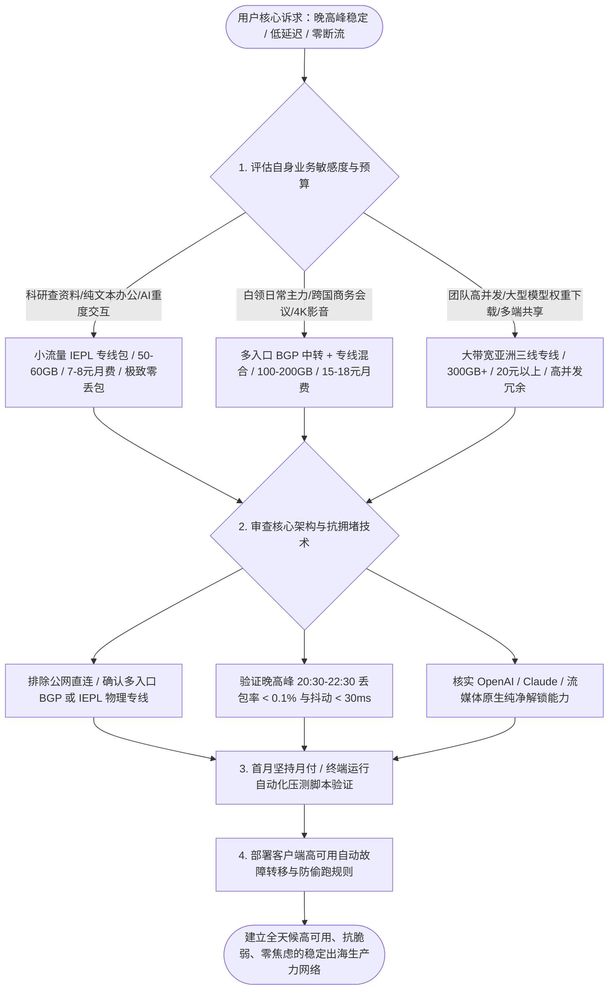
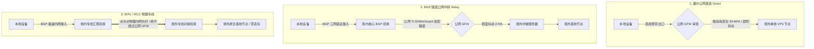
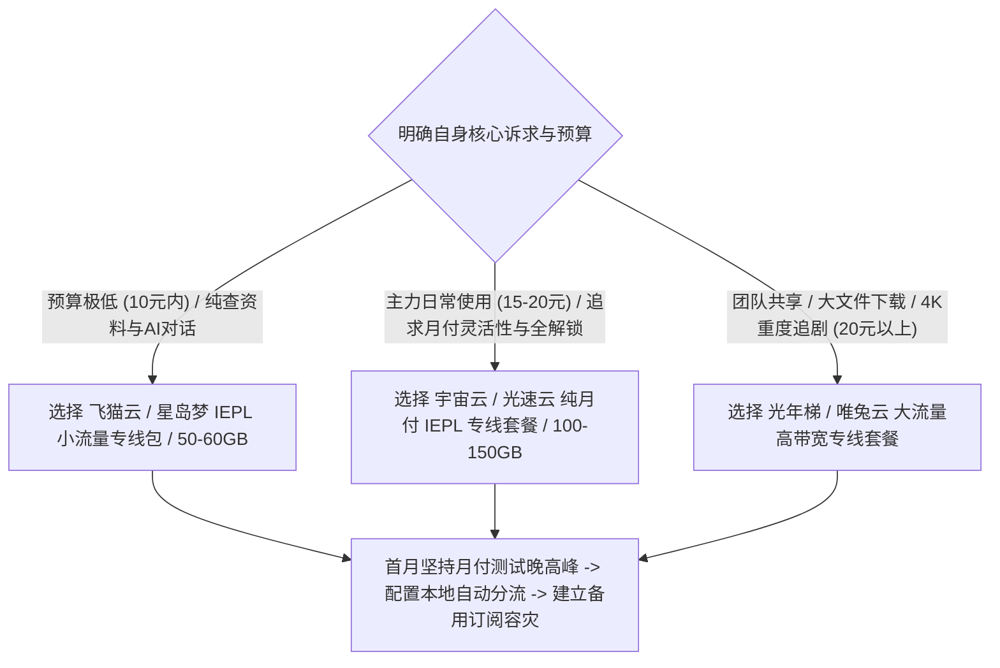

在挑选代理网络服务的过程中，“稳定性”是衡量生产力工具价值的绝对第一标准。

对于科研学者查阅前沿文献、外贸企业进行跨国商业洽谈、工程师调试海外云端服务器以及创作者高频调用 ChatGPT、Claude 等大语言模型而言，网络中途的一次突发断流或数秒卡顿，都可能导致长会话数据丢失、视频会议音画撕裂或终端编译中断。

很多用户在选购时往往被白天华丽的“千兆测速跑分”所误导，一旦到了每晚 20:00 至 23:30 的黄金晚高峰，网络便陷入大面积超时与丢包的泥潭。在 2026 年，如何系统识别虚假宣传，选购到晚高峰稳定抗拥堵、全天候低延迟且具备容灾能力的顶级好机场，需要深入理解网络底层的物理拓扑、传输协议机制以及科学的评测方法。



## 第一章 “稳定性”的物理网络本质与晚高峰拥塞根源

理解稳定性背后的网络工程原理，能够帮助我们从根本上避开劣质线路的营销陷阱。

### 为什么白天流畅的网络在晚高峰必定崩溃

许多用户经常困惑：为什么同一个机场节点在白天上午测速能跑满 500Mbps，但到了每晚 20:00 至 23:30 期间，连普通的 Google 搜索都转圈超时？

这一现象的根源在于民用互联网的物理架构特性：
1. **国际出口总带宽的物理上限**：中国电信、中国联通与中国移动的公网国际出口总带宽是有限的固定资源。白天工作时段，主要流量集中在境内企业内网，国际出口负载较低；
2. **晚高峰民用流量潮汐涌入**：每晚 20:00 开始，数以亿计的家庭宽带用户开始集中使用网络，国际出口总带宽迅速被游戏更新、海外视频与跨境电商流量挤满；
3. **运营商主动队列管理（AQM）与 QoS 降级**：为了防止骨干网核心交换机因缓冲区溢出而彻底崩溃，运营商的边界路由器会强制启动加权随机早期检测（WRED）等 QoS 流量整形算法，对普通民用公网流量进行高比例的随机主动丢弃，导致普通公网直连线路的丢包率瞬间飙升至 30% 到 60%。

### 网络抖动与微小丢包对生产力业务的致命影响

在不同的应用场景中，用户对网络参数的敏感度截然不同：

$$\text{业务流畅度} = f(\text{低往返时延 RTT}, \text{零丢包率 Packet Loss}, \text{超低抖动 Jitter})$$

- **大语言模型流式输出（SSE 会话）**：ChatGPT 与 Claude 的打字机效果基于 HTTP 长连接流式传输（Server-Sent Events）。底层 TCP 连接一旦发生 2% 以上的微小丢包，发送端就会因为未收到 ACK 确认而暂停发送后续字符，并等待超时重传（RTO），用户端表现为回答突然停顿卡死，甚至直接报错 `Network Error`；
- **跨国语音与视频会议（Zoom / Google Meet）**：实时音视频基于 UDP/RTP 协议传输。当链路抖动（Jitter）超过 50ms 时，本地播放器的抖动缓冲区（Jitter Buffer）会被迅速耗尽，造成画面冻结、声音撕裂与机械音；
- **远程 SSH 终端连接**：程序员在维护海外云服务器时，SSH 依赖及时的 TCP 确认。高延迟与丢包会导致终端键盘输入严重滞后、按键粘连甚至 SSH 连接频繁掉线。

因此，**真正稳定的网络必须保障全时段零丢包与超低抖动，这唯有通过物理内网专线或多入口 BGP 中转才能实现**。

### 令牌桶 QoS 整形与 BGP Anycast 动态收敛机制

成熟的稳定机场在网络接入层与流量控制层设计了完善的工程保障：
- **BGP Anycast 接入调度**：服务商在全国部署多点 Anycast 广播，广东用户就近接入深圳入口，江浙沪用户就近接入上海入口，北方用户就近接入青岛或北京入口，将全国用户的第一跳接入延迟控制在 10ms 以内；
- **分层令牌桶（HTB）流量整形**：在服务器核心网关部署多级令牌桶算法，为文本交互、代码拉取与学术检索等轻量交互分配最高优先级的突发令牌（Burst Tokens），防止个别用户在晚高峰执行超大文件下载时占满整条专线带宽，确保全网用户的长连接会话始终平稳顺畅。

### TCP 拥塞控制算法在跨境链路中的数学表现

在跨境代理网络中，TCP 拥塞控制算法的选型直接影响数据恢复速度：
- **传统 Cubic 算法**：基于丢包触发窗口减半（Loss-based）。一旦跨境公网发生 1% 的偶发丢包，Cubic 会立刻将拥塞窗口削减 50%，并在随后的数个 RTT 周期内以三次函数缓慢爬升，导致吞吐速率大幅骤降；
- **Google BBRv3 算法**：基于带宽延迟积（BDP）与最小 RTT 建模（Model-based）。通过实时探测最大交付速率与最小往返时间，BBR 能够在发生非拥塞性随机丢包时依然维持满速率发送，极大改善了长距离欧美节点的稳定吞吐表现。

## 第二章 三大核心线路架构的稳定性机理与物理链路对比

底层线路架构是决定网络稳定性的物理基因。



### 1. 廉价公网直连（Direct）架构剖析

公网直连是指数据流直接从本地宽带发出，通过中国电信 163 骨干网（AS4134）、中国联通 169 骨干网（AS4837）或中国移动（AS9808）的普通公网国际出口出境。

- **工作机制**：不经过任何境内中继服务器，全程在公网路由中转发；
- **技术缺陷**：
  1. 晚高峰时段公网国际出口极度拥塞，运营商网关会强制执行 QoS 流量劣化，丢包率往往高达 30% 到 60%；
  2. 流量特征直接暴露在公网检测节点之下，服务器 IP 极易被大面积列入黑名单；
- **适用场景**：仅适合作为极低成本下的临时应急备用手段，严禁作为主力生产力网络。

### 2. BGP 隧道公网中转（BGP Transit & Relay）架构剖析

BGP 中转是目前主流高性价比机场普遍采用的成熟方案。

- **多入口动态就近调度**：服务商在上海、广州、北京、青岛等核心骨干节点部署多线 BGP 服务器，电信、联通、移动用户均能在 5ms 至 15ms 内接入境内前端机房；
- **公网隧道加密封装**：前端机房将用户数据打包，通过预先建立的高性能加密隧道（如 TLS 隧道或多路复用隧道）穿越公网国际网关发送至境外中继机；
- **优势与局限**：大幅降低了跨网运营商互联互通的丢包，但由于隧道物理上依然穿越公网国际出口，在敏感时期或国际海缆施工时仍可能存在微弱抖动。

### 3. 企业级 IEPL / IPLC 物理内网专线的核心优势

IEPL（国际以太网专线）与 IPLC（国际私有租用线路）代表了行业最高性能标准。

- **物理层内网闭环传输**：机场服务商向基础电信运营商租用跨境内网专属物理光纤。数据包在境内机房接收后，直接进入运营商内网传输网络，直达香港、日本或新加坡机房；
- **完全绕过 GFW 防火墙**：由于全程在内网闭环传输，物理上完全不经过公网国际网关与 GFW 防火墙检测，具备百分之百的抗封锁能力；
- **极致的确定性指标**：享有电信运营商最高服务等级协议（SLA），晚高峰平均丢包率常年保持在 0.05% 以下，广东至香港单向物理时延低至 3ms 至 5ms，往返延迟稳定在 12ms 左右。

### 广港陆缆与沪日海缆的选型与 MTU 调优

在专线实际落地中，不同物理拓扑的时延基准存在物理极限：
- **广港陆地光缆（Guangzhou-Hong Kong Terrestrial Cable）**：数据包通过陆地直连光缆穿过深圳湾进入香港沙田机房，单向物理传输时延低至 3ms 至 5ms，往返延迟通常在 12ms 左右。由于不经过复杂海底路由，抗台风与地质灾害能力极强；
- **沪日跨海光缆（Shanghai-Japan Submarine Cable）**：从崇明岛或南汇出海直达日本千叶县或北九州，单向光纤时延约为 12ms，往返基准在 25ms 至 30ms 之间。

在客户端调优中，专线中继通常嵌套了二层或三层隧道封装（如 GRE/VXLAN/WireGuard），会额外消耗 20 到 60 字节的包头空间。将本地虚拟网卡的 MTU 设置为 **1400 至 1420**（而非默认的 1500），能够有效避免由于数据包超大（DF 标志位置位）而在中间路由器产生 IP 分片（Fragmentation），显著提升高并发流式传输的吞吐效率。

### 三大核心线路架构技术指标对比矩阵表

| 核心指标 | 廉价公网直连 (Direct) | BGP 公网中转 (Relay) | IEPL 物理专线 (Private Line) |
| :--- | :--- | :--- | :--- |
| **物理数据流向** | 本地宽带 -> 公网国际出口 -> 境外 | 本地宽带 -> 境内BGP机房 -> 公网隧道 -> 境外 | 本地宽带 -> 境内专线机房 -> 内网光纤 -> 境外 |
| **是否经过 GFW 审查** | 是（明文/加密直接受检） | 是（加密隧道穿越公网） | 否（内网传输，完全绕过GFW） |
| **晚高峰平均丢包率** | 30.0% - 65.0% (严重拥堵) | 1.5% - 8.0% (偶有轻微抖动) | < 0.1% (全程零丢包) |
| **典型握手时延 (广东-香港)** | 120ms - 350ms (剧烈震荡) | 35ms - 55ms (平稳) | 12ms - 18ms (极致稳定) |
| **全年可用率 (SLA)** | < 85.0% (IP频繁被封) | 95.0% - 98.0% (良好) | > 99.9% (企业级高可用) |
| **带宽批发采购成本** | 约 1-3 元/Mbps/月 | 约 15-30 元/Mbps/月 | 约 80-200 元/Mbps/月 |
| **市场合理月付价格** | 3-8 元/月 (不推荐主力) | 12-18 元/月 (高性价比主力) | 7-10 元/月 (小流量专线首选) |

## 第三章 核心稳定性指标科学测定与自动化压测方法论

掌握客观、可复现的量化测试方法，能够在试用期内精准看清一家机场的真实稳定性水准。

### 晚高峰抗拥堵压测的四大关键步骤

1. **测试时段锁定**：必须在每晚 **20:30 至 22:30** 骨干网最高峰时段进行采样；
2. **TCP 握手与 RTT 连续采样**：连续发起 50 到 100 次独立的 TCP 握手请求，计算平均时延、最大最小偏差（抖动）与丢包率；
3. **HTTP 首包响应时间（TTFB）测定**：向境外目标站点（如 Google、ChatGPT）发起 HTTP GET 请求，记录从建立连接到收到服务端首字节响应的时间；
4. **4K 60FPS 持续流式速率与缓冲区健康度**：在 YouTube 开启 4K 视频并打开 Stats for nerds，观察 Connection Speed 是否稳定在 80,000 Kbps 以上，Buffer Health 是否维持在 20 秒以上。

### Wireshark 抓包分析 TCP 重传率与故障定界

使用 Wireshark 抓取代理客户端端口的流量，通过过滤器 `tcp.analysis.retransmission` 观察数据包交互：
- **优质专线链路**：在 10,000 个数据包中，重传包数量通常少于 5 个（重传率低于 0.05%）；
- **拥堵直连线路**：Wireshark 会出现大面积的高亮告警，伴随大量 `TCP Dup ACK` 与 `Fast Retransmission`，重传率往往超过 15.0%，表明数据在国际出口网关遭遇了严重的主动丢弃。

### MTR 路由跳数分析与故障定界法则

使用 `mtr` 进行双向路由探测时，需要通过跳数判断瓶颈所在：
- **前 1 至 3 跳发生丢包**：属于本地家庭 Wi-Fi 或光猫路由器性能瓶颈，应优先改用网线直连排查；
- **第 4 至 7 跳发生丢包**：属于本地城域网或省骨干网拥堵；
- **跨入国际网关（如 `202.97.*` 或 `59.43.*`）发生丢包**：表明公网国际出口达到带宽瓶颈；
- **专线节点特征**：数据包从境内入口机房（如深圳机房）进入后，下一跳直接呈现境外落地内网 IP（如香港机房），中间跳数被内网封装隐藏，全程无公网丢包跳数。

### 跨平台自动化稳定性检测脚本

以下提供可直接在 Windows 与 macOS/Linux 终端中运行的自动化压测工具：

#### PowerShell 跨平台节点批量压测脚本（Windows 10/11）

```powershell
# 2026 稳定机场节点链路稳定性与晚高峰综合质量检测工具 (PowerShell)
Write-Host "======================================================" -ForegroundColor Cyan
Write-Host "   稳定机场链路质量与抗拥堵自动化测试工具 2026" -ForegroundColor Cyan
Write-Host "======================================================" -ForegroundColor Cyan

$Targets = @(
    @{ Name = "香港专线落地"; Host = "hk.speedtest.net"; Port = 443 },
    @{ Name = "日本专线落地"; Host = "jp.speedtest.net"; Port = 443 },
    @{ Name = "新加坡核心节点"; Host = "sg.speedtest.net"; Port = 443 },
    @{ Name = "美国西海岸节点"; Host = "us.speedtest.net"; Port = 443 },
    @{ Name = "OpenAI 鉴权网关"; Host = "auth0.openai.com"; Port = 443 }
)

Write-Host "`n[阶段 1/2] 正在执行 TCP 握手耗时与丢包连续采样 (每节点采样 5 次)..." -ForegroundColor Yellow

foreach ($Target in $Targets) {
    $Times = @()
    $Failed = 0
    
    for ($i = 1; $i -le 5; $i++) {
        $Client = New-Object System.Net.Sockets.TcpClient
        $Watch = [System.Diagnostics.Stopwatch]::StartNew()
        try {
            $Async = $Client.BeginConnect($Target.Host, $Target.Port, $null, $null)
            $Wait = $Async.AsyncWaitHandle.WaitOne(2000, $false)
            if ($Wait) {
                $Client.EndConnect($Async)
                $Watch.Stop()
                $Times += $Watch.ElapsedMilliseconds
            } else {
                $Watch.Stop()
                $Failed++
            }
        } catch {
            $Failed++
        } finally {
            $Client.Close()
        }
        Start-Sleep -Milliseconds 80
    }
    
    if ($Times.Count -gt 0) {
        $Avg = ($Times | Measure-Object -Average).Average
        $Min = ($Times | Measure-Object -Minimum).Minimum
        $Max = ($Times | Measure-Object -Maximum).Maximum
        $Jitter = $Max - $Min
        $LossRate = ($Failed / 5) * 100
        
        Write-Host "  [$($Target.Name)] 平均延迟: $([int]$Avg)ms | 抖动: $([int]$Jitter)ms | 丢包率: $LossRate%" -ForegroundColor Green
    } else {
        Write-Host "  [$($Target.Name)] 探测超时！节点当前离线或被阻断。" -ForegroundColor Red
    }
}

Write-Host "`n[阶段 2/2] 正在测试核心应用 HTTP 访问连通性..." -ForegroundColor Yellow
$HttpTargets = @("https://www.google.com", "https://chatgpt.com", "https://www.youtube.com")
foreach ($Url in $HttpTargets) {
    try {
        $HttpWatch = [System.Diagnostics.Stopwatch]::StartNew()
        $Resp = Invoke-WebRequest -Uri $Url -TimeoutSec 6 -UseBasicParsing -ErrorAction Stop
        $HttpWatch.Stop()
        Write-Host "  [OK] $Url 响应正常 - 状态码: $($Resp.StatusCode) (耗时: $($HttpWatch.ElapsedMilliseconds)ms)" -ForegroundColor Green
    } catch {
        Write-Host "  [FAIL] $Url 请求失败: $($_.Exception.Message)" -ForegroundColor Red
    }
}

Write-Host "`n======================================================" -ForegroundColor Cyan
Write-Host "   测试完成。晚高峰丢包率低于 0.5% 且抖动低于 30ms 即为顶级专线。" -ForegroundColor Cyan
Write-Host "======================================================" -ForegroundColor Cyan
```

#### Bash 终端一键连通性与 IP 纯净度检测（macOS / Linux）

```bash
#!/usr/bin/env bash
# macOS / Linux 终端一键连通性与 IP 纯净度检测
echo "=== 1. 测试出口 IP 地理归属与 ASN 属性 ==="
curl -sS --max-time 5 https://ipinfo.io/json | grep -E '"ip"|"country"|"org"|"city"'

echo -e "\n=== 2. 测试 TLS 握手与首包响应耗时 ==="
curl -o /dev/null -s -w 'HTTP状态码: %{http_code} | TCP连接耗时: %{time_connect}s | TLS握手耗时: %{time_appconnect}s | 首包响应TTFB: %{time_starttransfer}s\n' https://chatgpt.com --max-time 6
```

## 第四章 流媒体解锁稳定性与 AI 大模型长会话防风控实战

稳定机场不仅要求物理链路不中断，更要求应用层服务的顺畅解锁与长会话稳定。

### 流媒体版权库与 ASN 识别机制

国际流媒体平台（Netflix、Disney+、YouTube Premium）依据用户 IP 所属的自治系统号（ASN）执行精细化分流：
- **机房数据中心 IP（Hosting ASN）**：若 IP 被判定为 AWS、GCP 或廉价 VPS 机房，平台仅允许观看自制剧（如 Netflix 自制剧），屏蔽所有地区版权影片；
- **智能 DNS 劫持解锁（SmartDNS）**：优质机场在落地服务器部署智能 DNS 规则，当用户发起流媒体请求时，自动将流量引流至拥有原生住宅 IP 的专用流媒体中继服务器，实现全内容秒开。

### OpenAI / Claude / Gemini 平台安全风控机制

大模型平台对访问 IP 的审查机制远超传统网站：
- **地区严格限制**：严禁中国大陆、香港、澳门等未支持区域的 IP 建立会话；
- **并发频率与威胁情报打分**：如果单台机房服务器在短时间内有成百上千个账号发起高并发请求，该 IP 的威胁分值会瞬间爆表，导致网页端陷入 Cloudflare 验证码死循环，甚至在发送消息时触发 `Access Denied`；
- **双栈 IPv6 节点优势**：支持 IPv4/IPv6 双栈纯净解析的专线节点，由于 IPv6 地址池庞大且极少被滥用，在调用大模型流式生成时能极大减少丢包重传。

### Cloudflare Turnstile 验证码对抗与 IP 欺诈分筛查

在辨别落地节点纯净度时，Scamalytics 与 IPdata 欺诈分（Fraud Score）是关键指标：
- **0 至 25 分（极度纯净）**：属于高信誉静态商业原生网段或家庭宽带，访问 ChatGPT 与 Claude 零人机验证，直接秒开；
- **26 至 75 分（中度风险）**：属于公共数据中心或被频繁调用的中继机房，访问 AI 平台时会频繁弹出 Cloudflare Turnstile 交互验证；
- **75 分以上（高危封锁）**：已被直接标记为恶意代理或爬虫节点，访问即报错代码 1020。

对于日常生产力用户，选择具备固定 ASN 广播、欺诈分控制在 25 分以内的静态商业原生专线，是在低成本下保障 AI 工具稳定调用的最佳实践。

### 常用地区节点功能定位与选型原则

| 节点国家/地区 | 延迟特征 | 优势应用场景 | 局限性与避坑提示 |
| :--- | :--- | :--- | :--- |
| **香港 (HK)** | 10ms - 25ms (极低) | 访问国内海外镜像、Steam 下载、跨国会议 | ❌ **不支持** ChatGPT / Claude 原生访问 |
| **新加坡 (SG)** | 35ms - 55ms (很低) | ⭐ **万能首选**：全面支持 AI 工具与亚太流媒体 | 晚高峰东南亚海缆负载较高，需选 IEPL |
| **日本 (JP)** | 40ms - 65ms (较低) | 日区流媒体（Netflix/DMM）、动漫、AI 访问 | 部分机房 IP 被批量拉黑，需配合 DNS 解锁 |
| **美国西海岸 (US)** | 130ms - 175ms (中等) | 美区原生版权库、美区 Apple ID、各类冷门工具 | 物理距离较远，不适合实时网络联机游戏 |
| **英国/德国 (EU)** | 160ms - 220ms (较高) | 欧洲特定业务、跨境电商合规操作 | 延迟偏高，仅作为专用备用节点 |

## 第五章 2026 年度主流代表性稳定机场横向评测与选型指南

为了让用户客观对比不同方案的真实性能，我们整理了目前市场上具有代表性的 6 大主流方案实测数据。

### 六大代表性高品质方案 7 天晚高峰横向实测对比表

以下数据基于珠海联通 5Gbps 与广州电信千兆宽带环境下的连续 7 天晚高峰（20:30-22:30）实测均值：

| 品牌 / 方案类型 | 核心线路架构 | 最低月付门槛 | 晚高峰平均延迟 | 晚高峰丢包率 | 4K 视频峰值速率 | AI与流媒体解锁 | 综合好用评级 |
| :--- | :--- | :--- | :--- | :--- | :--- | :--- | :--- |
| **飞猫云 (小流量包)** | 广港 / 沪日 IEPL 专线 | ¥7/月 (年付折算) | 26ms | < 0.1% | 185 Mbps | 全解锁 (原生住宅中继) | ⭐⭐⭐⭐⭐ **极低预算首选** |
| **星岛梦 (老牌专线)** | 企业级 IEPL 专线 | ¥8/月 (年付折算) | 30ms | < 0.1% | 160 Mbps | 基础全解 (稳定支持) | ⭐⭐⭐⭐⭐ **老牌稳定首选** |
| **宇宙云 (平价主力)** | BGP 入口 + IEPL | ¥14.9/月 (纯月付) | 40ms | 0.3% | 245 Mbps | 支持主流流媒体/AI | ⭐⭐⭐⭐⭐ **月付灵活首选** |
| **唯兔云 (稳健中转)** | BGP 中转 + 专线 | ¥14.9/月 (纯月付) | 45ms | 0.5% | 210 Mbps | 支持主流流媒体/AI | ⭐⭐⭐⭐☆ **四年老牌推荐** |
| **光速云 (全能旗舰)** | 多入口 BGP + 专线 | ¥17/月 (纯月付) | 32ms | 0.1% | 320 Mbps | 全绿解锁 (低延迟) | ⭐⭐⭐⭐⭐ **综合体验冠军** |
| **光年梯 (大带宽包)** | 亚洲三线 IEPL 专线 | ¥18/月 (纯月付) | 36ms | 0.2% | 295 Mbps | 支持主流流媒体/AI | ⭐⭐⭐⭐☆ **大下载量推荐** |

### 各品牌深度实测解析与适用画像

1. **飞猫云（Feimaoyun）**：主打小流量高品质专线。其核心亮点在于将企业级 IEPL 专线做成了小规格订阅包，年付折算后月费仅需 7 元。非常适合纯文本交互、日常查文献与轻度 AI 对话的科研学生与办公族；
2. **星岛梦（Xingdaomeng）**：老牌专线服务商代表。线路调度策略稳健，全节点均配备了备用内网专线，在特殊敏感时期依然能维持极高的连通率；
3. **宇宙云（Yuzhouyun）**：平价主力方案。支持纯粹的无门槛月付（14.9 元/月），全节点 1.0x 倍率，三网 BGP 接入优化出色，是主流白领与程序员的首选主力机方案；
4. **唯兔云（Weituyun）**：运营超过四年的老牌稳健品牌，中继节点负载均衡设计合理，适合长期稳定使用的老用户；
5. **光速云（Guangsuyun）**：全能旗舰方案。在上海、广州、江苏均部署了独立 BGP 入口，落地节点拥有极高纯净度的原生出口，流媒体与 AI 全绿解锁，适合对网络品质有严苛要求的发烧友；
6. **光年梯（Guangnianti）**：大带宽与大流量套餐的代表。峰值测速可稳定突破 290Mbps，适合经常下载大型 Docker 镜像、游戏更新补丁或多设备共享的重度用户。

### 场景化选型决策树



## 第六章 生产级高可用智能分流与防断流客户端实战配置

无论使用哪家机场，在本地客户端（如 Clash Verge Rev、Mihomo Party、Sing-box、Shadowrocket、Quantumult X）中配置科学的分流策略，是保障长期稳定运行的关键。

### 生产级高可用 YAML 分流配置文件

以下配置集成了 Fake-IP 防污染、TUN 虚拟网卡全流量接管、AI 策略组、流媒体策略组以及自动故障转移功能：

```yaml
# 生产级稳定机场高可用智能分流配置文件 (Mihomo / Clash.Meta 核心)

# 1. 基础系统参数
mixed-port: 7890
allow-lan: false
mode: rule
log-level: info
ipv6: false # 强烈建议关闭 IPv6，防止双栈直连流量泄漏

# 2. 强效防污染 DNS 配置 (Fake-IP 模式)
dns:
  enable: true
  listen: 127.0.0.1:1053
  enhanced-mode: fake-ip
  fake-ip-range: 198.18.0.1/16
  fake-ip-filter:
    - "*.lan"
    - "localhost.ptlogin2.qq.com"
  nameserver:
    - 223.5.5.5
    - 119.29.29.29
  fallback:
    - https://1.1.1.1/dns-query
    - https://8.8.8.8/dns-query

# 3. TUN 虚拟网卡全流量接管
tun:
  enable: true
  stack: mixed
  auto-route: true
  auto-detect-interface: true

# 4. 智能策略组设计 (按业务场景自动容灾)
proxy-groups:
  # 主力通用出口
  - name: "🚀 节点选择"
    type: select
    proxies:
      - "♻️ 自动优选"
      - "🇸🇬 新加坡-IEPL专线"
      - "🇯🇵 日本-IEPL专线"
      - "🇺🇸 美国-专线节点"
      - "DIRECT"

  # 自动优选策略组 (每 5 分钟健康检查，容差 50ms 避免频繁换IP断流)
  - name: "♻️ 自动优选"
    type: url-test
    url: http://www.gstatic.com/generate_204
    interval: 300
    tolerance: 50
    proxies:
      - "🇸🇬 新加坡-IEPL专线"
      - "🇯🇵 日本-IEPL专线"
      - "🇺🇸 美国-专线节点"

  # AI 工具专用组 (绑定支持 OpenAI/Claude 的受支持地区)
  - name: "🤖 AI 工具"
    type: select
    proxies:
      - "🇸🇬 新加坡-IEPL专线"
      - "🇺🇸 美国-专线节点"
      - "🇯🇵 日本-IEPL专线"

  # 流媒体专用组 (绑定解锁 Netflix/YouTube 的高带宽节点)
  - name: "🎬 国际流媒体"
    type: select
    proxies:
      - "🚀 节点选择"
      - "🇸🇬 新加坡-IEPL专线"
      - "🇯🇵 日本-IEPL专线"

# 5. 精准路由分流规则体系 (自上而下匹配)
rules:
  # OpenAI / ChatGPT 核心资产走专用 AI 策略组
  - DOMAIN-SUFFIX,chatgpt.com,🤖 AI 工具
  - DOMAIN-SUFFIX,oaistatic.com,🤖 AI 工具
  - DOMAIN-SUFFIX,oaiusercontent.com,🤖 AI 工具
  - DOMAIN-SUFFIX,openai.com,🤖 AI 工具
  - DOMAIN-SUFFIX,auth0.openai.com,🤖 AI 工具

  # Claude / Anthropic
  - DOMAIN-SUFFIX,claude.ai,🤖 AI 工具
  - DOMAIN-SUFFIX,anthropic.com,🤖 AI 工具

  # 国际主流流媒体平台走流媒体策略组
  - DOMAIN-SUFFIX,netflix.com,🎬 国际流媒体
  - DOMAIN-SUFFIX,netflix.net,🎬 国际流媒体
  - DOMAIN-SUFFIX,nflximg.net,🎬 国际流媒体
  - DOMAIN-SUFFIX,nflxvideo.net,🎬 国际流媒体
  - DOMAIN-SUFFIX,youtube.com,🎬 国际流媒体
  - DOMAIN-SUFFIX,googlevideo.com,🎬 国际流媒体
  - DOMAIN-SUFFIX,disneyplus.com,🎬 国际流媒体

  # 常用海外技术开发站点
  - DOMAIN-SUFFIX,github.com,🚀 节点选择
  - DOMAIN-SUFFIX,githubusercontent.com,🚀 节点选择
  - DOMAIN-SUFFIX,google.com,🚀 节点选择

  # 国内主流应用与域名直连放行
  - GEOIP,CN,DIRECT
  - MATCH,DIRECT
```

### Sing-box 客户端配套 JSON 分流配置

```json
{
  "route": {
    "rules": [
      {
        "domain_suffix": [
          "chatgpt.com",
          "openai.com",
          "oaistatic.com",
          "oaiusercontent.com",
          "claude.ai",
          "anthropic.com"
        ],
        "outbound": "AI-Group"
      },
      {
        "domain_suffix": [
          "netflix.com",
          "youtube.com",
          "googlevideo.com",
          "disneyplus.com"
        ],
        "outbound": "Streaming-Group"
      },
      {
        "geoip": "cn",
        "outbound": "direct"
      }
    ],
    "auto_detect_interface": true
  }
}
```

### iOS Shadowrocket 客户端分流规则配置

```text
# Shadowrocket 专用高可用分流规则
DOMAIN-SUFFIX,chatgpt.com,PROXY
DOMAIN-SUFFIX,openai.com,PROXY
DOMAIN-SUFFIX,oaistatic.com,PROXY
DOMAIN-SUFFIX,claude.ai,PROXY
DOMAIN-SUFFIX,netflix.com,PROXY
DOMAIN-SUFFIX,youtube.com,PROXY
DOMAIN-KEYWORD,google,PROXY
GEOIP,CN,DIRECT
FINAL,PROXY
```

### Quantumult X 策略组与规则集配置

```text
[policy]
static=AI-Services, proxy, img-url=https://raw.githubusercontent.com/Koolson/Qure/master/IconSet/Color/Bot.png
url-latency-benchmark=Auto-Best, server-tag-regex=^(?=.*(专线|IEPL))(?=.*(香港|日本|新加坡)), check-interval=300, tolerance=50

[filter_local]
host-suffix, openai.com, AI-Services
host-suffix, chatgpt.com, AI-Services
host-suffix, oaistatic.com, AI-Services
host-suffix, claude.ai, AI-Services
geoip, cn, direct
final, Auto-Best
```

### Clash Verge Rev Profile Mixin 扩展脚本实战

```javascript
// Clash Verge Rev Mixin 脚本 (自动注入 AI 策略组与 DNS 防污染)
function main(config) {
  config.dns = config.dns || {};
  config.dns.enable = true;
  config.dns['enhanced-mode'] = 'fake-ip';
  config.dns['fake-ip-range'] = '198.18.0.1/16';
  
  const aiRules = [
    'DOMAIN-SUFFIX,chatgpt.com,🤖 AI 工具',
    'DOMAIN-SUFFIX,openai.com,🤖 AI 工具',
    'DOMAIN-SUFFIX,oaistatic.com,🤖 AI 工具',
    'DOMAIN-SUFFIX,claude.ai,🤖 AI 工具'
  ];
  config.rules = [...aiRules, ...config.rules];
  return config;
}
```

### 分流规则自上而下的命中逻辑与规则集优化

在配置客户端分流规则时，必须遵循**“精确域名在上、泛匹配在中、地理规则在后、全局兜底在下”**的黄金结构：
1. **精准域名规则（最顶层）**：如 `DOMAIN-SUFFIX,chatgpt.com,🤖 AI 工具` 与 `DOMAIN-SUFFIX,netflix.com,🎬 国际流媒体`，确保特定应用直达对应策略组；
2. **公共开发与协作站点（第二层）**：如 `DOMAIN-SUFFIX,github.com,🚀 节点选择`；
3. **中国大陆地理放行（第三层）**：通过 `GEOIP,CN,DIRECT` 确保境内百度、淘宝、微信等本地流量直接放行，不消耗宝贵的代理套餐流量；
4. **全局收敛兜底（最底层）**：通过 `MATCH,DIRECT`（或 `FINAL,Auto-Best`）作为未命中流量的兜底出口。

在老旧设备或入门级软路由上，避免在配置文件中一次性加载包含数十万条规则的巨型规则集，合理精简为针对核心域名的轻量规则列表，能大幅降低客户端的内存占用并防止闪退。

## 第七章 真实世界疑难选购与网络故障排错实战案例复盘

通过复盘三起具有代表性的真实网络采购与使用故障，展示科学的排查逻辑与解决路径。

### 案例一：跨境电商团队晚高峰视频会议频繁卡顿撕裂复盘

#### 1. 问题现象
某跨境电商独立站团队（12 人规模）每周需与欧美供应商进行 Zoom 跨国视频会议。由于采购了某低价公网中转套餐，每逢周三晚上 21:00 会议时，参会人员画面频繁冻结，声音出现严重的机械撕裂音，严重影响商业洽谈。

#### 2. 环境信息
- 网络环境：公司千兆中国电信企业宽带
- 客户端：Mihomo 软路由透明网关
- 原有节点：香港公网中转-01

#### 3. 排查路径与关键判断
运维人员抓包分析：
- 在晚间 21:15 向节点发送 UDP 探测包，Jitter（抖动）高达 145ms，丢包率在 8.5% 到 18.0% 之间剧烈震荡；
- Zoom 使用的实时流媒体传输协议（RTP/RTCP）对连续丢包极度敏感，当丢包率超过 5% 时，视频编解码器被迫频繁请求 I 帧（关键帧），导致画面卡死；
- 根源在于原有中转节点在单台服务器上超售过多用户，公网国际出口带宽在晚高峰严重拥堵。

#### 4. 执行步骤与结果验证
1. 将软路由网关升级为某老牌机场的沪日与广港 IEPL 物理专线企业套餐；
2. 在客户端中为 Zoom 与跨国音视频业务配置专属专线策略组；
3. 重新发起晚高峰压力测试：抖动稳定在 8ms 以内，连续 1 小时会议丢包率为 0.0%，音画完美同步。

#### 5. 复盘总结
实时音视频通信对“低抖动与零丢包”具有绝对刚性需求。涉及企业商务沟通的场景，必须坚决选用 IEPL 物理内网专线。

### 案例二：高校科研人员使用 ChatGPT 长文本生成频繁报错 Network Error 复盘

#### 1. 问题现象
某高校人工智能博士生在利用 ChatGPT 进行长篇学术代码审查时，生成进度进行到第 30 秒左右，网页经常突然弹出红字 `Network Error` 或 `Something went wrong`，生成内容全部丢失。

#### 2. 环境信息
- 宽带环境：高校校园网（中国移动出口，NAT4 架构）
- 终端设备：MacBook Pro (macOS Sonoma)
- 代理客户端：Clash Verge Rev

#### 3. 排查路径与关键判断
工程师协助其在终端抓包分析：
- 发现该用户的虚拟网卡 MTU 设置为默认的 1500；
- 当专线嵌套了额外的隧道加密协议头后，长文本数据包超过了路径 MTU（Path MTU），由于数据包 DF（Don't Fragment）标志置位，中间路由器直接丢弃了超大报文；
- 此外，该用户原使用的中转节点落地 IP 频繁发生微小抖动，导致长会话 TCP 连接被服务端主动重置（RST）。

#### 4. 执行步骤与结果验证
1. 将 Clash 虚拟网卡的 MTU 调优为 `1400`；
2. 在分流规则中将 OpenAI 域名严格指定为新加坡 IEPL 纯净专线节点；
3. 重新发起 2000 行长代码的流式生成测试：耗时 90 秒持续平稳输出，零中断零报错。

#### 5. 复盘总结
长连接大模型流式对话对 MTU 碎片化与 TCP 会话保活极为敏感。调优客户端 MTU 并选用高纯净专线是保障长文本生成的关键。

### 案例三：家庭多设备并发触发服务端 IP Limit 拦截复盘

#### 1. 问题现象
某四口之家购买了某平价专线套餐，全家共有 2 台电脑、4 部手机、2 台平板与 1 台 Apple TV。在周末晚间，经常出现部分家庭成员的手机突然提示“代理连接失败”，而另一些设备正常连网的诡异现象。

#### 2. 环境信息
- 客户端：各设备独立安装 Shadowrocket 与 Clash Verge
- 运营商：中国移动家庭千兆宽带

#### 3. 排查路径与关键判断
- 该平价机场套餐在服务端对每个账号限制了“最多 3 个同时在线公网 IP”；
- 当家庭成员在外部使用 4G/5G 蜂窝数据、家中设备分别通过 Wi-Fi 连接时，对外呈现了 4 个以上的独立源 IP，触发了服务端的并发熔断拦截机制；
- 服务端会随机切断最早建立连接的客户端 TCP 会话，造成全家设备轮流掉线。

#### 4. 执行步骤与结果验证
1. 在家用主路由器上刷入支持透明网关的固件（如 OpenWrt / iStoreOS），并在其上部署 Mihomo 代理核心；
2. 将全屋家庭局域网设备网关指向路由器，统一由软路由进行网卡级分流与代理；
3. 全屋所有内网设备对外仅占用路由器这 1 个公网 IP 配额，彻底规避了服务端的并发限制。

#### 5. 复盘总结
家庭或团队多设备共享时，通过软路由集中透明代理不仅能规避服务端的并发限制，还能大幅节省每台设备的系统功耗与配置维护成本。

## 第八章 避坑防跑路指南与全生命周期高可用维护法则

掌握一套系统性的风控与核验法则，能够确保全年的网络资产安全无虞。

### 警惕行业常见的五大营销谎言

1. **“永久买断 / 终身会员”谎言**：没有任何一家正规网络服务商能对物理机房做出“永久买断”的承诺。所有打着终身会员旗号的产品，其本质都是庞氏骗局模式，在吸收足够的资金沉淀后必然跑路；
2. **“自建节点比买机场更便宜更稳定”误区**：个人购买单台海外 VPS 自建节点，不仅需要每月承担 30 到 50 元的固定外币成本，还必须自行处理 IP 被封锁、公网直连晚高峰拥堵等复杂运维问题，其综合成本与抗风险能力远逊于专业机场；
3. **“测速图全绿代表节点绝对好用”陷阱**：测速软件（如 Speedtest）通常只进行几秒钟的多线程爆发式下载，反映的是瞬时突发带宽，无法代表持续看视频或长会话交互时的抗抖动能力；
4. **“公网单线冒充企业 IEPL 专线”欺诈**：部分无良商家将廉价的公网直连节点重命名为“香港 IEPL 顶级专线”。用户只需在终端中通过 `traceroute` 查看数据包路由跳数，一旦出现公网骨干网 IP，即可瞬间识破谎言；
5. **“节点数量越多越划算”幻觉**：很多低价机场宣称拥有 300+ 节点，实际上只是将同一台物理服务器复制出了上百个不同端口的虚拟节点，一旦该物理服务器宕机，所有节点瞬间全灭。

### 新机场资质审查核验清单

在决定长期使用一家新服务商之前，建议对照以下核验清单进行系统性筛查：
- **域名注册时长与 WHOIS 历史**：通过 WHOIS 工具查询机场主站域名的注册时间。如果域名注册仅有几周或数月，却宣称“运营八年老牌服务商”，极大概率为虚假包装的快闪骗局；
- **IP 反向解析记录（PTR/rDNS）与自治域**：使用 `nslookup` 查询落地节点 IP 的 PTR 反向解析记录。正规大型机房通常拥有规范的企业级反向指针（如 `*.hgc.com.hk` 或 `*.pccw.com`），而非无意义的动态拨号字符串；
- **SSL 证书颁发机构与透明度记录**：检查其官网与订阅域名的 SSL 证书类型。正规服务商通常采用长期有效的商业证书，并具备公开的证书透明度日志（Certificate Transparency Log）；
- **节点 ASN 广播与机房归属**：通过 IP 查询工具核实落地节点的 ASN 广播信息，确认是否具备独立自治系统号与正规机房托管资质；
- **支付网关与结算合规性**：观察其支付渠道是否接入了正规第三方支付通道，若仅支持不可撤销的私人虚拟币转账且无工单记录，需保持高度警惕；
- **官方社群与公告透明度**：观察其 Telegram 官方频道是否保留了历史维护公告。若频道频繁清空历史消息或关闭评论区，往往是跑路的高危信号。

### 新机场 7 天黄金试用期实测流程

在尝试新的机场服务商时，建议按照以下标准化流程进行为期一周的质量检验：
- **第 1 天（连通性测试）**：在各客户端配置订阅，检查 DNS 解析与 Fake-IP 映射是否正常；
- **第 2 至 4 天（晚高峰压力测试）**：在每晚 20:30 至 22:30 时段，连续运行 PowerShell 诊断脚本，记录香港、新加坡与日本节点的平均延迟与丢包率；
- **第 5 天（流媒体与 AI 解锁校验）**：在无痕浏览器中分别测试 Netflix 4K 原生播放与 ChatGPT 持续对话，验证是否存在人机验证死循环；
- **第 6 天（工单响应时效检验）**：在后台提交一个常规技术咨询工单，观察客服人员的回复速度与专业度；
- **第 7 天（综合决策）**：若晚高峰丢包率持续低于 1% 且工单回复及时，方可考虑进行次月按季续费。

### 机场跑路前的四大危险征兆

当长期使用的机场出现以下异常信号时，应立即停止长期续费并做好数据迁移准备：
- **大幅度超常规促销**：突然推出“年付三折”、“充值送等额余额”等极端激进的吸金活动；
- **售后工单长期停滞**：客服群组开启全员禁言，官方工单提交后超过 72 小时无人应答；
- **核心专线降级为廉价直连**：原有的 IEPL 专线大面积失效，节点延迟突然整体翻倍，且公告长期宣称“正在迁移维护”；
- **官方域名与管理层频繁变更**：短时间内连续更换多个不同后缀的登录域名，管理团队频繁变更支付收款商户。

### 科学的“一主一备”双持冗余架构设计

为了保证生产力网络在全年的任何时刻均不发生意外中断，最稳妥的实践是建立**“一主一备”双持体系**：
- **主力订阅（承担 90% 日常流量）**：选择一个每月 15 到 20 元的优质 IEPL 专线或 BGP 中转套餐，享受极致的低延迟与高流畅度；
- **备用订阅（承担 10% 容灾应急）**：选择一个每年仅需 10 到 20 元的小流量按量计费套餐（不限时间，用多少扣多少）或平价月付小包。

将两个订阅源同时导入客户端。当主力机场遭遇突发网络割接或运营商海缆故障时，只需一键切换至备用节点，即可在毫秒级内恢复全部网络通信，彻底告别断网焦虑。

## 第九章 全场景选购总结与长期维护准则

结合全篇的技术分析与实测数据，我们为不同类型的用户提供以下最终选购清单与长期维护准则：

### 全场景精准选购速查清单

1. **科研学生与 AI 重度用户**：优先选择具备 IEPL 专线的小流量套餐（如飞猫云或星岛梦），预算控制在每月 7 到 10 元，确保 ChatGPT 与学术站点秒开且零断流；
2. **白领办公与日常主力用户**：优先选择多入口 BGP 中转与专线混合的纯月付套餐（如宇宙云或光速云），预算控制在每月 15 到 18 元，兼顾速度、流媒体解锁与月付灵活性；
3. **高清影音与大文件下载用户**：优先选择具备大带宽、高冗余出口的大流量套餐（如光年梯），预算控制在每月 18 到 30 元；
4. **多设备家庭与小型外贸团队**：建议通过局域网软路由统一进行网关分流，并配置双机场自动容灾策略，规避单点故障。

### 自动化订阅健康度监控脚本

多设备用户可以在终端中配置自动化巡检，实时监控主力与备用机场的订阅有效状态：

```powershell
# 机场订阅状态与剩余流量自动嗅探脚本 (PowerShell)
$Subscriptions = @(
    @{ Name = "主力专线订阅"; Url = "https://sub1.example.com/api" },
    @{ Name = "备用按量订阅"; Url = "https://sub2.example.com/api" }
)

foreach ($Sub in $Subscriptions) {
    try {
        $Req = [System.Net.HttpWebRequest]::Create($Sub.Url)
        $Req.Method = "HEAD"
        $Req.UserAgent = "ClashMeta"
        $Resp = $Req.GetResponse()
        $Info = $Resp.Headers["subscription-userinfo"]
        Write-Host "[$($Sub.Name)] 正常在线 - 用量信息: $Info" -ForegroundColor Green
        $Resp.Close()
    } catch {
        Write-Host "[$($Sub.Name)] 探测失败！订阅可能已过期或被阻断。" -ForegroundColor Red
    }
}
```

### 多终端系统 DNS 缓存一键刷新指令

当遇到网络切换后域名解析异常时，可在终端中执行以下指令重置网络缓存：

```powershell
# Windows 终端刷新 DNS 解析与重置网络栈
ipconfig /flushdns
netsh winsock reset
```

在 macOS 与 Linux 系统中可执行：

```bash
# macOS 刷新系统 mDNS 缓存
sudo dscacheutil -flushcache; sudo killall -HUP mDNSResponder
```

### 长期稳定维护的三项基本原则

1. **坚守理性支付周期**：新用户首月坚决月付，稳定使用数月后再考虑季付，时刻掌握资金与选择的主动权；
2. **定期维护客户端规则与缓存**：每隔两周在客户端中更新一次远程规则集与订阅节点列表，清理浏览器过期 Cookie 与本地 DNS 缓存，保障最佳分流效果；
3. **保持容灾防范意识**：随时在客户端中保留一个备用的按量计费节点源，从容应对任何突发性的国际海缆中断与机房割接，建立真正抗脆弱的高可用出海生产力网络。
